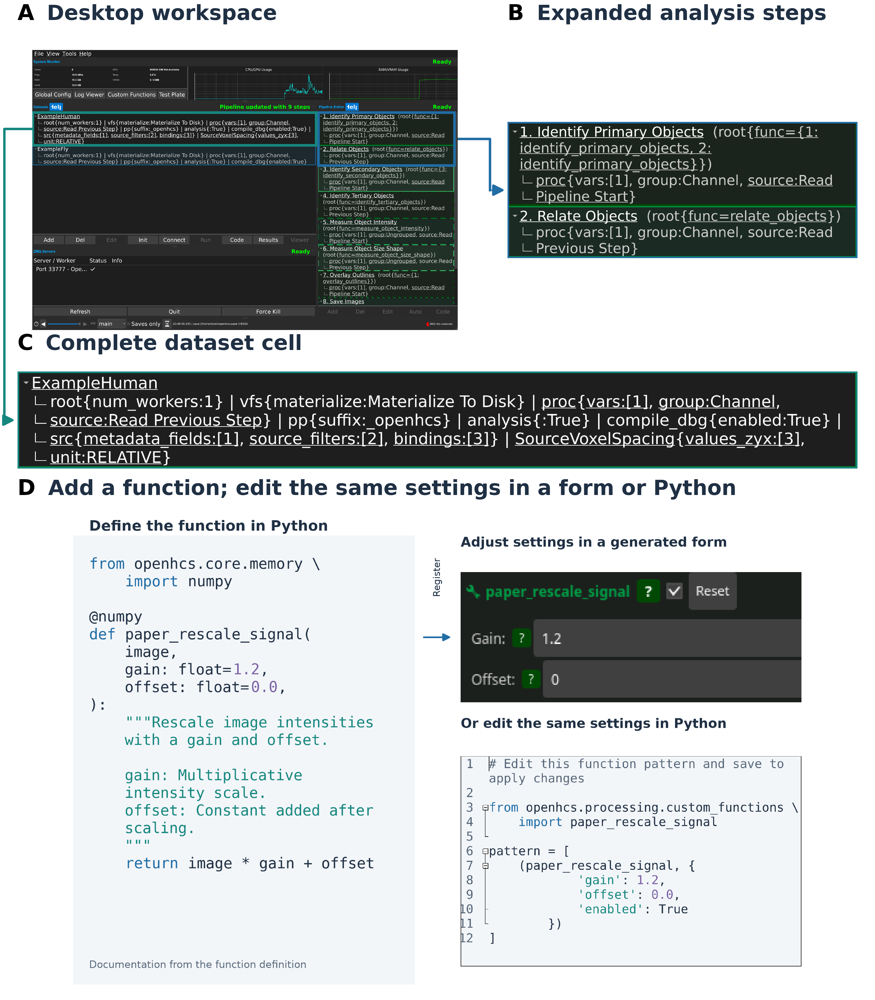
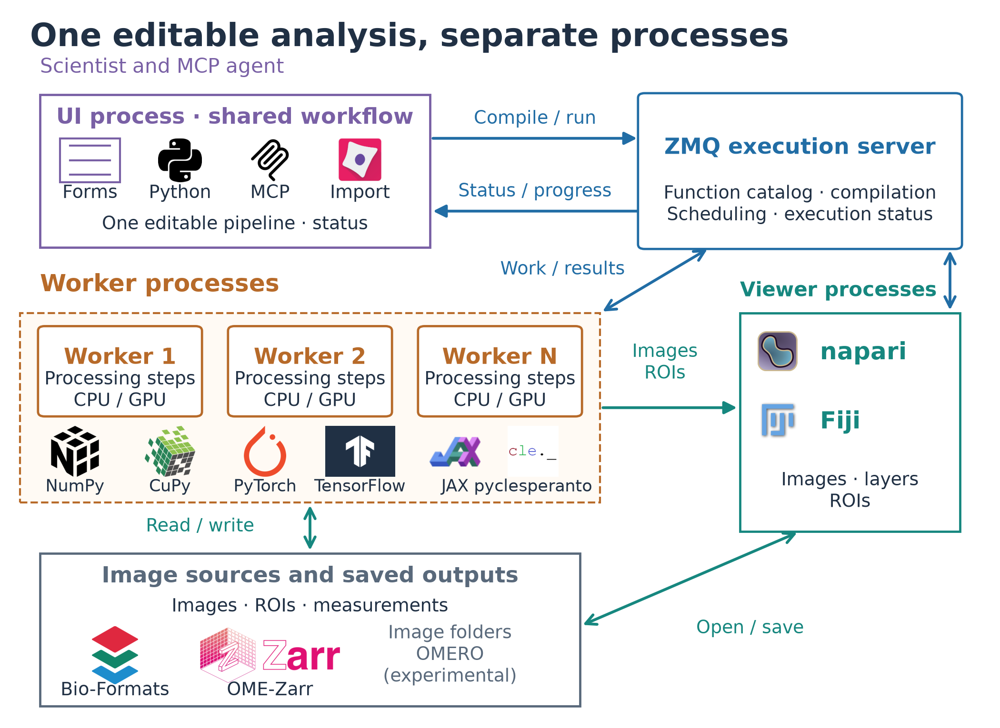
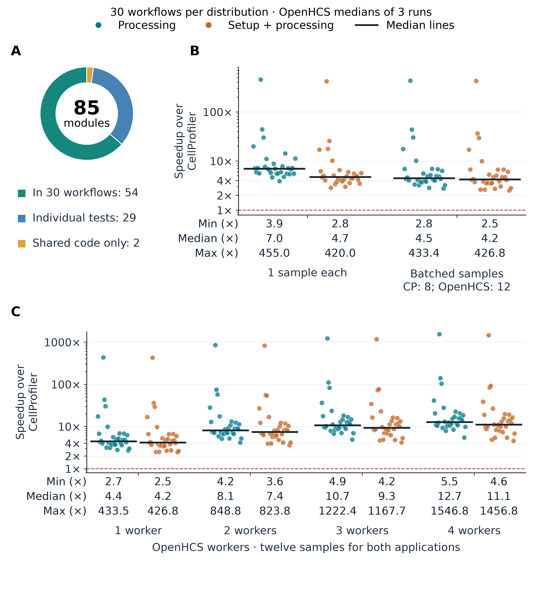
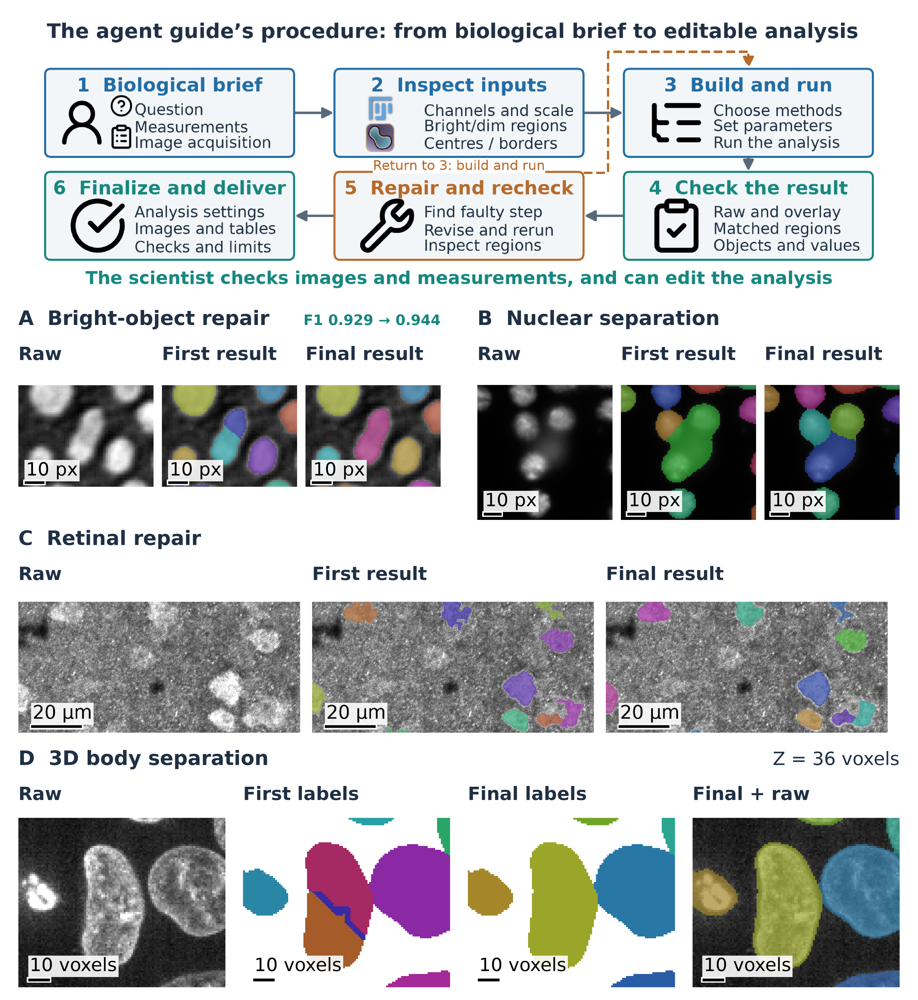
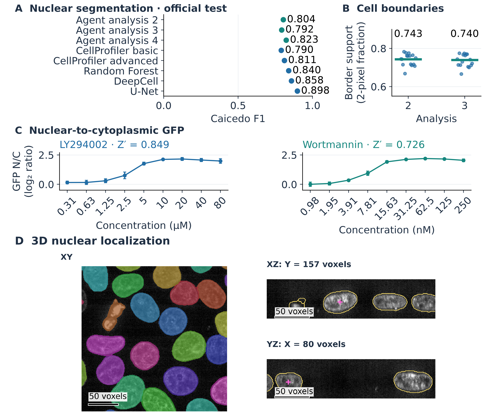
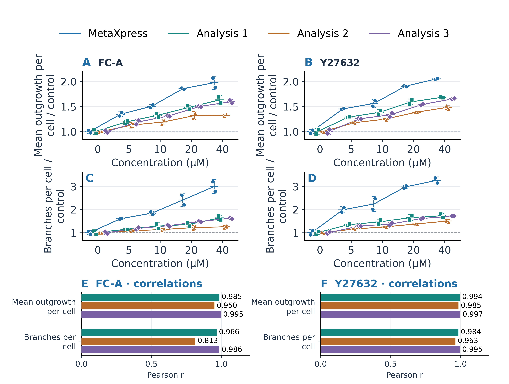

# OpenHCS: one editable bioimage analysis shared by scientists, code and AI agents

**Authors:** Tristan Simas, Jathav Puvirajan, and Alyson Fournier

**Affiliation:** McGill University, Montreal, Quebec, Canada

**Correspondence:** Tristan Simas, <tristan.simas@mail.mcgill.ca>

**Short title:** OpenHCS: one editable bioimage analysis

**Keywords:** microscopy; image analysis; self-driving laboratory; autonomous analysis; agentic AI; high-content screening

## Abstract

Bioimage analysis is essential for biological research, but connecting specialized tools into a working analysis demands programming that many laboratories lack. OpenHCS provides one editable analysis shared by graphical controls, Python and AI agents. It connects existing bioimaging software through a native Python layer, with multiprocessing and GPU support for standard machine-learning libraries. Scientists can round-trip edits between graphical controls and Python, add their own Python functions within the running application without a separate plugin package, and trace each measurement to its detections and source images in Fiji or napari. Existing CellProfiler pipelines join the same analysis: all 30 tested pipelines reproduced their native outputs and ran faster on one processor core, and parallel execution shortened them further. From written biological briefs, without labelled examples, independent agents built analyses in OpenHCS. Their classical nuclear-segmentation pipelines required no model training and performed at the level of expert-configured CellProfiler pipelines; three agents blinded to treatment recovered drug responses in a neurite outgrowth assay; and an agent-built analysis separated positive and negative assay controls. Each analysis remains one that scientists can inspect, change and reuse.

## Introduction

Self-driving laboratories couple experimental selection, automated execution and interpretation in an iterative feedback cycle [@Abolhasani2023]. In microscopy-based screening, this cycle depends on converting images into measurements that can inform subsequent decisions. Yet the required analysis is rarely fixed: changes in cell type, staining, imaging conditions or biological endpoint can demand new segmentation, tracking and quantification strategies. CellProfiler represented a major advance in biological image analysis by pioneering an accessible, reproducible framework for assembling complex image-processing workflows, fundamentally transforming the ability of researchers to extract quantitative phenotypic information from high-throughput microscopy data [@Carpenter2006; @McQuin2018]. Its success illustrates both the value of reusable analyses and the continuing need to adapt workflows to individual assays. For autonomous experimentation, the challenge is therefore not simply to invoke an image-processing algorithm, but to make the analytical workflow itself adaptable, verifiable and accessible to both scientists and automated systems.

The open-source bioimage-analysis ecosystem provides many of the capabilities needed for this work. ImageJ and Fiji offer mature processing functions, macros and plugins [@Schneider2012; @Schindelin2012]. Napari provides an extensible, Python-based platform for interactive multidimensional image visualization and analysis with a plugin architecture that enables integration with other bioimage-analysis tools [@Napari]. OMERO supports image and metadata management [@Allan2012], and Icy combines visualization with extensible analysis tools [@deChaumont2012]. Specialized algorithms for image correction, denoising, segmentation and quantitative measurement further expand what laboratories can accomplish. However, combining these capabilities can require coordinating software dependencies, data interfaces, image metadata and intermediate outputs, creating challenges for maintenance and reproducibility [@Ouyang2023]. These challenges become more consequential when an analysis must be repeatedly revised as an experiment evolves.

Considerable progress has been made in interoperability. Existing approaches connect ImageJ with Python, generate graphical controls from Python functions, enable exchange of processing and measurement tasks between platforms, and coordinate modular algorithms through plugins and containerized workflows [@Rueden2022PyImageJ; @NapariMagicgui; @Dobson2021; @Prigent2022; @Weisbart2024; @Schapiro2022]. These developments reduce the need to rebuild established tools, but connecting software does not by itself ensure that scientists and AI agents can develop and revise the same analysis. Autonomous microscopy requires a persistent, editable workflow whose processing choices and outputs remain understandable as changes are made. In particular, quantitative measurements must remain traceable to the source images and detected structures so scientists can determine whether an analysis measures the intended biology.

AI-assisted bioimage-analysis systems are beginning to reduce the burden of selecting methods, generating code and troubleshooting workflows. The BioImage.IO Chatbot connects users with computational bioimaging resources [@Lei2024], Omega supports conversational analysis and code correction [@Royer2024], and Agentic-J describes a multi-agent approach to image-analysis scripting, debugging and quality assurance [@Johanns2026]. Nevertheless, an analysis that runs successfully is not necessarily scientifically valid as exemplified by BIABench reports of variability across agent attempts and difficulties with complex imaging tasks [@Pan2026BIABench] (Supp. Table 1). OpenHCS addresses this challenge through a shared, editable analysis that scientists and agents can access using graphical controls, Python and agent-facing operations. The Model Context Protocol (MCP) provides a standardized way for agents to discover and invoke those operations [@MCP]. Within the same workflow, agents can inspect intermediate detections and revise methods, while scientists can examine the resulting measurements, trace them to the source images and modify the analysis. Such inspection supports iterative correction.

Here, we present OpenHCS, an open-source platform designed to support reproducible and autonomous bioimage analysis by enabling scientists and AI agents to develop, execute, and refine shared analytical workflows. We examine its ability to preserve and accelerate established analytical workflows and to enable AI agents to independently develop, execute and refine analyses across diverse microscopy applications. These studies investigate whether autonomous image analysis can be combined with the transparency, flexibility and scientific oversight needed to support the analytical component of self-driving laboratories.

## Materials and Methods

The first three subsections describe the shared analysis: building and editing pipelines, execution and viewers, and agent access. The next three describe the tests of existing analyses: CellProfiler import and output comparison, performance measurements and software reliability checks. The last two describe the data and autonomous-trial design used to test analyses built from written briefs. OpenHCS combines eight domain-agnostic libraries for editing, settings, data handling and communication (Figures 1–2; Supp. Table 2).

### Building and editing pipelines

The Open Microscopy Environment (OME) data model describes images using spatial dimensions X, Y and Z, channels and time [@Goldberg2005]. For plate imaging, well and site identify acquisition locations rather than additional pixel axes.

Preconfigured microscope handlers use file-discovery rules and metadata to identify each well, site, channel, Z plane and timepoint. Other microscope file formats are read through Bio-Formats [@BioFormats]. For ordinary folders without a recognized acquisition layout, source bindings let users select readable files, extract coordinates and name pipeline inputs, tasks familiar from [CellProfiler's image-input setup](https://cellprofiler-manual.s3.amazonaws.com/CellProfiler-4.2.8/help/projects_configure_images.html). Reading a file supplies its pixels and available metadata; users can assign channel and experimental roles explicitly when that metadata is insufficient.

A pipeline combines image-processing functions into a reusable, ordered sequence of configurable steps. Each step specifies one or more compatible Python functions, their settings and inputs from source images or earlier results. Functions specify their array library and whether they accept image planes or volumes.

Laboratories can extend an analysis by selecting functions from existing libraries or by adding their own Python functions within the running application, without maintaining a plugin package. We built pyqt-reactive to generate the interface from the function signatures and configuration classes of the analysis code, which also runs without a graphical interface. As in magicgui [@NapariMagicgui], parameter names, types, defaults and documentation come from the Python definition, so a new function receives its controls, Python view and agent-facing description from its definition alone (Figure 1D). Graphical settings are rendered as editable Python, and code edits update the same analysis and its controls. Shared defaults, step-specific settings and edit history stay with the analysis, which scientists can save as a reusable preset (Figure 1).

{width=6.5in}

::: {custom-style="ImageCaption"}
**Figure 1. Graphical controls and Python edit the same analysis.** **(A)** Native desktop with two public example datasets and the imported nine-step ExampleHuman analysis. **(B,C)** Zoom-ins show the expanded analysis and dataset entries; coloured outlines locate these regions in A. Green borders group the settings for a dataset or analysis step. **(D)** A laboratory function's definition and docstring supply its generated controls and agent-facing descriptions. Form and live Python views show the same gain 1.2 and offset 0.0. These screenshots show editing only; no images were processed (Supp. Data 1).
:::

### Execution and viewers

A step collects images into stacks along a selected dimension: site, Z plane, channel or timepoint. Collecting Z planes forms a volume; collecting overlapping sites supplies tiles to a stitching function. The remaining coordinates stay fixed. Processing groups then determine which function sequence each group of inputs receives. Grouping by channel, for example, applies different sequences to different channels without changing how images are stacked. Grouping defines the work; worker assignments determine what runs in parallel. Later steps can inherit or replace these grouping and stacking settings (Supp. Figure 1).

As in CellProfiler [@McQuin2018], processing steps use named images and detected objects and produce processed images, object-label images, numerical measurements, object relationships and exported files. These names connect each measurement to the intended cells or structures. Label images assign identifiers to individual objects; relationships link related detections, such as a nucleus with its surrounding cell. Before processing begins, OpenHCS's compiler connects defined inputs and outputs, checks function requirements and plans data-format conversions and worker assignments (Figure 2; Supp. Figure 1). This catches incompatible configurations early, and workers reuse the plan instead of repeating it.

Processing libraries store image pixels in different array formats. ArrayBridge handles conversions so that NumPy, TensorFlow, PyTorch, JAX and pyclesperanto functions can run in one pipeline without users writing conversion code between steps. It manages transfers between central processing unit (CPU) and graphics processing unit (GPU) memory, using supported direct transfers or copies as required.

The editor, execution server, workers and viewers run as separate processes, so their failures can be handled separately and editing and inspection stay available during processing. ZMQRuntime carries requests, results and progress between them through one Python interface (Figure 2). Workers keep loaded libraries and CPU/GPU resources across their assigned samples, avoiding repeated setup, and release them after the run.

Images may be TIFF files, compressed Zarr stores, arrays in memory or entries on an OMERO server (experimental support). PolyStore gives processing steps one reading and writing interface for all of them and delivers results to Fiji or napari through the same layer. For OME-Zarr, which stores data in blocks so that selected regions can be retrieved without downloading a whole dataset [@Moore2021], OpenHCS reads images, dimensions, channels and pixel sizes.

Saved and displayed results keep their source coordinates, processing group and producing step, so scientists can trace each measurement back to its source images and detections. Results can be saved, sent to Fiji or napari as processing proceeds, or both (Figure 2). Viewer sessions stay open after execution, and agents can query napari layers and regions of interest.

### Agent access through MCP

Learning to configure complex analysis software takes time and can discourage adoption. We designed the agent interface to help scientists get started while keeping an agent's work accessible through the same tools and settings they use themselves. We expose function discovery, pipeline editing and validation, execution and result inspection through MCP [@MCP]. Each operation is declared once, with its inputs, results, permitted changes and data access, and that declaration both generates the interface and enforces its limits. Agents can edit an analysis open in the desktop application or run one without opening a window.

Desktop connections require authentication, and revision checks stop an agent from overwriting edits made in the meantime. MCP file operations are limited to permitted directories, but processing functions run as Python code with the worker's permissions, so these checks are not an operating-system sandbox. A hosted, read-only interface lets remote assistants consult documentation, function lists and configuration schemas without connecting to a scientist's computer.

### CellProfiler import and output comparison

To let scientists reuse CellProfiler pipelines with OpenHCS's editing, execution and agent tools, we built an importer, then checked its output images and measurements against native CellProfiler results before comparing execution times (Figure 3).

The importer translates a pipeline file's processing and export modules into steps and its input modules into source bindings, keeping named images and objects, so the result runs and edits like any other OpenHCS analysis. We reloaded the generated Python for the advanced-segmentation and 3D-monolayer tutorials to check that functions and parameters were preserved [@CellProfilerTutorials] (Supp. Data 1).

We compared every exported file with native CellProfiler output: measurements and image pixels within absolute and relative tolerances of 1e-6, and identifiers, categorical values and object labels exactly. Five workflows without exports received export steps, with processing settings unchanged (Supp. Data 2–3).

### Performance measurement

We timed each workflow on one source sample, with both applications limited to one CPU core and one numerical thread, using OpenHCS on Python 3.12 and native CellProfiler 4.2.8.1 on Python 3.9. For batches, CellProfiler processed eight copies of the sample serially and OpenHCS processed twelve with one worker; per-sample time divides each batch time by its size, and both applications had access to the same four CPUs. To measure worker scaling, we ran OpenHCS on the twelve copies with one to four workers and compared each time with a serial CellProfiler time for twelve samples, estimated from its measured eight-sample batches (Supp. methods: execution-time estimates).

Speedup is CellProfiler's time, including its initialization, divided by the median of three OpenHCS runs after warmup. Application startup, pipeline-file loading and initial library loading were excluded for both applications (Supp. Table 3; Supp. Data 4).

### Software reliability checks

Bioimage analyses combine tools, dependencies and data formats that change independently, so software updates can alter results even when a pipeline still runs. Passing tests, including AI-generated ones, are useful only when they check behaviour scientists rely on. We therefore built automated checks around complete analysis tasks. Before each release, automated tests install it on Linux, Windows and macOS with Python 3.12 and 3.14, run the 30 imported pipelines and compare their outputs with native CellProfiler results, so installation problems surface before users meet them. Other tests cover storage, microscope inputs, live viewers and saving and reloading analyses (Supp. Table 4).

{width=6.5in}

::: {custom-style="ImageCaption"}
**Figure 2. One editable analysis connects editing, execution and inspection.** Graphical forms, Python and agents using MCP edit the same analysis, including imported CellProfiler pipelines. The editor sends compilation and execution requests to the execution server, which prepares the data connections and assigns processing to workers using ZMQRuntime's communication infrastructure. Worker processes load source images, execute the analysis on CPU or GPU resources and save images, object labels and measurements. Image and region-of-interest (ROI) results can also be sent to napari or Fiji for inspection. Blue arrows show requests, compiled work and status updates between processes, including two-way server–viewer communication. Fiji and napari share one viewer box; green arrows show image/ROI streaming and reading or writing stored data. Progress returns to the editor while the analysis runs. Separating these processes allows image inspection and editing to remain available alongside processing. We illustrate how image grouping, function preparation and worker assignment fit together in Supp. Figure 1.
:::

### Data acquisition and generation

All animal procedures were approved by the Montreal Neurological Institute Animal Care and Use Committee, following the Canadian Council on Animal Care guidelines.

Nuclear images came from BBBC039 in the Broad Bioimage Benchmark Collection (BBBC) [@Ljosa2012].

To test whether independent analyses recovered drug responses, we used images of primary cortical neurons from embryonic day 18 rats, imaged two days after plating. Fusicoccin-A (FC-A) and Y27632 were each tested at 0, 5, 10, 20 and 40 µM, with two technical wells per dose and dimethyl sulfoxide (DMSO) vehicle controls. Nine paired nuclear/neuronal fields were acquired per well on an ImageXpress Micro Confocal with a 10× Plan Apo Lambda objective (numerical aperture 0.45) and 2 × 2 binning, giving 1.3556 µm per pixel. Nuclei were stained with DAPI, and calcein-labelled neurons were imaged in the FITC channel (Supp. methods: neurite morphometry).

Protein translocation used the BBBC013 green fluorescent protein (GFP)/DNA assay, and cell-boundary analyses used the BBBC007 paired DNA/actin fields.

Three-dimensional nuclear localization used the H002 nuclei volume from the *Bio-image Analysis Notebooks* collection [@HaaseNotebooks], 60 × 256 × 256 voxels, with 15 manually marked centres covering only part of the volume; physical spacing was unverified. A separate repair example used the same volume.

Bright-object detection used the blobs.tif example (H001) from the same collection, whose reference labels come from a documented Otsu-threshold workflow rather than manual annotation.

Retinal cell-body detection used R0010, a whole-mount retina [species to be confirmed] prepared and imaged in the laboratory, immunostained for RNA-binding protein with multiple splicing (RBPMS), which marks retinal ganglion cells, and counterstained with Hoechst. It was acquired on a Zeiss LSM 800 confocal microscope with a 20× Plan-Apochromat objective (NA 0.8; metadata in Supp. Data 5). The editing example in Results used NeuronCyto II image 1 [@NeuronCytoII].

### Autonomous analysis design

To test whether agents could turn biological requests into useful measurements, we asked fresh agents to develop and inspect analyses of nuclei, cells, neurites and protein redistribution, with separate runs of the same task developed independently. Each agent received a task brief, acquisition information, MCP access and a written guide to using OpenHCS. The guide asks agents to inspect images, read function documentation and compare results with matched raw images and overlays, to direct repairs to the earliest faulty step, and to recheck examples that previously worked (Figure 4). Agents received no reference labels, accepted settings or score feedback, and finalized their pipelines before any comparison with reference data.

Three agents independently analysed the same 20 coded neurite-assay wells (180 fields) with the same brief, guide and software, and finalized their pipelines before treatment identities and MetaXpress measurements were revealed. All neurite measurements reported here come from these finalized pipelines run with the current neurite-tracing function (Supp. Data 5).

Analyses are numbered within each task. For nuclear detection, cell boundaries and protein translocation, analysis 1 was an earlier trial (gpt-5.6-sol) scored on images withheld before development; all other analyses used gpt-6.1-sol. Supp. Table 5 lists every task, model and protocol, and Supp. Table 6 summarizes the evaluation design.

## Results

### Every route edits the same analysis

An agent's MCP edit changed the upper normalization percentile from 99.8 to 99.6, and the graphical form showed the new value; restoring 99.8 in the form updated the generated Python (Supp. Data 1). Imported CellProfiler pipelines enter the same editing path: the advanced-segmentation and 3D-monolayer tutorials, regenerated as Python and reloaded, kept their functions and parameters.

Adding a laboratory’s own Python function required no separate plugin package. Its signature and docstring supplied the controls, Python view and agent description in Figure 1D, with the same gain of 1.2 and offset of 0.0. The linked result views retain source coordinates and the producing step (Figure 2), so a scientist can inspect a detection in Fiji or napari and replace its method, not only adjust its settings, within the same reusable analysis.

### Established workflows retain their outputs and run faster {#established-cellprofiler-workflows-retain-their-measurements}

All 30 imported workflows reproduced native CellProfiler 4.2.8.1 outputs, across assays including morphology, protein translocation, tracking and multi-stage 3D analysis. Object labels matched exactly, and measurements, calculated images, tables and the measurement databases CellProfiler writes for CellProfiler Analyst agreed within 1e-6 (Figure 3A; Supp. Data 2). Of 85 processing modules, 54 were tested in complete workflows, 29 individually and two through shared code (Figure 3A).

CellProfiler 4.2.8.1 pins SciPy 1.9.0 and scikit-image 0.18.3 [@CellProfiler4281Dependencies], whose prebuilt packages cover only Python 3.8 and 3.9 among the versions CellProfiler admits; both are now end of life [@ScikitImage0183Files; @Python38Release; @Python39Release]. OpenHCS reproduces the same outputs on Python 3.12 and [3.14](https://github.com/OpenHCSDev/openhcs/actions/runs/41624904501/job/125881555931).

Every workflow ran faster than CellProfiler on one core, for processing alone and with pipeline setup included (Figure 3B). In batches, the median per-sample speedup was [pending]{.benchmark-claim key=amortized_execution_median}-fold for processing (minimum [pending]{.benchmark-claim key=amortized_execution_min}-fold) and [pending]{.benchmark-claim key=amortized_total_median}-fold with setup included (minimum [pending]{.benchmark-claim key=amortized_total_min}-fold; Supp. Data 4).

With more OpenHCS workers, the median speedup over serial CellProfiler rose from 4.4-fold with one worker to 12.7-fold with four (11.1-fold including setup), and every workflow ran faster with two, three or four workers than with one (Figure 3C; Supp. Figure 2).

{width=6.5in}

::: {custom-style="ImageCaption"}
**Figure 3. Imported CellProfiler workflows reproduce their outputs and run faster.** Imported CellProfiler workflows were checked for output agreement before their execution times were compared. **(A)** All 30 imported workflows matched every compared CellProfiler output (Supp. Data 2). Test coverage of the 85 imported modules: in complete workflows (54), individually (29) or through shared code (2). Each module is counted once, under its strongest test. Shared-code tests do not test each module's own algorithm. **(B)** Measured one-worker comparisons: one sample each on the same CPU core, then per-sample time for batches of eight (CellProfiler) or twelve (OpenHCS). **(C)** Twelve copies of one source sample: a fixed serial CellProfiler estimate derived from measured eight-sample batches, divided by measured OpenHCS time at each worker count. The same serial estimate is used for every worker count. **(B, C)** Speedup is CellProfiler time divided by OpenHCS time; values above 1 mean faster OpenHCS execution. Each dot is one of 30 workflows; black lines mark medians. Each distribution is labelled with its minimum, median and maximum speedup. All maxima in B and C are the illumination-correction workflow Example1_AllMethod: single-sample processing took 953.4 s in CellProfiler and 2.10 s in OpenHCS. Logarithmic axes; the red dashed line marks equal speed.
:::

### Agents build working analyses from written briefs

Matched image inspection exposed errors that overall scores could hide. Agents corrected a split bright object, merged nuclei, fragmented retinal outlines and an over-split three-dimensional body (Figure 4A–D). The bright-object correction raised F1 against reference labels from 0.929 to 0.944; the other three are local corrections without a whole-dataset reference. Wider views still show residual merges, unsupported cell-body growth and unresolved neurite crossings (Supp. Figure 3).

{width=6.5in}

::: {custom-style="ImageCaption"}
**Figure 4. Image inspection guides repairs to agent-developed analyses.** Six stages turn a biological brief into an editable analysis, with images and measurements available for scientist inspection. **(A–D)** Separate recorded analyses, each showing the same input region before and after revision: bright objects (H001), nuclei (BBBC007 DNA), retinal cell bodies (R0010) and a three-dimensional body (H002). **(A)** A split bright object is joined; F1 against computational reference labels increased from 0.929 to 0.944 on the same development image. **(B–D)** Local, image-supported corrections rather than whole-dataset accuracy estimates. B shows the DNA channel only. D shows slice Z = 36, rotated 90° for display. Scale bars: A/B, 10 pixels; C, 20 µm; D, 10 voxels (physical spacing unverified). Instructions, pipelines and repair records: Supp. Data 5.
:::

### Agent-developed analyses perform quantitatively across microscopy tasks

#### Without labels or training, agents match expert-built pipelines

Following the procedure in Figure 4, each agent built a classical nuclear-detection pipeline from intensity thresholding, shape-based separation of touching nuclei and size filtering, without annotated examples or a trained model. On BBBC039's official test split (50 fields, 5,720 nuclei), scored with Caicedo et al.'s released evaluator, the three pipelines reached F1 of 0.792–0.823. All three scored above the expert-configured basic CellProfiler 3.0 pipeline (0.790), analysis 4 also scored above the advanced pipeline (0.811), and all scored below the learned methods (0.840–0.898; Figure 5A) [@Caicedo2019].

On the 175 fields no agent had viewed, the three analyses agreed closely, with pooled F1 at IoU ≥ 0.5 of 0.906–0.910. All three, however, scored below 0.80 on the same six fields, mostly by missing nuclei, so consistent overall scores can still hide shared local failures (Supp. Figure 4).

#### Agent-developed translocation analyses separate assay controls

Both translocation analyses separated positive and negative controls above Z′ = 0.5, the conventional threshold for an excellent screening assay [@Zhang1999]. Z′ compares the separation of control means with the variation among four positive and four negative control wells per drug. On 92 BBBC013 wells withheld before development, analysis 1 reached Z′ of 0.554 for LY294002 and 0.751 for Wortmannin; across all 96 wells, with three of its development wells among the controls, analysis 2 reached 0.849 and 0.726 (Figure 5C; Supp. Figure 5).

#### Cell borders and three-dimensional nuclear positions

On 16 BBBC007 DNA/actin fields, cell-boundary analyses 2 and 3 placed 74% of their predicted borders between touching cells within two pixels of a manual outline (Figure 5B). Nuclear localization analysis 1 found all 15 manually marked centres within 30 voxels; the annotations cover only part of the volume, so its 11 unmatched predictions cannot be scored as false detections (Figure 5D).

{width=6.5in}

::: {custom-style="ImageCaption"}
**Figure 5. Quantitative validation of agent-developed microscopy analyses.** **(A)** Caicedo F1 on the official 50-image BBBC039 test split; the x-axis is truncated. Agent analyses 2–4 use the released evaluator; the two expert-configured CellProfiler pipelines, Random Forest, DeepCell and U-Net are published values [@Caicedo2019]. F1 is averaged across images and nine strict intersection-over-union (IoU) thresholds from 0.50 to 0.90. Development access differs: agents received no reference labels or score feedback, whereas published methods used training images for configuration or supervised learning (Supp. Table 6). **(B)** Predicted borders within two pixels of manual outlines, 16 fields; dots are individual fields; lines show the value pooled across all fields. **(C)** Well-median log2 nuclear/cytoplasmic GFP across 96 wells, including four development wells; mean ± SD, four wells per dose. Concentration units are given in the plot headings. **(D)** Final three-dimensional nuclear localization analysis 1 (H002), shown in XY, XZ and YZ. All 15 manually annotated centres had a prediction within the predeclared 30-voxel radius; 11 predictions lacked matching annotations. Partial annotation coverage prevents classifying unmatched predictions as false detections. Label colours distinguish nuclei; yellow outlines and magenta in-plane centres locate detections in the orthogonal views. Distances and scale bars are in voxel-index units; physical spacing is unverified. Matching-radius diagnostic: Supp. Figure 4E.
:::

### Three blind agents recover drug responses in a laboratory neurite assay

All three analyses found larger outgrowth per cell at every nonzero dose of FC-A and Y27632, and more branches per cell with increasing dose (Figure 6A–D). Their outgrowth measurements tracked MetaXpress across wells (Pearson r 0.950–0.997 within each treatment; Figure 6E), but their fold changes were smaller: at 40 µM, 1.33–1.63 for FC-A and 1.49–1.69 for Y27632, against 1.98 and 2.05 for MetaXpress (Supp. Figure 6).

{width=6.5in}

::: {custom-style="ImageCaption"}
**Figure 6. Three independent agents recover neurite drug responses.** **(A–D)** Mean outgrowth per cell (A–B) and branches per cell (C–D) for fusicoccin-A (FC-A) and Y27632. Three blind analyses of 180 fields in 20 wells, compared with MetaXpress; OpenHCS values average nine fields per well. Each curve is divided by its own two zero-dose DMSO wells' mean; 1 means no change. Dots: two technical wells per dose per method. Whiskers: SD after normalization. **(E)** Pearson r against MetaXpress, grouped by treatment and endpoint; colours match A–D. Each bar uses ten absolute well measurements across doses within one treatment; drugs are not pooled. **(F–H)** One field from the earlier analysis-1 run: raw calcein, detected cell bodies and paths, and overlay. Scale bars, 200 µm. Other endpoints: Supp. Figure 6.
:::

## Discussion

Because the 30 CellProfiler workflows kept their outputs on current Python (Figure 3), laboratories can carry validated pipelines forward without redoing them, then replace a single module with a GPU or deep-learning function without rebuilding the rest. The changed step still needs validation for the assay.

Existing integrations show why carrying validated analyses onto current software matters. The [napari-n2v revision cited here](https://github.com/juglab/napari-n2v/tree/0e9fee355d5f51c8ec0f0a6a3b9e4c71fe35237e) reports incompatibility with TensorFlow 2.16 and later and marks the plugin as “no longer maintained” [@NapariN2V]. The documented [RunCellpose recipe for Cellpose-SAM on Apple Silicon](https://plugins.cellprofiler.org/runcellpose.html#cellpose-sam-cellpose-4) uses Python 3.9 [@RunCellposeDocumentation], which reached end of life on 31 October 2025 [@Python39Release].

OpenHCS shortens the revision cycle in two independent ways. It was faster on a single core even after CellProfiler's initialization was spread over eight samples, so per-sample processing is faster (Figure 3B), and additional workers add parallel speed (Figure 3C). Both make it cheaper to change a pipeline and recheck it across an experiment.

The nuclear benchmark shows that agents given written briefs can reach the accuracy of expert-configured pipelines without labelled examples or model training (Figure 5A). Their analyses are ordinary, editable processing steps rather than trained weights. Where annotations exist, learned methods remain more accurate on this benchmark; where they do not, an agent working inside a shared, inspectable analysis is an alternative that required none here.

The neurite analyses recovered both drug responses with smaller fold changes than MetaXpress. For outgrowth, their absolute increases were comparable (71–95 µm per cell against 75 µm with 40 µM FC-A), but they measured 1.5–2.8 times as much outgrowth in vehicle wells, which shrinks the ratio. Their branching increases were smaller in absolute terms as well. Manual tracing would be needed to tell which method traces more accurately; each OpenHCS measurement can be traced to its detections, settings and source images.

Repeated agent runs have been unreliable on complex data [@Pan2026BIABench], and Agentic-J leaves repeatability between sessions to future work [@Johanns2026]. Here, three independently developed nuclear analyses agreed within about 0.004 pooled F1, and all three neurite analyses recovered both drug responses; these are independent analyses of the same images, without biological replication. Yet all three nuclear analyses missed nuclei in the same six fields, so agreement between runs cannot replace inspecting the detections.

The shared analysis can grow with stronger agents, larger workloads and other domains. Stronger agents and vision models can use the same authoring, execution and inspection tools, and new functions join the editable pipeline. Multicore execution distributes samples among workers; multi-GPU methods must coordinate their devices within their own library, because OpenHCS currently assigns one device per framework. The underlying libraries are not specific to microscopy (Supp. Table 2), and pipeline preparation and execution are being released separately as ArrayPipe [@ArrayPipe].

In a self-driving laboratory, each cycle proposes an experiment, executes it and interprets the result before choosing the next. From a single written brief, agents working over MCP closed a loop of their own within the interpreting step: they proposed analyses, ran them, checked the results against the images and repaired them without human intervention. The resulting analyses matched expert-configured pipelines and separated assay controls, and each remains inspectable and editable. Connecting that loop to experiment selection and instrument control, which systems using SiLA, a standard for laboratory automation, provide [@Hinkel2023; @Lange2026; @Courtney2025; @Thieme2024; @Rihm2024], would close the experimental loop; we did not test that here. In either a conventional or automated laboratory, the aim is to delegate technical analysis work while keeping scientists able to judge, change and extend it.

## Supp. Data {#supplementary-data}

We provide additional assay results and image comparisons in the supplementary figures. CellProfiler output comparisons, module coverage and timing measurements are available in Supp. Data 2–4; editable workflows, NeuronCyto references and software checks in Data 1, 7 and 8; and agent instructions, final pipelines, evaluation partitions and individual analysis results in Data 5–6.

## Code and Data Availability

OpenHCS source code: <https://github.com/OpenHCSDev/OpenHCS>.

OpenHCS documentation: <https://openhcs.readthedocs.io/>.

We provide figure inputs and generation scripts, final pipelines, scores and benchmark measurements as supplementary files. Versioned repository copies are available at <https://github.com/OpenHCSDev/openhcs/tree/563dd84dd7cbfe586c4a7288b70e56795925c1e1/paper/supplementary> and <https://github.com/OpenHCSDev/openhcs/tree/192500f312c25d7d8f406516e1b7f1cec908334f/benchmark/results>.

The benchmark uses biological images and pipelines distributed by the CellProfiler project. Original sources:

- official CellProfiler example pipelines and images: <https://github.com/CellProfiler/examples> [@CellProfilerExamples]
- official CellProfiler tutorial pipelines and images: <https://github.com/CellProfiler/tutorials> [@CellProfilerTutorials]
- CellProfiler 4 benchmark supplement: <https://github.com/carpenterlab/2021_Stirling_BMCBioInformatics> [@Stirling2021]

We list the source repositories for the eight reusable libraries in Supp. Table 2.

## Acknowledgements

We thank the CellProfiler project, its contributors, and the authors of the underlying biological datasets for making the example, tutorial, and benchmark materials available.

## Author Contributions

T.S.: Conceptualization, Methodology, Software, Validation, Formal analysis, Data curation, Visualization, Writing – original draft. J.P.: Validation (development testing and quality assurance), Writing – review and editing. A.E.F.: Resources, Supervision, Funding acquisition, Writing – review and editing.

## Funding

A.E.F. is funded by the Canadian Institutes of Health Research. [to be filled]

## Declaration of Conflicting Interests

The authors declare no conflicting interests.

## Declaration of generative AI and AI-assisted technologies in the manuscript preparation process

OpenAI Codex assisted with manuscript organization, prose revision and reproducible figure-assembly code; Claude (Anthropic) also assisted with prose revision. Both were used under the corresponding author's direction. The autonomous analyses evaluated in this study are described separately in Materials and Methods.
