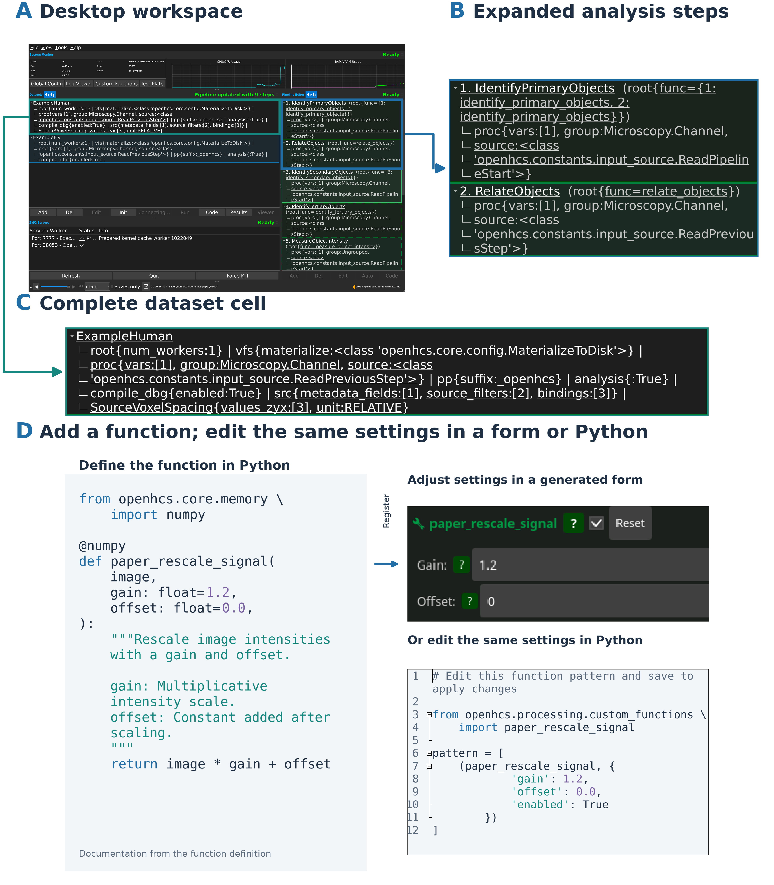
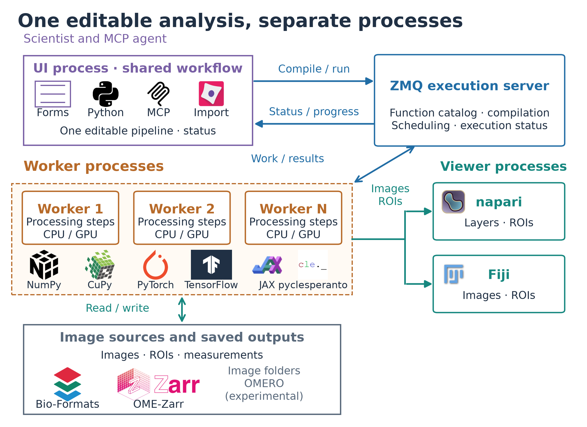
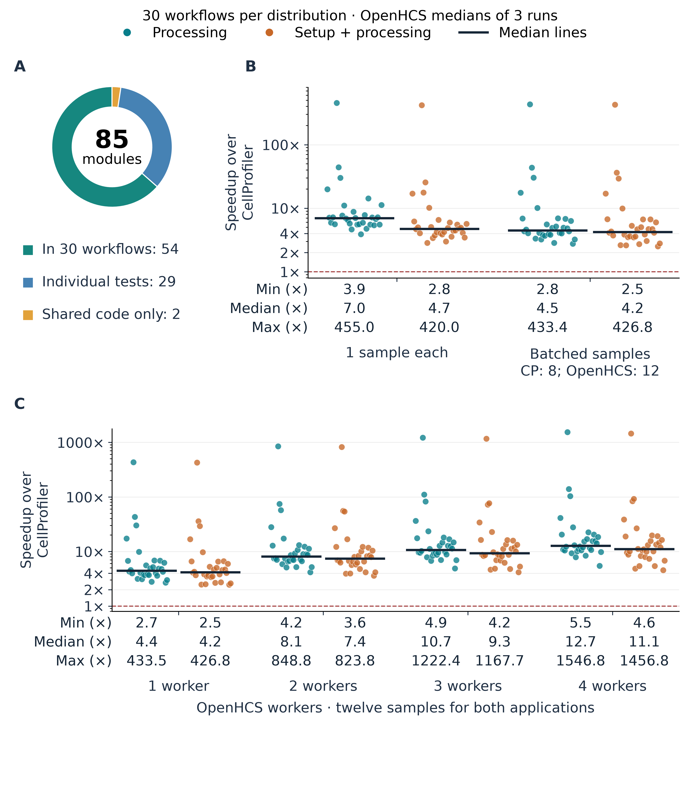
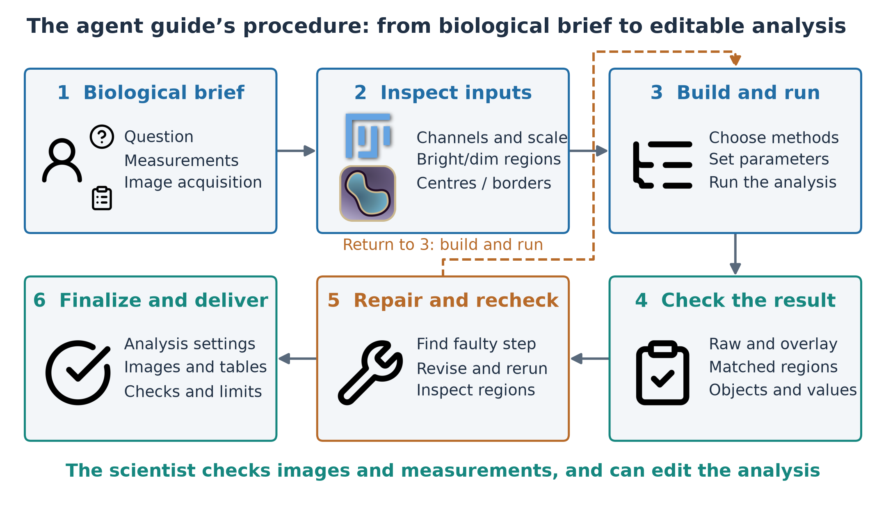
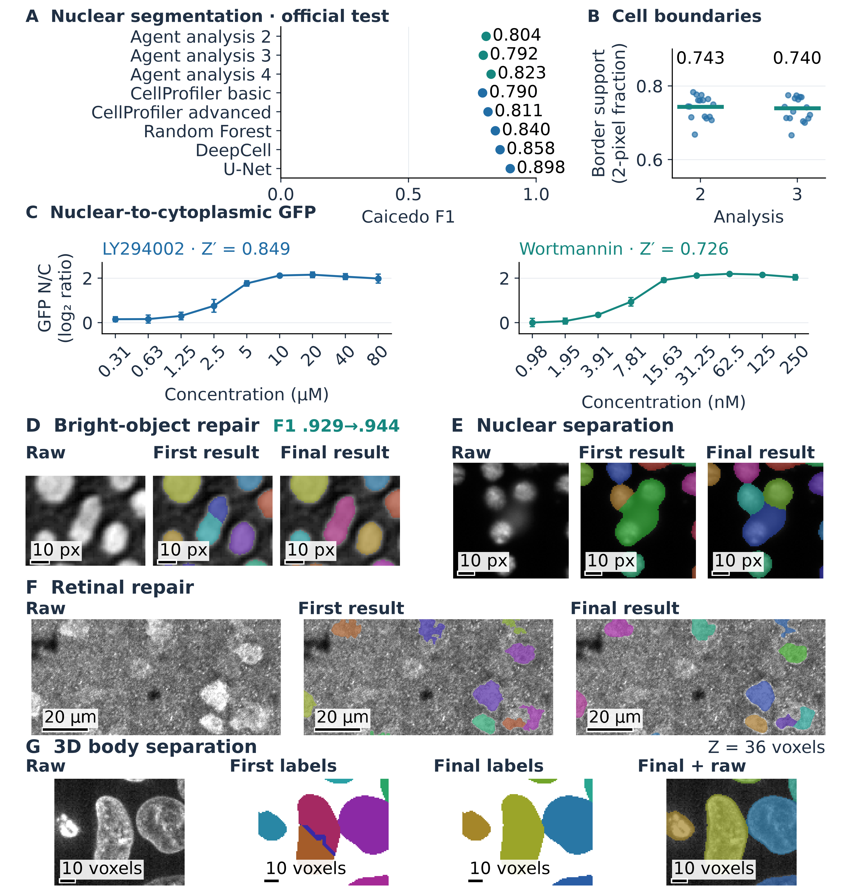
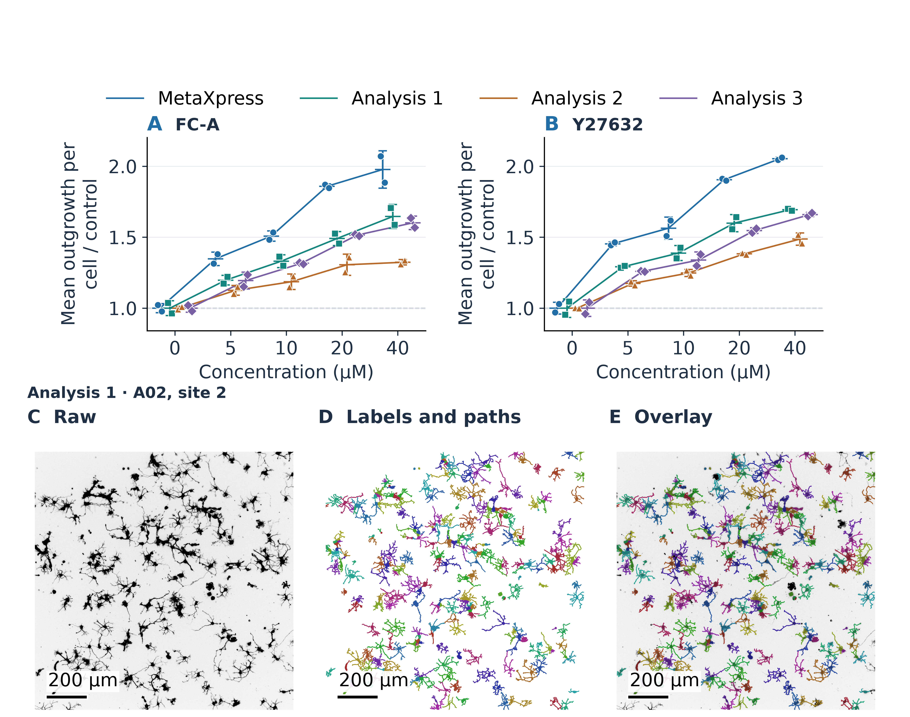

# OpenHCS: one editable bioimage analysis shared by scientists, code and AI agents

**Authors:** Tristan Simas, Jathav Puvirajan, and Alyson Fournier

**Affiliation:** McGill University, Montreal, Quebec, Canada

**Correspondence:** Tristan Simas, <tristan.simas@mail.mcgill.ca>

**Short title:** OpenHCS: one editable bioimage analysis

**Keywords:** microscopy; image analysis; self-driving laboratory; autonomous analysis; agentic AI; high-content screening

## Abstract

Bioimage analysis is essential for biological research, but connecting specialized tools into a working analysis demands programming that many laboratories lack. OpenHCS provides one editable analysis shared by graphical controls, Python and AI agents. It connects existing bioimaging software through a native Python layer, with multiprocessing and GPU support for standard machine-learning libraries. Scientists can round-trip edits between graphical controls and Python, add their own Python functions within the running application without a separate plugin package, and trace each measurement to its detections and source images in Fiji or napari. Existing CellProfiler pipelines join the same analysis: all 30 tested pipelines reproduced their native outputs and ran faster on one processor core, and parallel execution shortened them further. From written biological briefs, without labelled examples, independent agents built analyses in OpenHCS. Their classical nuclear-segmentation pipelines required no model training and performed at the level of expert-configured CellProfiler pipelines; three agents blinded to treatment recovered drug responses in a neurite outgrowth assay; and an agent-built analysis separated positive and negative assay controls. Each analysis remains one that scientists can inspect, change and reuse.

## Introduction

Drug screening and studies of cell and molecular biology need open-source tools that automate measurements from microscopy images. Microscope-integrated commercial software offers convenient analysis tools, but licensing costs, hardware dependence and closed source code can limit access and adaptation [@Carpenter2006; @McQuin2018]. Different disease models and biological questions require measurements ranging from cell number and morphology to subcellular protein location and signal dynamics. Each assay therefore needs its own processing sequence and often substantial troubleshooting. First described in 2006, CellProfiler was developed with academic and industry support to organize image processing and measurement into reusable pipelines [@Carpenter2006; @McQuin2018]. Its pipeline model lets researchers assemble and tune a sequence of processing steps for their assay.

Over the past two decades, an expanding open-source bioimaging ecosystem has given laboratories alternatives to commercial software that they can inspect, adapt and share. ImageJ/Fiji offers image-processing tools, macros and community-developed plugins, while napari combines interactive multidimensional viewing with Python extensions [@Schneider2012; @Schindelin2012; @NapariPlugins]. OMERO supports storing, organizing and sharing images with their experimental information [@Allan2012], and Icy combines visualization, plugins and graphical workflows [@deChaumont2012]. Access to their source code lets laboratories examine and adapt these tools to their assays and share extensions with other researchers.

Many advances in image processing have come from specialized algorithms, made available as standalone software, libraries or plugins. [BaSiCPy](https://github.com/peng-lab/BaSiCPy) corrects uneven illumination and background [@BaSiCPy], Cellpose finds cells and N2V2 reduces noise [@Stringer2021Cellpose; @Hock2022N2V2]. Plugins bring Cellpose to Fiji and napari, and N2V2 to napari [@FijiCellpose; @CellposeNapari; @NapariN2V]. Changes to either the host application or the underlying library can require plugin updates. The [napari-n2v installation guide](https://github.com/juglab/napari-n2v/blob/0e9fee355d5f51c8ec0f0a6a3b9e4c71fe35237e/docs/installation.md#L15), for example, states that “`n2v` is not compatible with TensorFlow 2.16 and upwards” and its [maintenance notice](https://github.com/juglab/napari-n2v/blob/0e9fee355d5f51c8ec0f0a6a3b9e4c71fe35237e/README.md#L11) says the plugin is “no longer maintained” [@NapariN2V]. The documented [RunCellpose recipe for Cellpose-SAM on Apple Silicon](https://plugins.cellprofiler.org/runcellpose.html#cellpose-sam-cellpose-4) uses `python=3.9` with `cellpose==4.0.6` [@RunCellposeDocumentation]; Python 3.9 [reached end of life on 31 October 2025](https://peps.python.org/pep-0596/#lifespan) [@Python39Release]. In the image.sc support forum [@Rueden2019Forum], installation problems came up in about 19% of roughly 500 recent threads [@Ouyang2023]. These examples show why laboratories must consider the integration's supported environment alongside the algorithm itself.

A repeatable end-to-end analysis must exchange images and results while preserving channels, dimensions, pixel sizes and sample identities. Researchers must maintain the connecting scripts when tools, parameters, formats or versions change, creating a barrier for those without programming training.

PyImageJ connects ImageJ to Python, napari-imagej makes ImageJ tools available in napari, and magicgui generates controls from Python functions [@Rueden2022PyImageJ; @NapariImageJ; @NapariMagicgui; @NapariWidgetWorkshop]. A complete analysis can still require code to connect images, detections, measurements and settings while preserving sample identities. To address dependency conflicts between bioimaging tools, container systems such as Docker package tools with their required libraries in isolated environments. Other integration routes include Fiji–CellProfiler image and table exchange [@Dobson2021], BioImageIT's packaged processing and data management [@Prigent2022], CellProfiler's Python and Docker plugins [@Weisbart2024], and MCMICRO's coordination of tissue-imaging tools through containers and files [@Schapiro2022; @MCMICROImplementation]. Different dependency versions can increase container-image storage, and file-based workflows add reads and writes between steps. Choosing suitable functions and settings matters because imaging artifacts can otherwise appear as biological differences. Scientists must also coordinate settings, execution and inspection across the packaged tools, choosing parameters and checking the resulting measurements. Connecting individual pairs of tools still leaves scientists to assemble those connections into an analysis they can build, run, inspect and revise.

Much research effort has gone into platforms where AI assistants aim to reduce this technical burden by helping researchers develop and run analyses from written requests. We outline community-linked assistance, generated Python and specialist tool use, including the Model Context Protocol (MCP) for invoking software operations, in [Supp. Table 1](supplementary/README.md#supplementary-table-1.-ai-assistance-and-evaluation-resources). BIABench separately evaluates agent-produced analyses against reference answers and expert assessments: performance was stronger on routine 2D tasks, while repeated runs were unreliable on more complex data [@Pan2026BIABench]. When repeated runs can disagree, an agent's analysis is usable only if the scientist responsible can inspect and correct it.

Self-driving laboratories automate the cycle of proposing, executing and interpreting experiments, but interpreting images still depends on analyses that a specialist builds and validates for each new assay [@Abolhasani2023]. An agent that builds, checks and repairs an analysis in its own closed loop could fill that role. We developed OpenHCS so that every route into an analysis, whether graphical controls, Python or an AI agent, edits the same analysis, and every result stays linked to the images and detections behind it. Laboratories often keep validated pipelines on fixed software versions to preserve their results, which strands them on environments that, like Python 3.9, reach end of life. Each revision of an analysis must also be rerun across an experiment, so execution time sets how quickly scientists can check a change. We tested whether existing analyses can join that shared analysis without changing their outputs by importing 30 CellProfiler pipelines, then measured their execution and worker scaling on a fixed twelve-sample workload. We also tested whether new analyses could be built from written biological briefs without reference labels by asking independent agents to analyse nuclei, a laboratory neurite assay and protein redistribution.

## Materials and Methods

The first three subsections describe the shared analysis: building and editing pipelines, execution and viewers, and agent access. The next three describe the tests of existing analyses: CellProfiler import and output comparison, performance measurements and software reliability checks. The last two describe the data and autonomous-trial design used to test analyses built from written briefs (Table 1). OpenHCS combines eight domain-agnostic libraries for editing, settings, data handling and communication (Figures 1–2; Supp. Table 2).

### Building and editing pipelines

The Open Microscopy Environment (OME) data model describes images using spatial dimensions X, Y and Z, channels and time [@Goldberg2005]. For plate imaging, well and site identify acquisition locations rather than additional pixel axes.

Preconfigured microscope handlers use file-discovery rules and metadata to identify each well, site, channel, Z plane and timepoint. Supported rich image containers without a specialized handler are read through Bio-Formats [@BioFormats]. For ordinary folders without a recognized acquisition layout, source bindings let users select readable files, extract coordinates and name pipeline inputs, tasks familiar from [CellProfiler's image-input setup](https://cellprofiler-manual.s3.amazonaws.com/CellProfiler-4.2.8/help/projects_configure_images.html). Reading a file supplies its pixels and available metadata; users can assign channel and experimental roles explicitly when that metadata is insufficient.

A pipeline combines image-processing functions into a reusable, ordered sequence of configurable steps. Each step specifies one or more compatible Python functions, their settings and inputs from source images or earlier results. Functions specify their array library and whether they accept image planes or volumes.

Laboratories can extend an analysis without maintaining a separate plugin package by selecting compatible functions from existing libraries or adding their own Python function code within the running application. We built pyqt-reactive to dynamically generate the user interface from the function signatures and configuration classes used by the underlying analysis code, which can run without a graphical interface. Like magicgui [@NapariMagicgui], it derives parameter names, types, defaults and documentation from Python definitions. Compatible new functions therefore receive controls without separate interface code (Figure 1D), while the interface remains synchronized with analysis settings. The same definitions supply agent-facing parameter descriptions. Each function defines its inputs and outputs; registering these definitions integrates the function with execution, graphical editing and agent access. We render graphical settings as editable Python, and applying code edits updates the same analysis and its controls. Shared defaults, step-specific settings and edit history remain with the analysis, which scientists can save as a reusable preset (Figure 1).

{width=6.5in}

::: {custom-style="ImageCaption"}
**Figure 1. Graphical controls and Python edit the same analysis.** **(A)** Native desktop with two public example datasets and the imported nine-step ExampleHuman analysis. **(B,C)** Zoom-ins show the expanded analysis and dataset entries; coloured outlines locate these regions in A. Green borders group the settings for a dataset or analysis step. **(D)** A laboratory function's definition and docstring supply its generated controls and agent-facing descriptions. Form and live Python views show the same gain 1.2 and offset 0.0. These screenshots show editing only; no images were processed. Editing records and full source: Supp. Data 1.
:::

### Execution and viewers

A step collects images into stacks along a selected dimension: site, Z plane, channel or timepoint. Collecting Z planes forms a volume; collecting overlapping sites supplies tiles to a stitching function, which also needs tile positions. The remaining coordinates stay fixed. Processing groups then determine which function sequence each group of inputs receives. Grouping by channel, for example, applies different sequences to different channels without changing how images are stacked. Grouping defines the work; worker assignments determine what runs in parallel. Sample and image coordinates are retained, and later steps can inherit or replace the grouping and stacking settings (Supp. Figure 1).

As in CellProfiler [@McQuin2018], processing steps use named images and detected objects and produce processed images, object-label images, numerical measurements, object relationships and exported files. These names connect each measurement to the intended cells or structures. Label images assign identifiers to individual objects; relationships link related detections, such as a nucleus with its surrounding cell. Before processing begins, OpenHCS's compiler connects defined inputs and outputs, checks function requirements and plans data-format conversions and worker assignments (Figure 2; Supp. Figure 1). This catches incompatible configurations early, and workers reuse the plan instead of repeating it.

Processing libraries store image pixels in different array formats. ArrayBridge handles conversions so that NumPy, TensorFlow, PyTorch, JAX and pyclesperanto functions can run in one pipeline without users writing conversion code between steps. It manages transfers between central processing unit (CPU) and graphics processing unit (GPU) memory, using supported direct transfers or copies as required.

OpenHCS coordinates the editor, execution server, workers and viewers while they run concurrently. ZMQRuntime provides one native Python interface for communication between their processes (Figure 2). ZeroMQ messages carry requests, results and progress through shared client and server interfaces; applications add operations such as viewer controls through those interfaces. Separate processes keep these responsibilities apart and allow their failures to be handled at process boundaries. ZMQRuntime coordinates process startup, shutdown and progress. Workers reuse loaded libraries and CPU/GPU resources across assigned samples to reduce repeated setup, then release them after the run. Execution uses processes by default, with optional threads.

These programs also need access to images held in different forms and locations: TIFF files, compressed Zarr stores, memory or an OMERO server. PolyStore provides shared reading and writing interfaces so processing steps can use those sources without separate storage code. Viewer destinations deliver results to Fiji or napari through the same data-handling layer. A new destination implements the shared interface instead of adding a storage path to every processing step. OME-Zarr stores microscopy data in blocks, allowing selected image regions to be retrieved without downloading the entire dataset [@Moore2021]; OpenHCS reads its images, dimensions, channels and pixel sizes. Experimental OMERO support provides access to images in a shared image-management server.

These shared interfaces let saved and displayed results retain their source coordinates, processing group and producing step across supported viewers and storage formats. Scientists can therefore trace measurements back to their source images and detected structures. We made saving and live inspection independently configurable: image results can be saved to a folder and sent directly to Fiji or napari as processing proceeds (Figure 2). Scientists can inspect results without finding and loading each output file manually. Viewer sessions remain open after execution for continued inspection, and agents can query napari layers and regions of interest.

### Agent access through MCP

Learning to configure complex analysis software takes time and can discourage adoption. We designed the agent interface to help scientists get started while keeping an agent's work accessible through the same tools and settings they use themselves. We expose function discovery, pipeline editing and validation, execution and result inspection through MCP [@MCP]. Each operation's definition specifies its input and result types, implementation, permitted changes, data access and security requirements; these definitions generate the interface and govern execution. Agents can edit an analysis open in the desktop application or run one without opening a window.

To protect analyses from unintended access and conflicting edits, desktop connections require authentication and revision checks prevent an agent from overwriting intervening edits. MCP file operations check permitted directories. Processing functions run as Python code with the worker's permissions; these path checks are not an operating-system sandbox. Local clients communicate through standard input/output. A hosted HTTP interface gives remote assistants access to packaged knowledge, architecture descriptions, processing-function discovery and configuration schemas without connecting to a scientist's local application. This interface is read-only and cannot access local files, graphical state, viewers or execution sessions.

### CellProfiler import and output comparison

CellProfiler is an established reference for image analysis in academic and industrial laboratories [@Carpenter2006; @McQuin2018]. Keeping validated pipelines on fixed software versions helps preserve results, making dependency updates a reproducibility concern as well as a maintenance task. To let scientists reuse these pipelines with OpenHCS’s editing, execution and agent tools, we built an importer. We then checked their output images and measurements against native CellProfiler results before comparing execution times (Figure 3).

The importer reads `.cppipe` settings and translates processing and export modules into configurable steps and setup modules into source bindings. CellProfiler-compatible numerical implementations include Numba-compiled propagation kernels. Module definitions specify images, objects, measurements, relationships and image-group or plate-wide operation. The resulting pipeline uses OpenHCS compilation and execution and remains editable through graphical controls, Python and MCP. Named images and objects connect measurements to inputs. We reloaded generated Python for the advanced-segmentation and 3D-monolayer tutorials to check functions and parameters [@CellProfilerTutorials] (Supp. Data 1).

We checked that imported workflows retained their outputs by comparing numerical measurements and image pixels with absolute and relative tolerances of `1e-6`. Identifiers and categorical values were compared exactly after the documented formatting adjustments needed to match CellProfiler. Object-label images were compared exactly after standardizing dimensions of length one. Five workflows lacking exports received eight added image or label export steps without changing their processing settings. Every expected exported file was checked in each workflow. We provide output counts, comparison rules, imported modules and settings, and module-level test coverage in Supp. Data 2–3.

### Performance measurement

For the single-sample comparison, both applications used one physical CPU core, one worker and one numerical thread, so neither received extra CPU resources. Each workflow used one selected source well or sample, unchanged settings and defined comparison outputs. OpenHCS supports Python 3.11–3.14, but the reported timing runs used Python 3.12, against native CellProfiler 4.2.8.1 on Python 3.9.

**Batching and workers.** Twelve copies of one source sample measured batch-processing costs. Per-sample times divided the measured eight-sample CellProfiler time by eight and the one-worker, twelve-sample OpenHCS time by twelve. A separate measured comparison used eight copies in each application, two OpenHCS workers and one serial CellProfiler process (Supp. Data 4). The CellProfiler batch used one numerical thread with four permitted CPUs (2–5), versus one CPU in the single-sample comparison. OpenHCS batch workers also had access to those four CPUs, with one numerical-library thread per worker; workers were not pinned to individual cores. We estimated one serial CellProfiler twelve-sample time per workflow from measured eight-sample first and post-initialization batches, using a model calibrated on three workflows. We kept that estimate fixed while measuring OpenHCS with one, two, three or four workers on the same twelve-sample workload (Figure 3C). OpenHCS worker scaling was measured for both timing intervals. Combined process memory was not measured. We document the estimation formulas, calibration and full benchmark protocol in Supp. methods: execution-time estimates and Supp. Data 4.

**Timing intervals.** Supp. Table 3 defines the processing and setup-plus-processing intervals. Speedup was CellProfiler's first-batch time divided by the median OpenHCS time; we summarize speedups across workflows using their minimum, median and maximum.

OpenHCS times are medians of three measured repetitions after warmup. Application/server startup, CellProfiler pipeline-file loading, initial OpenHCS library loading, OpenHCS warmup runs and subsequent output-agreement checks were excluded. OpenHCS server time is already inside the client intervals and was not added again.

### Software reliability checks

Bioimage analyses combine tools, dependencies and data formats that change independently, so software updates can alter results even when a pipeline still runs. Passing tests, including AI-generated ones, are useful only when they check behaviour scientists rely on. We therefore built automated checks around complete analysis tasks. Before PyPI release, the automated test workflow, known as continuous integration, is configured to install the release candidates, run the 30 imported CellProfiler pipelines and compare their outputs with saved native results on Linux, Windows and macOS, each with Python 3.12 and 3.14. These release checks address installation failures, the support problem cited in the Introduction. Other checks exercise storage, microscope inputs, live viewers and saving and reloading analysis settings (Supp. Table 4).

{width=6.5in}

::: {custom-style="ImageCaption"}
**Figure 2. One editable analysis connects editing, execution and inspection.** Graphical forms, Python and agents using MCP edit the same analysis, including imported CellProfiler pipelines. The editor sends compilation and execution requests to the execution server, which prepares the data connections and assigns processing to workers using ZMQRuntime's communication infrastructure. Worker processes load source images, execute the analysis on CPU or GPU resources and save images, object labels and measurements. Image and region-of-interest (ROI) results can also be sent to napari or Fiji for inspection. Blue arrows show requests, compiled work and status updates between processes, including two-way server–viewer communication. Fiji and napari share one viewer box; green arrows show image/ROI streaming and reading or writing stored data. Progress returns to the editor while the analysis runs. Separating these processes allows image inspection and editing to remain available alongside processing. We illustrate how image grouping, function preparation and worker assignment fit together in Supp. Figure 1.
:::

### Data acquisition and generation

All animal procedures were approved by the Montreal Neurological Institute Animal Care and Use Committee, following the Canadian Council on Animal Care guidelines.

We used public benchmark images, distributed demonstration images and laboratory acquisitions to examine analysis reuse and agent-developed measurements.

Nuclear images came from BBBC039 in the Broad Bioimage Benchmark Collection (BBBC) [@Ljosa2012].

To test whether independent analyses recovered drug responses, we used images of primary cortical neurons from embryonic day 18 rats, imaged two days after plating. Fusicoccin-A (FC-A) and Y27632 were each tested at 0, 5, 10, 20 and 40 µM, with two technical wells per dose and dimethyl sulfoxide (DMSO) vehicle controls. Nine paired nuclear/neuronal fields were acquired per well on an ImageXpress Micro Confocal with a 10× Plan Apo Lambda objective (numerical aperture 0.45) and 2 × 2 binning, giving 1.3556 µm per pixel. DAPI marked nuclei and calcein neuronal signal was recorded in the FITC channel. We describe the medium changes and imaging details, including image dimensions and the acquisition record, in Supp. methods: neurite morphometry.

Protein translocation used the BBBC013 green fluorescent protein (GFP)/DNA assay, and cell-boundary analyses used the BBBC007 paired DNA/actin fields.

Three-dimensional nuclear localization used the H002 nuclei volume from the *Bio-image Analysis Notebooks* collection [@HaaseNotebooks], 60 × 256 × 256 voxels, with 15 manually marked centres covering only part of the volume; physical spacing was unverified. Body-separation repair used the same volume in a separate development analysis.

For bright-object detection, we used the public `blobs.tif` example (H001) from the algorithm-validation chapter of *Bio-image Analysis Notebooks*. This example pairs a raw image with an explicit Otsu-thresholding and connected-component workflow, allowing a reproducible computational comparison against its saved scikit-image labels. These labels are not manual biological annotations. Original specimen and acquisition details were not established for these example images.

Retinal cell-body detection used R0010, a whole-mount retina [species to be confirmed] prepared and imaged in the laboratory, immunostained for RNA-binding protein with multiple splicing (RBPMS), which marks retinal ganglion cells, and counterstained with Hoechst. It was acquired on a Zeiss LSM 800 confocal microscope with a 20× Plan-Apochromat objective (NA 0.8); full metadata are in Supp. Data 5. The physical scale for the retinal repair comes from the CZI metadata. Public neurite tracing used paired TIFFs from NeuronCyto II image 1 [@NeuronCytoII]; coordinate-level manual traces and verified physical calibration were unavailable. Separate laboratory tracing used nine DAPI/calcein fields from one coded well, distinct from the 20-well drug-response cohort.

### Autonomous analysis design

To test whether agents could turn biological requests into useful measurements, we asked fresh agents to develop and inspect analyses of cells, nuclei, neurites and protein redistribution. We compared their final results with references after analysis development had finished. Separate runs let us compare independently developed analyses of the same task.

Agents finalized their pipelines before any comparison with reference data, and no pipeline changed after scoring began. They received no reference labels, accepted settings or score feedback while building their analyses. First-versus-final comparisons use the first completed prediction and the final settings on the same inputs. Self-directed repairs are autonomous; revisions prompted by a scientist are assisted.

Each fresh agent received a task brief, acquisition information and MCP access. The gpt-6.1-sol independent trials reported here also received the packaged OpenHCS skill, a written guide to using OpenHCS; briefs could include channel hints, requested outputs and review instructions. The skill asks agents to inspect images, read function documentation and compare results with matched raw images and overlays (Figure 4). It directs repairs to the earliest faulty step and requires rechecking previously successful examples. Earlier withheld-evaluation trials used OpenHCS 0.8.5; later independent trials used 0.8.7. For the prospective evaluations, images and treatment metadata were released after finalization; only input and output folders changed.

Three fresh gpt-6.1-sol agents independently analysed the same 20 coded neurite-assay wells, with nine fields each, using the same brief, acquisition information, MCP access, guide revision and OpenHCS 0.8.7 installation. Each analysed all 180 fields and finalized its outputs before treatment identities, MetaXpress measurements and scientist-assisted results were used for evaluation. Development and subsequent review fields are listed in the cohort record (Supp. Data 5; Supp. Figure 2).

We summarize the main comparisons, image access and reference measures in Table 1, with the complete task, model and protocol mapping, including earlier prospectively withheld evaluations, in Supp. Table 5. Analysis numbers are local identifiers rather than model generations. The original runs, guides and pipelines are available in Supp. Data 5.

Table: Table 1. Evaluation design. Pipelines were finalized before reference comparisons, without reference labels or score feedback during development. The quantitative rows used gpt-6.1-sol; repair-continuation model identities, where recorded, are listed in Supp. Table 5. IoU is intersection over union; F1 combines precision and recall. Caicedo F1 averages per-image F1 over nine thresholds from 0.50 to 0.90, requiring IoU strictly greater than each; pooled F1 combines object counts across fields. Original instructions, freeze records and scores: Supp. Data 5–6.

| Analysis and images | Development access | Comparison population | Reference | Measure and scope |
|:-----------------|:--------------------|:----------------------|:------------------|:------------------|
| Nuclear detection 2–4; BBBC039, 200 fields | Before method freeze: analysis 2 viewed one official-test field; analyses 3–4 viewed none | Official 50-field test split; retrospective 175-field subset excluding 25 fields viewed at any time (44 official-test fields overlap) | Manual instance masks [@Caicedo2019] | Test: per-image F1 at IoU ≥ 0.5 and Caicedo F1. Subset: pooled F1 at IoU ≥ 0.5 |
| Protein translocation 2; BBBC013, 96 wells | Four development wells | All 96 wells, including those four | Positive and negative control treatments | Z′ from well-median log2 nuclear / cytoplasmic GFP; control separation, not segmentation accuracy |
| Neurite drug-response analyses 1–3; 20 wells × nine fields | Six, four and eight fields, respectively. Treatment identities released after finalization | All 180 fields, summarized by well | MetaXpress measurements | Fold change from vehicle; Pearson r. Algorithm comparison, not manual tracing accuracy |
| Cell-boundary analyses 2–3; BBBC007, 16 fields | Analysis 2: 12 development fields, four held out by the agent. Analysis 3: all 16 available | All 16 fields | Manual outlines | Predicted borders between cells within two pixels of reference; not the fraction of reference borders recovered |
| 3D nuclear localization 1; H002 volume | Whole volume | Whole volume after finalization | 15 manual centres in part of the volume | Matches within 30 voxels; matched-centre error. No false-detection rate from this partial reference |
| Repairs: H001, BBBC007 DNA, R0010, H002 | Same development image/volume for each first/final pair | Fixed first/final outputs; no held-out population | Computational labels (H001); image inspection (others) | Local before/after repair, not whole-dataset accuracy. H002 repair and localization are separate |

## Results

### Every route edits the same analysis

An MCP code-edit operation changed the upper normalization percentile from 99.8 to 99.6, and the graphical form displayed the new value. Restoring 99.8 through the form's settings updated the generated Python: the edit travelled both ways. Imported CellProfiler pipelines entered the same editing path: the advanced-segmentation and 3D-monolayer tutorials, regenerated as Python and reloaded, kept their functions and parameters (Supp. Data 1).

A laboratory's own function was added to the analysis without a plugin package. Its signature and docstring supplied the controls, Python view and agent description in Figure 1D, with the same gain of 1.2 and offset of 0.0. The linked result views retain source coordinates and the producing step (Figure 2), so a scientist can inspect a detection in Fiji or napari and replace its method, not only adjust its settings, within the same reusable analysis.

### Established workflows retain their outputs and run faster {#established-cellprofiler-workflows-retain-their-measurements}

All 30 imported workflows reproduced native CellProfiler 4.2.8.1 outputs across assays including morphology, protein translocation, tracking and multi-stage 3D analysis. Images marking individual detected objects retained their pixels and identifiers exactly; numerical measurements agreed within absolute and relative tolerances of 1e-6. Comparisons also covered calculated pixel values, measurement tables and SQLite measurement databases for CellProfiler Analyst compatibility (Supp. Data 2). They establish output agreement; CellProfiler Analyst itself was not run. Across 85 processing modules, 54 were tested in complete workflows and 29 individually; the remaining two had shared-code tests (Figure 3A).

CellProfiler 4.2.8.1 pins SciPy 1.9.0 and scikit-image 0.18.3 [@CellProfiler4281Dependencies], whose prebuilt packages cover only Python 3.8 and 3.9 among the versions CellProfiler admits; both are now end of life [@ScikitImage0183Files; @Python38Release; @Python39Release]. OpenHCS retained output parity on Python 3.12 and 3.14, including [all 30 workflows on Linux with Python 3.14](https://github.com/OpenHCSDev/openhcs/actions/runs/41624904501/job/125881555931).

The timing comparison used OpenHCS on Python 3.12 with NumPy 2 and native CellProfiler on Python 3.9 (Supp. Data 2). Every one of the 30 workflows ran faster than CellProfiler on one core, both for processing alone and with pipeline setup included (Figure 3B). Across the measured batches, median per-sample speedup was [pending]{.benchmark-claim key=amortized_execution_median}-fold for processing (minimum [pending]{.benchmark-claim key=amortized_execution_min}-fold) and [pending]{.benchmark-claim key=amortized_total_median}-fold with setup included (minimum [pending]{.benchmark-claim key=amortized_total_min}-fold), with CellProfiler's initialization spread over a measured eight-sample batch. We report the individual timings, estimates, calibration and separate measured eight-sample, two-worker comparison in Supp. Data 4.

Adding OpenHCS workers shortened execution further. Against a fixed serial CellProfiler estimate for twelve samples, the median speedup rose from 4.4-fold with one worker to 12.7-fold with four for processing, and from 4.2- to 11.1-fold with setup included, and every workflow stayed faster at each worker count (Figure 3C). This measures parallel execution against a serial reference, not equal CPU allocations. Measured OpenHCS-only scaling confirms the benefit: every workflow ran faster with two, three and four workers than with one, for processing alone and with setup included (Supp. Figure 3).

{width=6.5in}

::: {custom-style="ImageCaption"}
**Figure 3. Imported CellProfiler workflows reproduce their outputs and run faster.** Imported CellProfiler workflows were checked for output agreement before their execution times were compared. **(A)** Test coverage of the 85 imported modules: in complete workflows (54), individually (29) or through shared code (2). Each module is counted once, under its strongest test. Shared-code tests do not test each module's own algorithm. **(B)** Measured one-worker comparisons: one sample each on the same CPU core, then per-sample time for batches of eight (CellProfiler) or twelve (OpenHCS). Batch CPU allocations differ from the single-sample comparison (Methods: Performance measurement). **(C)** Twelve copies of one source sample: a fixed serial CellProfiler estimate derived from measured eight-sample batches, divided by measured OpenHCS time at each worker count. The serial estimate retains initialization and is identical across all four worker counts. **(B, C)** Speedup is CellProfiler time divided by OpenHCS time; values above 1 mean faster OpenHCS execution. Each dot is one of 30 workflows; black lines mark medians. Each distribution is labelled with its minimum, median and maximum speedup. All maxima in B and C are the illumination-correction workflow Example1_AllMethod: single-sample processing took 953.4 s in CellProfiler and 2.10 s in OpenHCS. Logarithmic axes; the red dashed line marks equal speed. Intervals and exclusions as in Methods: Performance measurement.
:::

### Agents build working analyses from written briefs

{width=6.5in}

::: {custom-style="ImageCaption"}
**Figure 4. The agent guide's procedure, from biological brief to an editable analysis.** The biological brief specifies the question, requested measurements and acquisition information. Image inspection establishes channels, feature scales and representative regions before the agent selects processing functions and runs the pipeline. Results are compared with raw images from the same region; errors lead to revised settings and further inspection before delivery. The dashed repair loop returns to step 3, build and run. The scientist receives the analysis settings, images and measurements and can continue editing the analysis. Figure 5D–G shows recorded examples of the repair step.
:::

#### Without labels or training, agents match expert-built pipelines

Following the procedure in Figure 4, each agent built a classical nuclear-detection pipeline from a written brief, using intensity thresholding, shape-based separation of touching nuclei and size filtering; no annotated examples were provided and no learned model was used or trained (Table 1). On BBBC039's official test split (50 fields, 5,720 nuclei), the pipelines reached per-image mean F1 of 0.898–0.903 at IoU ≥ 0.5. Scored with Caicedo et al.'s released evaluator, they reached 0.792–0.823: all three scored above the expert-configured basic CellProfiler 3.0 pipeline (0.790), analysis 4 (0.823) also scored above the advanced pipeline (0.811), and all were below the learned methods (0.840–0.898; Figure 5A) [@Caicedo2019]. Excluding the one official-test field viewed before freeze changed that agent's scores by less than 0.001. We document the evaluator, the 49-field check and the supplementary 44-field robustness check in Supp. methods: analysis scoring.

Across the 175 image-unviewed fields, nuclear detection analyses 2–4 reached pooled F1 of 0.906–0.910 (Table 1; Supp. Data 5). Unlike the per-image benchmark mean, this score combines object counts across fields. Most errors were missed nuclei, and all three analyses scored below 0.80 on the same six fields. Their similar overall accuracy therefore coexisted with shared local failures. We report per-field errors, all-field and earlier withheld-evaluation results, and the repair that recovered nuclei while increasing splitting in Supp. Figure 4 and Data 5–6.

{width=6.5in}

::: {custom-style="ImageCaption"}
**Figure 5. Agent analyses reach expert-level accuracy, and image review guides their repairs.** **(A)** Caicedo F1 on the official 50-image BBBC039 test split. Agent analyses 2–4 use the released evaluator; the two expert-configured CellProfiler pipelines, Random Forest, DeepCell and U-Net are published values [@Caicedo2019]. F1 is averaged across images and nine strict intersection-over-union (IoU) thresholds from 0.50 to 0.90. Development access differs: agents received no reference labels or score feedback, whereas published methods used training images for configuration or supervised learning (Table 1). **(B)** Predicted borders within two pixels of manual outlines, 16 fields; dots are individual fields; lines show the value pooled across all fields. **(C)** Well-median log2 nuclear/cytoplasmic GFP across 96 wells, including four development wells; mean ± SD, four wells per dose. **(D–G)** Matched raw/first/final repairs: bright objects, nuclei, retina and 3D bodies. D uses a computational reference; E–G show image-supported repairs, not accuracy estimates. E shows the DNA channel only; G shows the same Z = 36 voxel slice with all four views rotated 90° counterclockwise for display, and is separate from the localization analysis in Supp. Figure 6P. Scale bars: D/E, 10 pixels; F, 20 µm; G, 10 voxels (physical spacing unverified). Full protocols, trajectories and display settings: Supp. Data 5; orthogonal views: Supp. Figure 6M–O.
:::

#### Three blind agents recover drug responses in a laboratory neurite assay

All three analyses found increased mean outgrowth per cell and total outgrowth at every nonzero dose of FC-A and Y27632 (Figure 6A–B). Across the 20 wells, each agent's algorithm-defined mean outgrowth per cell correlated closely with MetaXpress (Pearson r 0.963–0.996), but fold changes were generally smaller, mainly because the analyses measured more outgrowth in vehicle wells (Discussion). At 40 µM, mean outgrowth per cell increased 1.32–1.65-fold for FC-A and 1.49–1.69-fold for Y27632, against 1.98- and 2.05-fold for MetaXpress (Supp. Figure 2).

{width=6.5in}

::: {custom-style="ImageCaption"}
**Figure 6. Three independent agents recover both neurite outgrowth responses.** **(A–B)** Mean neurite outgrowth per cell after treatment with fusicoccin-A (FC-A) or Y27632. Three independent blind agents and MetaXpress analysed the same 180 fields from 20 wells; analyses 1–3 identify independent agent runs. OpenHCS well values are unweighted means of nine fields. Each drug curve is normalized to the mean of its two zero-dose vehicle (DMSO) wells; 1 denotes no change from vehicle. Dots are two technical wells per dose for each method; whiskers show sample standard deviation (SD) among those wells, excluding uncertainty in the control mean. **(C⁠–⁠E)** Coded well A02, site 2, from drug-response analysis 1 in A–B: calcein/FITC raw image, saved cell-body detections and neurite paths, and their overlay. Colours identify algorithm-assigned cells and arbors. Scale bars, 200 µm, using the recorded 1.3556 µm/pixel acquisition scale. We report additional measurements and the scientist-assisted comparison in Supp. Figure 2, and the separate public-image comparison is in Supp. Data 7.
:::

#### An agent-developed translocation analysis separates assay controls

Protein translocation analysis 2 separated controls across 96 BBBC013 wells, including four development wells, with Z′ of 0.849 for LY294002 and 0.726 for Wortmannin (Figure 5C). Z′ compares the separation of control means with variation between wells, here four positive and four negative control wells per drug; both values exceed 0.5, the conventional threshold for an excellent screening assay [@Zhang1999]. Three of the four development wells were among those control wells; on 92 wells withheld before development, the earlier analysis 1 also exceeded 0.5, with Z′ of 0.554 for LY294002 and 0.751 for Wortmannin, using a different well summary. The agent chose each well’s median log2 nuclear-to-cytoplasmic GFP ratio, using cells with measurable cytoplasm. We report eligibility counts and both analyses in Supp. Figure 5 and Data 5–6.

#### Cell borders and three-dimensional nuclear positions

On 16 BBBC007 DNA/actin fields, cell-boundary analyses 2–3 placed 0.743 and 0.740 of their predicted borders between touching cells within two pixels of a manual outline (Figure 5B). Nuclear localization analysis 1 recovered all 15 manually marked centres within 30 voxels; 11 predictions lacked a matching annotation, but the partial reference cannot establish their false-detection rate (Supp. Figure 6P).

### Image review identifies repairs and remaining errors

Matched image inspection exposed errors that overall scores could hide. Agents corrected a split bright object, merged nuclei, fragmented retinal outlines and an over-split three-dimensional body (Figure 5D–G). Bright-object reference F1 rose from 0.929 to 0.944 on one development image; the remaining examples show local image-supported corrections rather than measured whole-dataset accuracy.

Orthogonal views let scientists check three-dimensional detections across planes (Supp. Figure 6M–O). Wider matched views still show residual merges, unsupported cell-body growth and unresolved neurite crossings (Supp. Figure 6; Figure 6C–E). Captions and Supp. Data 5–7 identify the separate analyses, references and repair trajectories.

## Discussion

Preserving the outputs of established workflows lets laboratories extend analyses without discarding their existing processing choices. The 30 CellProfiler workflows retained their outputs on OpenHCS's newer Python environment (Figure 3). Because imported pipelines enter the same editable analysis as any other, a laboratory can replace a CellProfiler module with a compatible GPU or deep-learning function without rebuilding the surrounding workflow. The changed method still needs validation for the assay.

The execution results distinguish two ways to shorten the revision cycle. The advantage held on a single core and persisted after CellProfiler's initialization was spread over eight samples, so it comes from faster per-sample processing (Figure 3B). Measured OpenHCS worker scaling adds a separate parallel-execution benefit. Both reduce the cost of inspecting a result, changing the pipeline and checking the revised analysis across an experiment.

The nuclear benchmark shows that agents given written briefs can reach the accuracy of expert-configured pipelines without labelled examples or model training (Figure 5A). Their analyses are ordinary, editable processing steps rather than trained weights. Where annotations exist, learned methods remain more accurate on this benchmark; where they do not, an agent working inside a shared, inspectable analysis is an alternative that required none here.

The neurite analyses estimated smaller fold changes than MetaXpress (Figure 6A–B). Both methods averaged the nine sites in each well, and pooling cells instead changed fold changes by at most about 0.06. The agent analyses recovered absolute increases in outgrowth per cell comparable to MetaXpress's (72–102 µm against 75 µm with 40 µM FC-A), but measured 1.6–2.9 times as much outgrowth per cell in vehicle wells. Two analyses had similar cell counts to MetaXpress; analysis 2 detected fewer cells. Their smaller outgrowth fold changes therefore reflect higher vehicle baselines rather than systematically smaller absolute drug responses; branching responses were smaller in absolute terms as well (Supp. Figure 2). Manual tracing and the MetaXpress analysis settings would be needed to explain the baseline differences and compare tracing accuracy. The OpenHCS measurements remain traceable to their detections, settings and source images.

Repeated agent runs have been unreliable on complex data [@Pan2026BIABench], and Agentic-J describes independent-session repeatability as future work [@Johanns2026]. Here, three independently developed nuclear analyses agreed within about 0.004 pooled F1 on the 175 unviewed fields across three guide revisions, and all three neurite analyses recovered both drug responses with the same model, guide and runtime. These are independent analyses of the same experimental material, not biological replicates. All three nuclear analyses also missed nuclei in the same six difficult fields. Their agreement motivates checking repeatability, but these shared failures show why repeated scores cannot replace inspection of detections.

The shared analysis is designed to grow with stronger agents, larger workloads and other domains. It can support stronger agents and vision models through the existing authoring, execution and image-inspection tools, while new processing functions join the editable Python pipeline. Multicore execution distributes samples among workers; multi-GPU methods must coordinate their devices within the underlying library because OpenHCS currently assigns one device to each required framework. The general-purpose libraries are also reusable outside microscopy (Supp. Table 2), with source tests using remote-sensing and telemetry examples. Preparation and execution are being released separately as ArrayPipe [@ArrayPipe] for other data-science and machine-learning applications.

In a self-driving laboratory, each cycle proposes an experiment, executes it and interprets the result before choosing the next. From a single written brief, agents working over MCP closed a loop of their own within the interpreting step: they proposed analyses, ran them, checked the results against the images and repaired them without human intervention, producing analyses that matched expert-configured pipelines and separated assay controls, each remaining inspectable and editable. Connecting that loop to experiment selection and instrument control, which systems using SiLA, a standard for laboratory automation, provide [@Hinkel2023; @Lange2026; @Courtney2025; @Thieme2024; @Rihm2024], would close the experimental loop; we did not test that here. In either a conventional or automated laboratory, the aim is to delegate technical analysis work while keeping scientists able to judge, change and extend it.

## Supp. Data {#supplementary-data}

We provide additional assay results and image comparisons in the supplementary figures. CellProfiler output comparisons, module coverage and timing measurements are available in Supp. Data 2–4; editable workflows, NeuronCyto references and software checks in Data 1, 7 and 8; and agent instructions, final pipelines, evaluation partitions and individual analysis results in Data 5–6.

## Code and Data Availability

OpenHCS source code: <https://github.com/OpenHCSDev/OpenHCS>.

OpenHCS documentation: <https://openhcs.readthedocs.io/>.

We provide figure inputs and generation scripts, final pipelines, scores and benchmark measurements as supplementary files. Versioned repository copies are available at <https://github.com/OpenHCSDev/openhcs/tree/192500f312c25d7d8f406516e1b7f1cec908334f/paper/supplementary> and <https://github.com/OpenHCSDev/openhcs/tree/192500f312c25d7d8f406516e1b7f1cec908334f/benchmark/results>.

The benchmark uses biological images and pipelines distributed by the CellProfiler project. Original sources:

- official CellProfiler example pipelines and images: <https://github.com/CellProfiler/examples> [@CellProfilerExamples]
- official CellProfiler tutorial pipelines and images: <https://github.com/CellProfiler/tutorials> [@CellProfilerTutorials]
- CellProfiler 4 benchmark supplement: <https://github.com/carpenterlab/2021_Stirling_BMCBioInformatics> [@Stirling2021]

The [benchmark protocol](../benchmark/results/matched_worker_sweep_20261008_latestproduction/README.md) specifies the workloads, software versions, hardware and timing reports.

We list the source repositories for the eight reusable libraries in Supp. Table 2.

## Acknowledgements

We thank the CellProfiler project, its contributors, and the authors of the underlying biological datasets for making the example, tutorial, and benchmark materials available.

## Author Contributions

T.S.: Conceptualization, Methodology, Software, Validation, Formal analysis, Data curation, Visualization, Writing – original draft. J.P.: Validation (development testing and quality assurance), Writing – review and editing. A.E.F.: Resources, Supervision, Funding acquisition, Writing – review and editing.

## Funding

A.E.F. is funded by the Canadian Institutes of Health Research. [to be filled]

## Declaration of Conflicting Interests

The authors declare no conflicting interests.

## Declaration of generative AI and AI-assisted technologies in the manuscript preparation process

OpenAI Codex assisted with manuscript organization, prose revision and reproducible figure-assembly code; Claude (Anthropic) also assisted with prose revision. Both were used under the corresponding author's direction. The autonomous analyses evaluated in this study are described separately in Materials and Methods.
