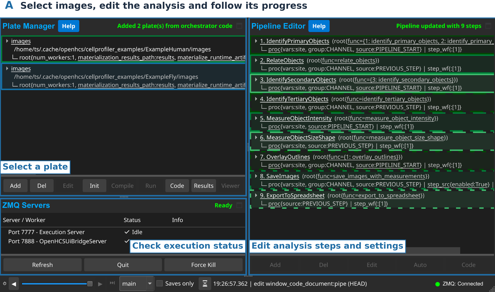
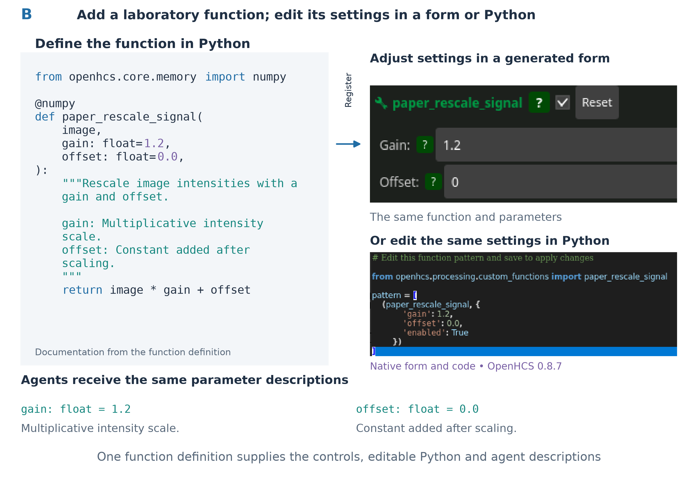
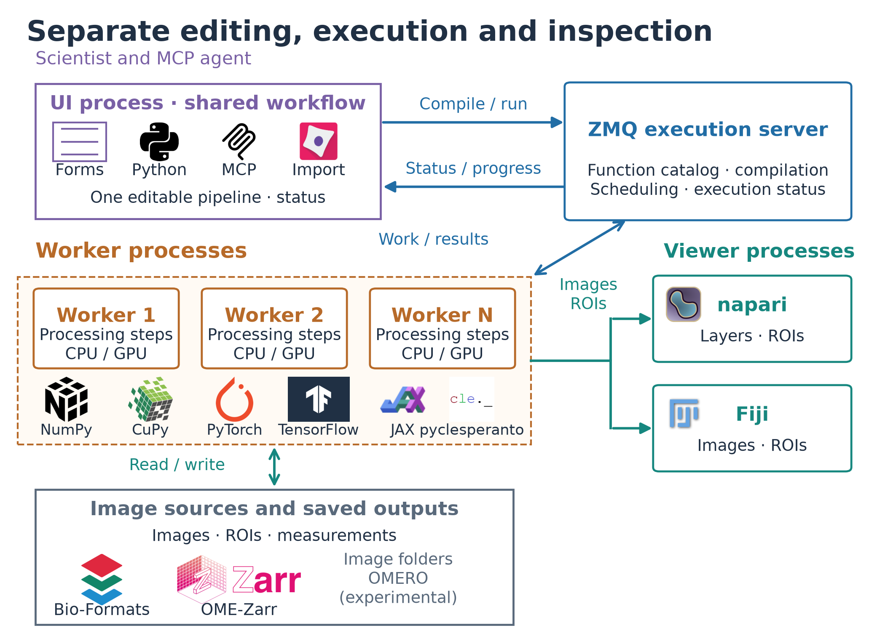
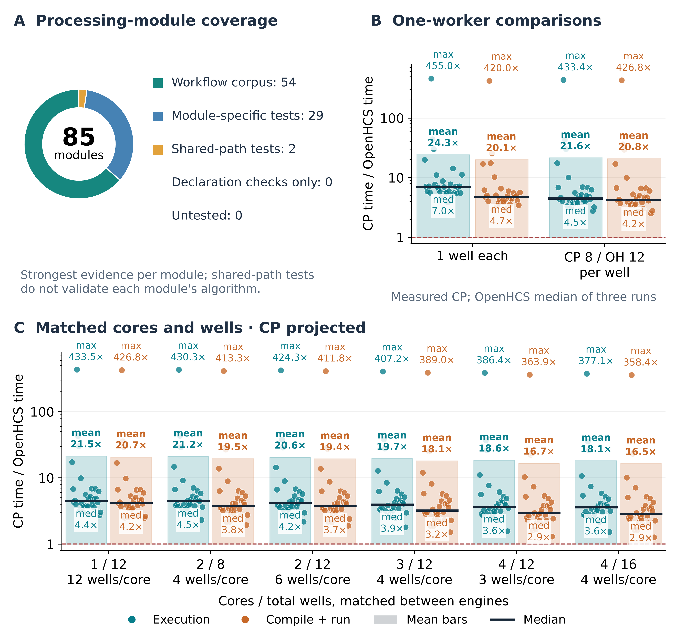
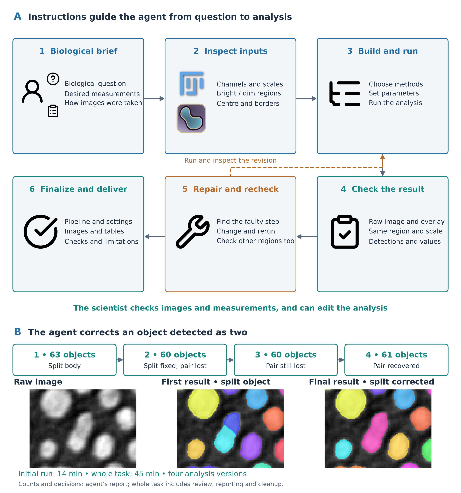
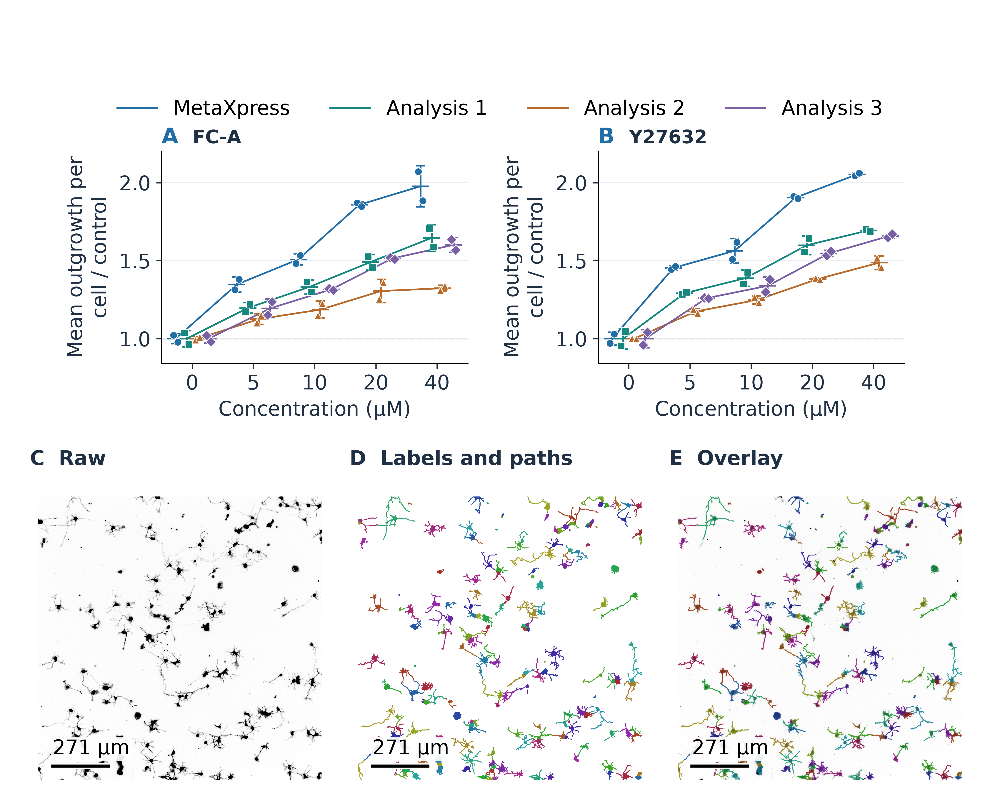
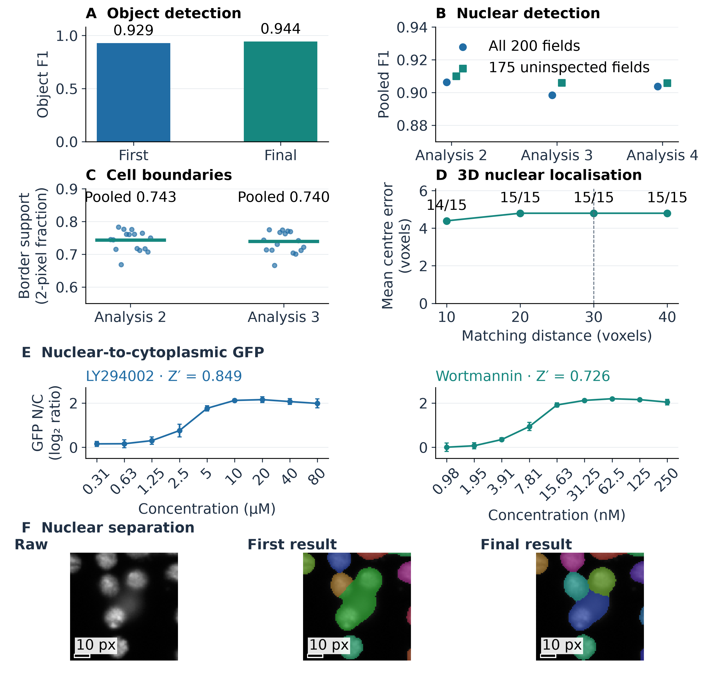
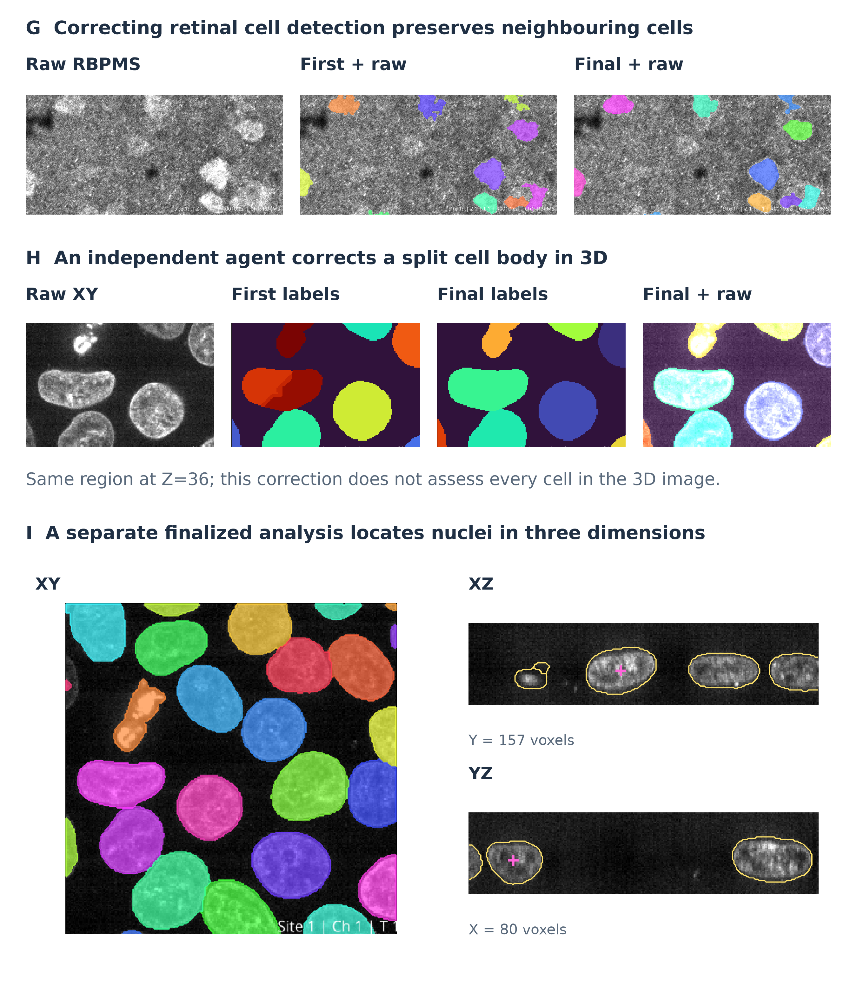

# OpenHCS: an extensible platform for agent-driven bioimage analysis

**Authors:** Tristan Simas, Jathav Puvirajan, and Alyson Fournier

**Affiliation:** McGill University, Montreal, Quebec, Canada

**Correspondence:** Tristan Simas, <tristan.simas@mail.mcgill.ca>

**Short title:** OpenHCS: agent-driven bioimage analysis

**Keywords:** microscopy; image analysis; self-driving laboratory; autonomous analysis; agentic AI; high-content screening

## Abstract

Bioimage analysis is essential for biological research, but setting up specialized tools and getting them to work together can impede discovery for researchers without the required technical expertise. OpenHCS connects the bioimaging ecosystem's existing software tools and platforms through a native Python layer, with multiprocessing and GPU support for standard machine-learning libraries. Scientists can round-trip analysis edits between graphical controls and Python. Measurements remain linked to their source images and samples, letting scientists inspect the detections behind a result in Fiji or napari. Laboratories can load compatible Python functions within the running application without a separate plugin package and reuse existing CellProfiler pipelines within OpenHCS's modern processing engine. All 30 tested CellProfiler pipelines retained their outputs and ran faster with both applications using one processor core; parallel OpenHCS execution further reduced times on the same twelve-sample workload. From a single written biological task prompt, independent AI agents used the same tools to build, run, inspect and correct analyses autonomously, recovering drug responses, detecting nuclei and distinguishing positive and negative assay controls. OpenHCS extends laboratory automation to building and running analyses that scientists inspect, change and reuse.

## Introduction

Drug screening and studies of cell and molecular biology need open-source tools that automate measurements from microscopy images. First described 20 years ago, CellProfiler was developed with academic and industry support to organize image processing and measurement into reusable pipelines [@Carpenter2006; @McQuin2018]. Its pipeline-based approach became widely used; assembling an analysis still means choosing and tuning steps for a particular assay. Different disease models and biological questions require measurements ranging from cell number and morphology to subcellular protein location and signal dynamics. Each assay therefore needs its own processing sequence and often substantial troubleshooting.

Researchers can draw on a rich open-source bioimaging ecosystem as an alternative to closed commercial software. ImageJ/Fiji offers image-processing tools, macros and community-developed plugins, while napari combines interactive multidimensional viewing with Python extensions [@Schneider2012; @Schindelin2012; @NapariPlugins]. OMERO supports storing, organizing and sharing images with their experimental information [@Allan2012], and Icy combines visualization, plugins and graphical workflows [@deChaumont2012]. Access to their source code lets laboratories examine and adapt these tools to their assays and share extensions with other researchers.

Specialized algorithms reach these platforms as standalone software, libraries or plugins. [BaSiCPy](https://github.com/peng-lab/BaSiCPy) corrects uneven illumination and background, N2V2 reduces noise and Cellpose finds cells [@Stringer2021Cellpose; @Hock2022N2V2]. Choosing suitable functions and settings matters because imaging artifacts can otherwise appear as biological differences. Cellpose plugins for Fiji and napari and N2V2 for napari provide host-specific access [@FijiCellpose; @CellposeNapari; @NapariN2V], but updates to the underlying libraries or host interfaces can require integration changes. The [napari-n2v installation guide](https://github.com/juglab/napari-n2v/blob/0e9fee355d5f51c8ec0f0a6a3b9e4c71fe35237e/docs/installation.md#L15), for example, states that “`n2v` is not compatible with TensorFlow 2.16 and upwards”; its [maintenance notice](https://github.com/juglab/napari-n2v/blob/0e9fee355d5f51c8ec0f0a6a3b9e4c71fe35237e/README.md#L11) says the plugin is “no longer maintained”. The documented [RunCellpose recipe for Cellpose-SAM on Apple Silicon](https://plugins.cellprofiler.org/runcellpose.html#cellpose-sam-cellpose-4) uses `python=3.9` with `cellpose==4.0.6`; Python 3.9 [reached end of life on 31 October 2025](https://peps.python.org/pep-0596/#lifespan). These examples show why laboratories must consider the integration's supported environment alongside the algorithm itself.

Compatible versions alone do not produce a repeatable end-to-end analysis. Steps must exchange images and results while preserving channels, dimensions, pixel sizes and sample identities. Researchers must maintain the connecting scripts when tools, parameters, formats or versions change, creating a barrier for those without programming training. In the image.sc support forum [@Rueden2019Forum], installation appeared in approximately 19% of roughly 500 recent threads [@Ouyang2023].

Existing Python bridges reduce some of this integration work. PyImageJ connects ImageJ to Python, napari-imagej makes ImageJ tools available in napari, and magicgui generates controls from Python functions [@Rueden2022PyImageJ; @NapariImageJ; @NapariMagicgui; @NapariWidgetWorkshop]. A complete analysis can still require code to connect images, detections, measurements and settings while preserving sample identities. We outline extension routes and learning resources in the [software-resource inventory](supplementary/software_resources.md). Python access alone does not resolve incompatible dependencies.

To address dependency conflicts between bioimaging tools, container systems such as Docker package tools with their required libraries in isolated environments. Other integration routes include Fiji–CellProfiler image and table exchange [@Dobson2021], BioImageIT's packaged processing and data management [@Prigent2022], CellProfiler's Python and Docker plugins [@Weisbart2024], and MCMICRO's coordination of tissue-imaging tools through containers and files [@Schapiro2022; @MCMICROImplementation]. Different dependency versions can increase container-image storage, and file-based workflows add reads and writes between steps. Packaging alone does not coordinate settings, execution and inspection: scientists must still choose settings and check measurements.

Much research effort has gone into platforms where AI assistants aim to reduce this technical burden by helping researchers develop and run analyses from written requests. We outline community-linked assistance, generated Python and specialist tool use, including the Model Context Protocol (MCP) for invoking software operations, in [Supp. Table 3](supplementary/README.md#supplementary-table-3.-ai-assistance-and-evaluation-resources). BIABench separately evaluates agent-produced analyses against reference answers and expert assessments: performance was stronger on routine 2D tasks, while repeated runs were unreliable on more complex data [@Pan2026BIABench].

Bringing these tools together requires more than compatible software: scientists need connected analyses that they can inspect, modify and reuse. We developed OpenHCS as a native Python integration layer for connecting existing bioimage-analysis tools and platforms within one editable analysis. Graphical settings can be opened as editable Python, and applying code changes updates that same analysis and its controls; pipelines can be shared as reusable presets (Figure 1A). From within the running application, laboratories can add compatible Python functions without writing a host-specific plugin package; these functions receive the same controls and agent access (Figure 1B). Multiprocessing runs samples in parallel, while native GPU support lets functions use libraries such as PyTorch and TensorFlow. Results remain linked to source images and samples (Figure 2); OpenHCS uses PyImageJ for Fiji viewing and also supports napari. From a biological task brief, agents use MCP to build, run, inspect and repair these same pipelines autonomously.

We demonstrated shared graphical and Python editing, compatible-function extension and linked result inspection. We compared images, measurements and completion times for 30 imported CellProfiler workflows and measured OpenHCS worker scaling on a fixed twelve-sample workload. Independent agents also developed analyses of neurite growth, nuclei and protein redistribution; we compared their final measurements with references after development.

## Materials and Methods

OpenHCS must coordinate images across microscope formats, processing functions, storage systems, viewers and parallel processes. We built eight domain-agnostic libraries for editing, settings, data handling and communication and composed them into OpenHCS (Figures 1–2; Supp. Table 1). The Open Microscopy Environment (OME) data model describes images using spatial dimensions X, Y and Z, channels and time [@Goldberg2005]. For plate imaging, well and site identify acquisition locations rather than additional pixel axes.

### Building and editing pipelines

A pipeline combines image-processing functions into a reusable, ordered sequence of configurable steps. Each step specifies one or more compatible Python functions, their settings and inputs from source images or earlier results. Functions specify their array library and whether they accept image planes or volumes. N2V2 denoising is available as a PyTorch processing function with CUDA on OpenHCS's current dependency stack (Supp. Table 1).

We provided preconfigured microscope handlers to select images across different acquisition layouts, using file-discovery rules and metadata to identify each well, site, channel, Z plane and timepoint. We use Bio-Formats to open supported microscopy image files. For ordinary image folders requiring manual configuration, we provide source bindings for selecting readable files, extracting coordinates and naming pipeline inputs, tasks familiar from [CellProfiler's image-input setup](https://cellprofiler-manual.s3.amazonaws.com/CellProfiler-4.2.8/help/projects_configure_images.html). Users can assign channel and image roles explicitly when acquisition metadata are insufficient.

Laboratories can extend an analysis without maintaining a separate plugin package by selecting compatible functions from existing libraries or adding their own Python function code within the running application. We built PyQt-Reactive to generate parameter forms from the function signatures and configuration classes used by the underlying analysis code, which can run without a graphical interface. Like magicgui [@NapariMagicgui], it derives parameter names, types, defaults and documentation from Python definitions. Compatible new functions therefore receive controls without separate interface code (Figure 1B), while the forms remain synchronized with analysis settings. The same definitions supply agent-facing parameter descriptions. Each function defines its inputs and outputs; registering these definitions integrates the function with execution, graphical editing and agent access. We render graphical settings as editable Python, and applying code edits updates the same analysis and its controls. Shared defaults, step-specific settings and edit history remain with the analysis, which scientists can save as a reusable preset (Figure 1A–B). OpenHCS discovers compatible processing and storage classes through shared interfaces rather than separate implementation lists.

### Figure 1. Graphical controls and Python edit the same analysis

{width=6.5in}

::: {custom-style="ImageCaption"}
**(A)** OpenHCS brings input selection, analysis editing and execution status into one workspace, shown here with the ExampleHuman and ExampleFly image folders and a nine-step ExampleHuman analysis. The Plate Manager at left lists input collections and their analyses. The Pipeline Editor at right lists object-detection, measurement and export steps in execution order, with their settings available for editing. The lower-left server panel reports execution-server and desktop-connection status. Blue outlines identify these three regions; annotations indicate their roles. Scientists can prepare and follow the analysis from this window.
:::

### Execution and viewers

An array stores an image's pixel values, but its representation depends on the processing library. ArrayBridge handles these differences by converting array formats and transferring data natively between central processing unit (CPU) and graphics processing unit (GPU) memory.

**Stack collection** determines which images are supplied together to a function. A step can collect images by site, Z plane, channel or timepoint. Collecting Z planes forms a volume. Collecting overlapping sites instead supplies tiles for stitching, with well, channel, Z plane and timepoint held fixed; the stitching function also needs tile positions.

**Processing groups** determine which function sequence is applied to each group of inputs. Grouping by channel, for example, can apply different function sequences to different channels without changing the stack axis. We retain sample and image coordinates during grouping or stacking; later steps can inherit or replace these settings (Supp. Figure 1).

To measure the intended cells or structures, processing functions need the correct images and detected objects. Steps produce processed images, object-label images, numerical measurements, object relationships and exported files. Label images assign identifiers to individual objects; relationships link related detections, such as a nucleus with its surrounding cell. Before processing begins, the compiler connects defined inputs and outputs, checks function requirements and plans data-format conversions and worker assignments (Figure 2; Supp. Figure 1). This detects incompatible configurations early and reduces repeated planning during processing.

ZMQRuntime lets OpenHCS and other programs in the bioimaging ecosystem communicate across processes through one native Python interface. We built it using ZeroMQ messages and shared client and server interfaces (Figure 2); applications add operations, including viewer controls, through those interfaces. ZMQRuntime coordinates process startup, shutdown and progress. Workers reuse loaded libraries and CPU/GPU resources across assigned samples to reduce repeated setup, then release them after the run. Execution uses processes by default, with optional threads.

We built PolyStore so the same analysis can read and write local files, data held in memory, Zarr and OMERO without rewriting each processing step. New storage destinations implement PolyStore's shared reading or writing interfaces rather than adding a separate storage path to every processing step. OME-Zarr stores microscopy data in blocks, allowing selected image regions to be retrieved without downloading the entire dataset [@Moore2021]; OpenHCS reads its images, dimensions, channels and pixel sizes. Experimental OMERO support provides access to images in a shared image-management server.

Saved and displayed results retain their source coordinates, processing group and producing step, so scientists can trace measurements back to their source images and detected structures. We made saving and live inspection independently configurable: image results can be saved to a folder and sent directly to Fiji or napari as processing proceeds (Figure 2). Scientists can inspect results without finding and loading each output file manually. Viewer sessions remain open after execution for continued inspection, and agents can query napari layers and regions of interest. During processing, the streaming service checks viewer readiness and waits for display updates.

### Figure 1, continued. The laboratory's own Python joins the shared analysis

{width=6.5in}

::: {custom-style="ImageCaption"}
**(B)** A laboratory-specific Python function is available through graphical controls, editable code and the agent interface. The function definition specifies its parameters; the docstring describes their meaning. OpenHCS uses this information to generate the parameter controls and descriptions available to an agent. The graphical form and Python views both show gain 1.2 and offset 0.0 for the same function. Parameter changes between the graphical and Python views are documented separately in Supp. Data 5. Scientists can therefore use either view while agents work with the same analysis, rather than maintaining separate graphical and scripted interfaces.
:::

### Agent access through MCP

We designed the agent interface around the same analysis tools and settings that scientists use, so they can inspect, reuse and continue an agent's work through familiar controls. We expose function discovery, pipeline editing and validation, execution and result inspection through MCP [@MCP]. Each operation's definition specifies its input and result types, implementation, permitted changes, data access and security requirements; these definitions generate the interface and govern execution. Agents can edit an analysis open in the desktop application or run one without opening a window.

To protect analyses from unintended access and conflicting edits, desktop connections require authentication and revision checks prevent an agent from overwriting intervening edits. MCP file operations check permitted directories. Processing functions run as Python code with the worker's permissions; these path checks are not an operating-system sandbox. Local clients communicate through standard input/output. The hosted HTTP interface offers selected read-only operations.

### CellProfiler import and output comparison

Academic and industrial laboratories rely on established CellProfiler pipelines for day-to-day image analysis. To let scientists reuse these pipelines with OpenHCS’s editing, execution and agent tools, we built an importer. We then checked their output images and measurements against native CellProfiler results before comparing execution times (Figure 3).

The importer reads `.cppipe` settings and translates processing and export modules into configurable steps and setup modules into source bindings. Module definitions specify images, objects, measurements, relationships and image-group or plate-wide operation. The resulting pipeline uses OpenHCS compilation and execution and remains editable through graphical controls, Python and MCP. Named images and objects connect measurements to inputs. We reloaded generated Python for the advanced-segmentation and 3D-monolayer tutorials to check functions and parameters [@CellProfilerTutorials] (Supp. Data 5). CellProfiler-compatible numerical implementations include Numba-compiled propagation kernels.

We checked that imported workflows retained their outputs by comparing numerical measurements and image pixels with absolute and relative tolerances of `1e-6`. Identifiers and categorical values were compared exactly after the documented formatting adjustments needed to match CellProfiler. Object-label images were compared exactly after standardizing dimensions of length one. Five workflows lacking exports received a final image or label export step without changing their processing settings. Every expected exported file was checked in each workflow. Supp. Data 1–2 provide output counts, comparison rules, imported modules and settings, and details of the additional software checks.

### Performance measurement

For the single-sample comparison, both applications used one physical CPU core, one worker and one numerical thread, so neither received extra CPU resources. Each workflow used one selected source well or sample, unchanged settings and defined comparison outputs. OpenHCS supports Python 3.11–3.14, but the reported timing runs used Python 3.12, against native CellProfiler 4.2.8.1 on Python 3.9.

**Timing intervals.** Table 1 defines the two reported intervals. Speedup was CellProfiler's first-batch time divided by the median OpenHCS time; we summarize speedups across workflows using their minimum, arithmetic mean, median and maximum.

Table: Table 1. Timing boundaries used for the execution comparisons. Setup plus processing is not application-launch-to-result time.

| Application | Processing | Setup plus processing |
|---|---|---|
| CellProfiler | Immediately before the first pipeline invocation → batch completion, including internal initialization, image-group preparation, processing, output steps and measurement-file closure. | Before initial output-directory and measurement setup → the same batch completion. |
| OpenHCS | Server execution-job start → job completion, including saving results and plate-level exports. | Sum of four client intervals: submit compilation, wait for compilation, submit execution and wait for execution. |

OpenHCS times are medians of three measured repetitions after warmup. Application/server startup, CellProfiler pipeline-file loading, initial OpenHCS library loading, OpenHCS warmup runs and subsequent output-agreement checks were excluded. OpenHCS server time is already inside the client intervals and was not added again.

**Batching and workers.** Twelve copies of one source sample measured batch-processing costs. Per-sample times divided the measured eight-sample CellProfiler time by eight and the one-worker, twelve-sample OpenHCS time by twelve. The CellProfiler batch used one numerical thread with four permitted CPUs (2–5), versus one CPU in the single-sample comparison. OpenHCS batch workers also had access to those four CPUs, with one numerical-library thread per worker; workers were not pinned to individual cores. We estimated one serial CellProfiler twelve-sample time per workflow from measured eight-sample first and post-initialization batches, using a model calibrated on three workflows. We kept that estimate fixed while measuring OpenHCS with one, two, three or four workers on the same twelve-sample workload (Figure 3C). OpenHCS worker scaling was measured for both timing intervals. Combined process memory was not measured. Supp. methods: execution-time estimates and Supp. Data 3 retain formulas, calibration and the full benchmark protocol.

### Software reliability checks

Bioimage analyses combine tools, dependencies and data formats that change independently, so software updates can alter results even when a pipeline still runs. Passing tests, including AI-generated ones, are useful only when they check behavior scientists rely on. We therefore built automated checks around complete analysis tasks. Before PyPI release, the automated test workflow, known as continuous integration, is configured to install candidate wheels, run the 30 imported CellProfiler pipelines and compare their outputs with saved native results on Linux, Windows and macOS, each with Python 3.12 and 3.14. These release checks address installation, which appeared in about 19% of the surveyed image.sc threads [@Ouyang2023]. Other checks exercise storage, microscope inputs, live viewers and saving and reloading analysis settings (Supp. Table 2).

### Figure 2. One editable workflow connects editing, execution and inspection

{width=6.5in}

::: {custom-style="ImageCaption"}
Graphical forms, Python and agents using MCP edit the same analysis, including imported CellProfiler pipelines. The editor sends compilation and execution requests to the execution server, which prepares the data connections and assigns processing to workers using ZMQRuntime's communication infrastructure. Worker processes load source images, execute the analysis on CPU or GPU resources and save images, object labels and measurements. Image and region-of-interest results can also be sent to napari or Fiji for inspection. Blue arrows show requests, compiled work and status updates between the editor, server and workers; green arrows connect workers with viewers and stored data. Progress returns to the editor while the analysis runs. Separating these processes allows image inspection and editing to remain available alongside processing. Supp. Figure 1 describes how image groups, function preparation and worker assignments are assembled.
:::

### Data acquisition and generation

To test whether independent analyses recovered drug responses, we used images of primary cortical neurons from embryonic day 18 rats, imaged two days after plating. Fusicoccin-A (FC-A) and Y27632 were each tested at 0, 5, 10, 20 and 40 µM, with two technical wells per dose and dimethyl sulfoxide (DMSO) vehicle controls. Nine paired nuclear/neuronal fields were acquired per well. Culture media, stains and acquisition settings are given in Supp. methods: neurite morphometry.

The nuclear, cell-boundary and protein-translocation datasets came from the Broad Bioimage Benchmark Collection (BBBC).

### Autonomous analysis design

To test whether agents could turn biological requests into useful measurements, we asked fresh agents to develop and inspect analyses of cells, nuclei, neurites and protein redistribution. We compared their final results with references after analysis development had finished. Separate runs let us compare independently developed analyses of the same task.

Analysis identifiers in Supp. Data 8 distinguish independently developed methods; repairs retain their original analysis identifier and numbers do not rank quality.

Each fresh agent received a task brief, acquisition information and MCP access. Nuclear detection 1, cell-boundary 1 and protein translocation 1 used gpt-5.6-sol; no OpenHCS instruction-guide version was recorded for those analyses. The gpt-6.1-sol agents also received the packaged OpenHCS skill, a written guide to using OpenHCS. Briefs could include channel hints, requested outputs and review instructions; the retinal task, for example, requested labels, measurements and counts of somata stained for RNA-binding protein with multiple splicing (RBPMS). Nuclear detection analyses 2–4 each used a different guide revision, while the three drug-response analyses used the same revision.

The skill asks agents to inspect images, read function documentation and compare results with matched raw images and overlays (Figure 4A). It directs repairs to the earliest faulty step and requires rechecking previously successful examples. Trial records document how agents followed it. Earlier trials used OpenHCS 0.8.5; later trials used 0.8.7.

Agents finalized their pipelines before any comparison with reference data, and no pipeline changed after scoring began. They received no reference labels, accepted settings or score feedback while building their analyses. First-versus-final comparisons use the first completed prediction and the final settings on the same inputs. Self-directed repairs are autonomous; revisions prompted by a scientist are assisted.

The earlier gpt-5.6-sol trials each used four development inputs. Evaluation images were withheld before development: 50 fields for nuclear detection 1, 12 for cell-boundary analysis 1 and 92 wells for protein translocation 1. These images, called “held-out” in the records, and treatment metadata were released only after finalization; only input and output folders changed for evaluation. The later gpt-6.1-sol trials gave agents development images and compared results with task-specific references after the agents finished.

Three fresh gpt-6.1-sol agents independently analysed the same 20 coded neurite-assay wells, with nine fields each, using the same brief, acquisition information, MCP access, guide revision and OpenHCS 0.8.7 installation. Each analysed all 180 fields and finalized its outputs before the evaluator opened treatment identities, MetaXpress measurements or assisted results. Development and subsequent review fields are listed in the cohort record (Supp. Data 8; Supp. Figure 5).

For nuclear detection analyses 2–4, we evaluated all 200 fields and separately a retrospective image-unviewed subset of 175 fields not viewed by any of the three agents. Image-delivery records identified this subset retrospectively: at least one agent had opened the other 25 fields. These 175 fields were not withheld in advance; the records call them “uninspected”. Cell-boundary analyses 2–3 used all 16 fields; protein translocation analysis 2 used all 96 wells, including four development wells. Supp. Data 7–8 provide the original task briefs, guide versions, final pipelines, data partitions, scores, model and software versions, task times and computational usage.

## Results

OpenHCS supported inspection, revision and reuse of analyses through shared graphical and Python tools. We first report the editing and extension demonstrations and the CellProfiler output and timing comparisons, followed by agent-developed biological analyses and the remaining errors revealed by image review.

### Scientists can inspect, revise and extend the analysis behind a measurement

Graphical controls and Python operated on the same analysis settings, so editing did not require reconstructing the pipeline. An agent's upper normalization-percentile change from 99.8 to 99.6 appeared in the form; restoring 99.8 updated the generated Python (Supp. Data 5). Registering a custom function also exposed its settings through both graphical and agent interfaces (Figure 1B).

### Established CellProfiler workflows retain their outputs {#established-cellprofiler-workflows-retain-their-measurements}

Reusing an established analysis on a newer software stack requires preserving its outputs, not merely importing its settings. All 30 imported workflows reproduced native CellProfiler 4.2.8.1 outputs: exported label images matched native pixels and identifiers exactly, and numerical measurements met absolute and relative tolerances of 1e-6. The workflows covered DNA damage, human and Drosophila morphology, tumor morphology, Cell Painting, protein translocation, wound healing, tracking, imaging flow cytometry, colocalization, positive-cell classification, yeast screening and *C. elegans* phenotyping.

The output checks covered 21 workflows with comma-separated values (CSV) tables, three with SQLite databases and six with image or array outputs only. Five workflows received added exports comprising five label images and three numerical images (Supp. Data 1). Seven workflows had image comparisons, including the translocation overlay alongside SQLite measurements. These comparisons covered complete preprocessing, segmentation, measurement and export workflows, including multi-stage 3D analysis.

Output parity was retained across Python 3.12–3.14. The recorded thirty-workflow benchmark used OpenHCS on Python 3.12 with NumPy 2, against native CellProfiler 4.2.8.1 on Python 3.9.25 with NumPy 1.24.4 and SciPy 1.9.0 (Supp. Data 1). CellProfiler 4.2.8.1 pins SciPy to 1.9.0 and scikit-image to 0.18.3 [@CellProfiler4281Dependencies], whereas OpenHCS allows NumPy 2 and requires newer SciPy and scikit-image releases. Of the Python versions allowed by CellProfiler 4.2.8.1, only Python 3.8 and 3.9 have prebuilt PyPI packages for its pinned scikit-image dependency; both are now end of life. Newer Python versions and native Apple Silicon require a source build of that dependency when installing from PyPI [@ScikitImage0183Files; @Python38Release; @Python39Release]. The tested workflows therefore retained their outputs without retaining CellProfiler's older runtime and dependency constraints. In a separate editing check, advanced segmentation and 3D monolayer imports were reloaded as editable Python with their named structures, measurements and processing sequences (Supp. Data 5).

To show what was checked beyond the 30 complete workflows, Figure 3A separates three levels of module evidence. Of 85 processing modules, 54 were tested in complete workflows and another 29 individually. For the remaining two, tests covered shared components rather than each module's own algorithm.

### Faster execution supports iteration and larger experiments

Revising an analysis requires rerunning it, and larger experiments repeat that work across many fields. OpenHCS prepares data connections and plans data-format conversions and worker assignments before execution; workers reuse loaded libraries across assigned samples during processing. We measured execution times with output export included and checked output agreement.

Every one of the 30 workflows was faster than CellProfiler on one core, both for processing alone and with pipeline setup included (Figure 3B). When CellProfiler's internal initialization was spread over a measured eight-sample serial batch, the median per-sample processing speedup across workflows was [pending]{.benchmark-claim key=amortized_execution_median}-fold, with a minimum of [pending]{.benchmark-claim key=amortized_execution_min}-fold. This comparison divides each application's time by the number of samples: eight for CellProfiler and twelve for OpenHCS, using one worker. Including pipeline setup, speedup was a median [pending]{.benchmark-claim key=amortized_total_median}-fold, with minimum [pending]{.benchmark-claim key=amortized_total_min}-fold. The largest processing gain, [pending]{.benchmark-claim key=amortized_execution_max}-fold, came from an illumination-correction workflow whose large median filter took CellProfiler about 950 s per sample at both first and repeated use. Outputs matched during warmup and every measured repetition. Extrapolating these measured per-sample processing rates to 384 such samples gives about four days in serial CellProfiler versus 14 minutes with one OpenHCS worker. Supp. Data 3 provides individual workflow timings, batch summaries, CellProfiler estimates and calibration checks.

A separate measured eight-sample comparison also favoured OpenHCS for every workflow, both for processing alone and with pipeline setup included, using two workers against one serial CellProfiler process.

Figure 3C holds the workload at twelve samples and compares measured OpenHCS times with a fixed serial CellProfiler estimate derived from measured eight-sample batches. Increasing the OpenHCS worker count from one to four increased the median speedup relative to this unchanged baseline. Every workflow was faster than the serial estimate at each worker count, for processing alone and with setup included. This comparison measures the benefit of OpenHCS parallel execution relative to a serial reference, not equal CPU allocations.

On the same twelve-sample workload, every workflow ran faster with two, three and four workers than with one, both for processing alone and with setup included (Supp. Figure 6). All these OpenHCS times were measured.

### Figure 3. CellProfiler compatibility and execution speed

{width=6.5in}

::: {custom-style="ImageCaption"}
Imported CellProfiler workflows were checked for output agreement before their execution times were compared. **(A)** Strongest test per module; zero-count categories have no slice. Shared-code tests do not test each module's own algorithm. **(B)** Measured one-worker comparisons: one sample each on the same CPU core, then per-sample time for batches of eight (CellProfiler) or twelve (OpenHCS). Batch CPU affinities differ from the single-sample comparison (Table 1). **(C)** Twelve copies of one source sample: a fixed serial CellProfiler estimate derived from measured eight-sample batches, divided by measured OpenHCS time at each worker count. The serial estimate retains initialization and is identical across all four worker counts. **(B, C)** Speedup is CellProfiler time divided by OpenHCS time; values above 1 mean faster OpenHCS execution. Each dot is one of 30 workflows; translucent bars are arithmetic means and black lines medians. Each distribution is labelled with its minimum, arithmetic mean, median and maximum speedup. Logarithmic axes; the red dashed line marks equal speed. Intervals and exclusions as in Table 1.
:::

### Agent-developed analyses produce useful assay measurements

Agents autonomously developed analyses that recovered neurite drug responses, detected nuclei and separated translocation controls without reference answers during development (Table 2).

Table: Table 2. Main results from the three neurite drug-response analyses, nuclear detection analyses 2–4 and protein translocation analysis 2, all using gpt-6.1-sol. Agent counts refer to independent agents within each assay. Agents could inspect development images while building their pipelines; nuclear results use the retrospective image-unviewed subset. Supp. Data 7–8 give individual results, including nuclear detection 1, cell-boundary 1 and protein translocation 1 on images withheld before development.

| Assay | Agents | Evaluation inputs | Endpoint | Result |
|---|---|---|---|---|
| Laboratory neurite drug assay | 3 | 180 fields in 20 wells per agent | Control-normalized outgrowth responses | Both positive responses recovered by all three; magnitudes varied |
| Nuclear detection 2–4 (BBBC039) | 3 | 175 fields, retrospective image-unviewed subset | Pooled detection F1 | 0.906 to 0.910 |
| Protein translocation 2 (BBBC013) | 1 | 96 wells including four development wells | Control separation, Z′: LY294002; Wortmannin | 0.849; 0.726 |

### Figure 4. Delegated specialist work leaves an analysis the scientist can inspect

{width=6.5in}

::: {custom-style="ImageCaption"}
**(A)** Analysis procedure described by the agent guide. The biological brief specifies the question, requested measurements and acquisition information. Image inspection establishes channels, feature scales and representative regions before the agent selects processing functions and runs the pipeline. Results are compared with raw images from the same region; errors lead to revised settings and further inspection before delivery. The scientist receives the analysis settings, images and measurements and can continue editing the analysis. **(B)** Four recorded versions of bright-object detection analysis 1 (H001) on one development image. Correcting an initially split object temporarily lost a neighbouring pair, which was recovered in the final version. The matched raw, first-result and final-result crops show the same region. Colours distinguish detections within each view rather than matching object identities across versions. Elapsed times start when the agent was asked to read its brief: approximately 14 min to the first completed execution and 45 min for the whole task, including inspection, corrections, reporting and cleanup.
:::

#### Three blind agents recover drug responses in a laboratory neurite assay

All three analyses found increased mean outgrowth per cell and total outgrowth at every nonzero dose of FC-A and Y27632 (Figure 5A–B). Across the 20 wells, each agent's mean outgrowth per cell correlated closely with MetaXpress (Pearson r 0.963 to 0.996). Effect sizes nevertheless differed by method: at 40 µM, fold changes in mean outgrowth per cell were 1.32 to 1.65 for FC-A and 1.49 to 1.69 for Y27632, against 1.98 and 2.05 for MetaXpress. Two agents were close to the scientist-assisted analysis, which gave 1.77 and 1.76; the third estimated smaller treatment effects. Cell-count fold changes were 0.94 to 0.99 for FC-A and 0.92 to 0.94 for Y27632, against 0.95 and 0.91 for MetaXpress.

Branches per cell increased at every nonzero dose and correlated with MetaXpress across wells (r 0.875 to 0.990), although fold responses were smaller. In analysis 3, higher control values compressed fold changes despite absolute increases closer to MetaXpress; the cause of the baseline difference was not established. Smaller branching responses also appeared in the assisted analysis and persisted in total branches and branches per primary process, so cell-count denominators alone do not explain the difference (Supp. Figure 5). These algorithm-defined measurements recover the treatment response but do not establish equivalent anatomical branching.

### Figure 5. Three independent agents recover both neurite outgrowth responses

{width=6.5in}

::: {custom-style="ImageCaption"}
**(A–B)** Mean neurite outgrowth per cell after treatment with fusicoccin-A (FC-A) or Y27632. Three independent blind agents and MetaXpress analysed the same 180 fields from 20 wells; analyses 1–3 identify independent agent runs. OpenHCS well values are unweighted means of nine fields. Each drug curve is normalized to the mean of its two zero-dose DMSO wells; 1 denotes no change from vehicle. Dots are two technical wells per dose for each method; whiskers show sample standard deviation (SD) among those wells, excluding uncertainty in the control mean. All three analyses recover increased outgrowth for both drugs, with smaller response magnitudes than MetaXpress. **(C–E)** A laboratory field shown as a raw image, detected cell bodies and neurites, and an overlay on the raw image. This separate nine-field autonomous analysis is not one of the three drug-response analyses in A–B. Scale bars in C–E are in image pixels. Supp. Figure 5 shows additional measurements and the scientist-assisted comparison; Supp. Data 4 retains the separate public-image comparison.
:::

#### Three agents reach similar pooled nuclear accuracy

Nuclear detection analyses 2–4 reached pooled F1 of 0.906 to 0.910 on the 175 BBBC039 fields not viewed by any agent (Figure 6B). F1 balances recovery of reference nuclei against false detections; pooled scores combine object counts across fields. Across all 200 fields, including those the agents inspected, F1 was 0.898 to 0.906.

Repeated agent runs have been unreliable on complex data [@Pan2026BIABench], and Agentic-J describes independent-session repeatability as future work [@Johanns2026]. Here, the three independently developed nuclear analyses agreed within about 0.004 pooled F1 using the same agent model across three guide revisions, and all three neurite analyses recovered both drug responses.

On the dataset's official 50-image test partition (5,720 nuclei), the agents' per-image mean F1 at IoU ≥ 0.5 was 0.898 to 0.903. Using Caicedo et al.'s released evaluator, the frozen agent pipelines scored 0.792–0.823 (F1 averaged over IoU 0.50–0.90), spanning the expert-configured CellProfiler 3.0 pipelines (0.790 and 0.811) and below the learned methods (0.840–0.898) [@Caicedo2019]. Two of the three analyses viewed no official test field before their methods were frozen; the third viewed one, and excluding that field changed its scores by less than 0.001. Our agents received no reference labels while building their pipelines. Supp. methods: analysis scoring gives the evaluator, the 49-field check and the supplementary 44-field robustness check.

Most fields scored highly, but all three analyses shared difficult images. For each agent, 117 to 121 fields in this 175-field subset reached F1 of at least 0.90. Most errors were missed nuclei, and all three agents scored below 0.80 on the same six fields. Similar pooled accuracy therefore did not remove the need to inspect individual images. Supp. Figure 3 and Data 8 give per-field agreement, error counts and a three-field repair that improved recovery but increased splitting. The earlier nuclear detection analysis 1 reached F1 0.746 and Dice area overlap 0.935 on 50 fields withheld before development (Supp. Data 7).

#### An agent-developed translocation analysis separates assay controls

For a screening assay, an analysis must separate biological controls, not merely produce plausible segmentations. Protein translocation analysis 2 analysed all 96 BBBC013 wells and obtained Z′ of 0.849 for LY294002 and 0.726 for Wortmannin (Figure 6E). Z′ measures control separation relative to variation between wells; higher values mean clearer separation. Both exceed 0.5, the conventional threshold for an excellent screening assay [@Zhang1999]. The agent chose its own readout: each well's median log2 ratio of nuclear to cytoplasmic GFP across eligible cells. Cytoplasm could be measured around 14,631 of 17,320 nuclei (84.5%); this fraction varied with treatment (Supp. Figure 2). Four wells contributed to each treatment group. Protein translocation analysis 1 obtained Z′ of 0.554 for LY294002 and 0.751 for Wortmannin on 92 wells withheld before development (Supp. Data 7). The two analyses used different well summaries and evaluation sets, so these scores are not a controlled before-and-after comparison.

### Image review identifies repairs and remaining errors

Agents used image inspection to locate and correct split and merged detections. Bright-object detection analysis 1 (H001) increased F1 against computational reference labels from 0.929 to 0.944 on one development image (Figures 4B and 6A). On 16 BBBC007 DNA/actin fields, cell-boundary analyses 2 and 3 placed 0.743 and 0.740 of their predicted borders between touching cells within two pixels of a manual outline (Figure 6C). Figure 6F shows a local correction of merged nuclear detections; Figure 6G shows improved retinal cell-body outlines while neighbouring cells remain separate.

Three-dimensional images require checking object positions across image planes. Nuclear localisation analysis 1 (H002) recovered all 15 manually annotated centres within 30 voxels (Figure 6D,I). Eleven predictions had no matching annotation; because the reference covers only some centres, those predictions do not establish a false-detection rate. A separate agent corrected a continuous body divided between multiple detections in a 3D image (Figure 6H).

For datasets without exhaustive spatial annotations, we compared analysis results with the same raw-image regions. These examples include retinal cell bodies (Supp. Figure 4) and nine laboratory neurite fields (Figure 5C–E). The comparisons show recovered structures and remaining errors; unresolved neurite crossings limit per-neuron path assignment. Supp. Data 4 retains the separate public NeuronCyto II comparison, including its initial result, later off-target extension and target clarification after the run. These demonstrations involved one or two agents per task; Supp. Data 8 gives their analyses and reference definitions.

### Figure 6. Analysis accuracy and visible corrections

{width=6.5in}

::: {custom-style="ImageCaption"}
Independent analyses were checked against reference labels and assay controls; matched images show a local nuclear repair. **(A)** Bright-object detection analysis 1 (H001), first and final detections on one development image. F1 balances precision and recall against computational reference labels (1 is perfect).
**(B)** Nuclear detection analyses 2–4 on all 200 annotated BBBC039 fields and the 175-field retrospective image-unviewed subset. Pooled F1 combines object counts across fields; matches require intersection over union ≥ 0.5.
**(C)** Cell-boundary analyses 2–3, 16 BBBC007 fields each. Dots give the per-field fraction of predicted borders between touching cells within two pixels of manual outlines; horizontal lines pool border pixels. This does not measure recovery of every manual border.
**(D)** Mean centre-to-centre distance for matched 3D nuclei in H002. Labels give matches among 15 manual centres; the dashed line is the predeclared 30-voxel matching limit. Partial annotations prevent a false-detection estimate.
**(E)** Protein translocation analysis 2, 96 BBBC013 wells including four development wells. Dots are well medians of cell-level log2 nuclear/cytoplasmic green fluorescent protein (GFP) ratios; marks and whiskers show mean ± sample SD of four wells per dose. Drug panels share vertical limits. Z′ compares controls (four positive and four negative wells); values above 0.5 indicate excellent separation.
**(F)** Matched BBBC007 DNA-stained region: raw image, first nuclear detections and final separation of a merge. Colours distinguish nuclei within each view, not identities across views. Scale bar, 10 pixels.
:::

### Figure 6, continued. Correcting cell detection in two and three dimensions

{width=6.5in}

::: {custom-style="ImageCaption"}
**(G)** Matched retinal regions showing raw RNA-binding protein with multiple splicing (RBPMS) signal, which marks the cell bodies, and first and final detections over the raw image. The final analysis reduces fragmented outlines while preserving a neighbouring pair of cells. Scale bar, 20 µm.
**(H)** A continuous body initially divided between multiple detections in a 3D image. The same XY region at Z = 36 is shown as raw signal, first labels, final labels and final labels over raw signal. This local repair is from a separate analysis, not a before-and-after comparison of H002 localisation accuracy.
**(I)** Finalized 3D nuclear localisation analysis 1 (H002), shown in XY, XZ and YZ. Label colours distinguish detected nuclei; yellow outlines and magenta in-plane centres locate detections in the orthogonal views. All 15 manually annotated centres have a prediction within the predeclared 30-voxel radius. Eleven predictions have no matching annotation; the partial reference does not establish whether these are false detections. Distances and scale bars in H–I are in voxel-index units, not calibrated physical lengths. Image panels are matched within each comparison; colours do not track object identities across versions.
:::

## Discussion

OpenHCS connects existing bioimage-analysis tools through a native Python layer, combining analysis editing, execution and inspection. Graphical controls and editable Python operate on the same analysis, so scientists can inspect, revise and extend it themselves or continue work developed by an agent.

Preserving the outputs of established workflows lets laboratories extend analyses without discarding their existing processing choices. The 30 CellProfiler workflows retained their outputs on OpenHCS's newer Python environment (Figure 3). Scientists can extend these pipelines with compatible CPU, GPU and deep-learning functions from existing libraries or laboratory code as biological questions change.

Faster reruns reduce the cost of inspecting a result, changing the pipeline and checking it again across an experiment. With one worker and CellProfiler initialization spread across eight samples, OpenHCS retained a median [pending]{.benchmark-claim key=amortized_execution_median}-fold per-sample speedup (Figure 3B). The advantage persisted with pipeline setup included, and additional OpenHCS workers shortened execution further. The single-core comparison shows an execution advantage without extra CPU resources; measured worker scaling adds a separate parallel-execution benefit.

Separating general computing tasks from microscope-specific definitions also makes the components reusable outside microscopy (Supp. Table 1). Pipelines organize data by dimensions and processing groups without requiring microscope-specific fields; source tests include remote-sensing and telemetry examples. Work is underway to release preparation and execution separately as ArrayPipe [@ArrayPipe], so other data-science and machine-learning applications could combine array libraries, run processing steps in parallel and inspect intermediate results.

All three neurite analyses recovered both drug responses but estimated smaller effects than MetaXpress (Figure 5A–B). The commercial reference's site weighting and analysis settings were unavailable for comparison; the OpenHCS measurements remain traceable to their detections, settings and source images. Agreement between independent agents does not establish correctness: all three nuclear analyses missed nuclei and scored below F1 0.80 on the same six fields. OpenHCS therefore leaves verification with the scientist, who inspects the detections behind each measurement in the same analysis the agent built.

These independent-session comparisons evaluate complete agent-developed analyses on the same experimental material. The treatment-assay cohort held the model, written guide and OpenHCS runtime fixed; the broader trial series used the model and guide versions recorded in Methods.

OpenHCS addresses analysis development and execution within laboratory automation. Systems using SiLA, a standard for laboratory automation, connect instrument control and laboratory data [@Hinkel2023; @Lange2026; @Courtney2025; @Thieme2024; @Rihm2024]. In either a conventional or automated laboratory, the aim is to delegate technical analysis work while keeping scientists able to judge, change and extend it.

## Supp. Data {#supplementary-data}

Supp. figures provide additional assay results and image comparisons. Supp. Data 1–3 contain CellProfiler output comparisons, module coverage and timing measurements; Data 4–6 contain NeuronCyto references, editable workflows and software checks; Data 7–8 contain agent instructions, final pipelines, evaluation partitions and individual analysis results.

## Code and Data Availability

OpenHCS source code: <https://github.com/OpenHCSDev/OpenHCS>.

OpenHCS documentation: <https://openhcs.readthedocs.io/>.

Supp. files contain figure inputs and generation scripts, final pipelines, scores and benchmark measurements. Repository copies are available at <https://github.com/OpenHCSDev/openhcs/tree/main/paper/supplementary> and <https://github.com/OpenHCSDev/openhcs/tree/main/benchmark/results>.

The benchmark uses biological images and pipelines distributed by the CellProfiler project. Original sources:

- official CellProfiler example pipelines and images: <https://github.com/CellProfiler/examples> [@CellProfilerExamples]
- official CellProfiler tutorial pipelines and images: <https://github.com/CellProfiler/tutorials> [@CellProfilerTutorials]
- CellProfiler 4 benchmark supplement: <https://github.com/carpenterlab/2021_Stirling_BMCBioInformatics> [@Stirling2021]

The [benchmark protocol](../benchmark/results/matched_worker_sweep_20261008_latestproduction/README.md) specifies the workloads, software versions, hardware and timing reports.

Supp. Table 1 links the source repositories for the eight reusable libraries.

## Acknowledgements

We thank the CellProfiler project, its contributors, and the authors of the underlying biological datasets for making the example, tutorial, and benchmark materials available.

## Author Contributions

[To be confirmed by the authors: assign contributions to the final author list.]

## Funding

[To be confirmed by the authors: list applicable funding bodies, grants and fellowships, or confirm that no specific funding supported this work.]

## Declaration of Competing Interests

[To be confirmed by the authors: disclose relevant financial or personal relationships, or confirm that there are no competing interests to declare.]

## Declaration of generative AI and AI-assisted technologies in the manuscript preparation process

OpenAI Codex was used to assist with manuscript organization, prose revision and reproducible figure-assembly code under the corresponding author's direction. The autonomous analyses evaluated in this study are described separately in Materials and Methods.
