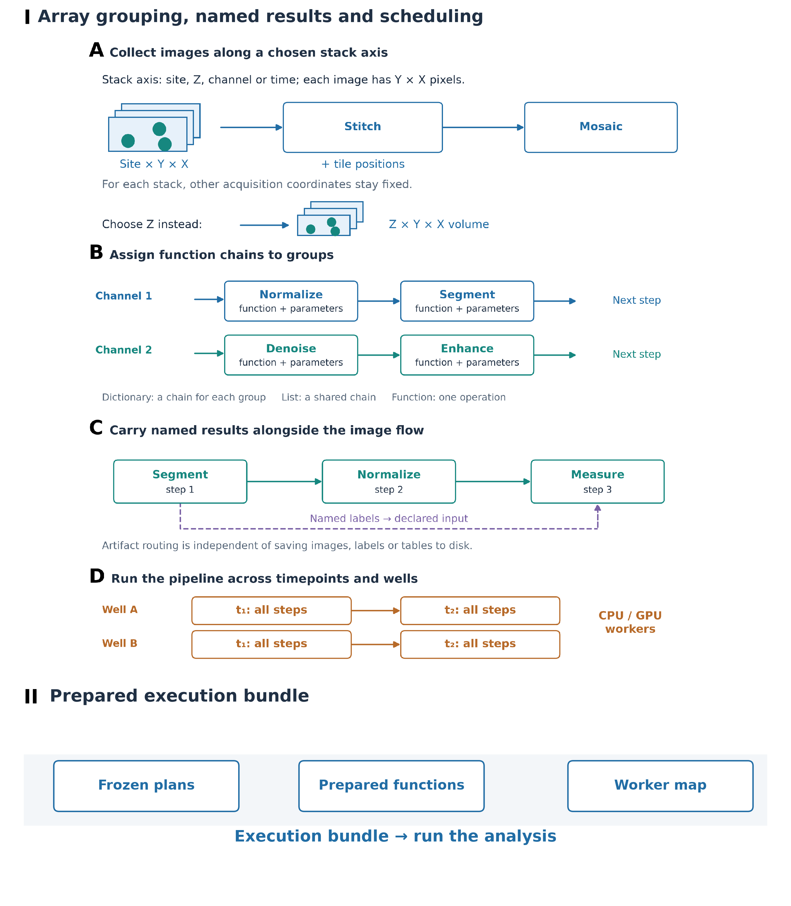
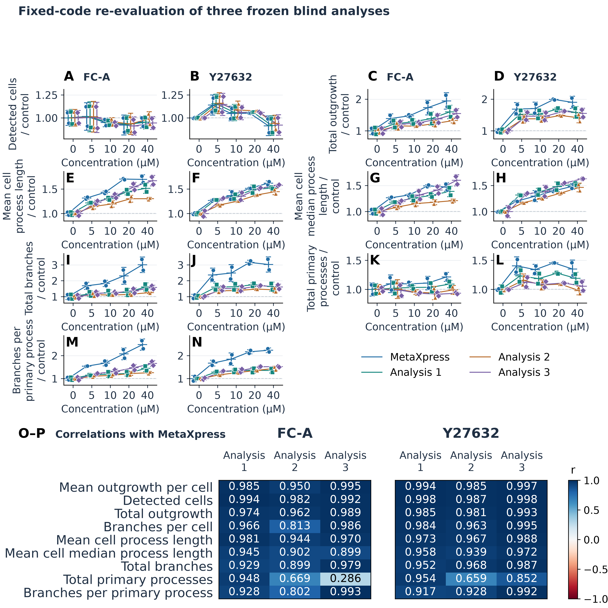
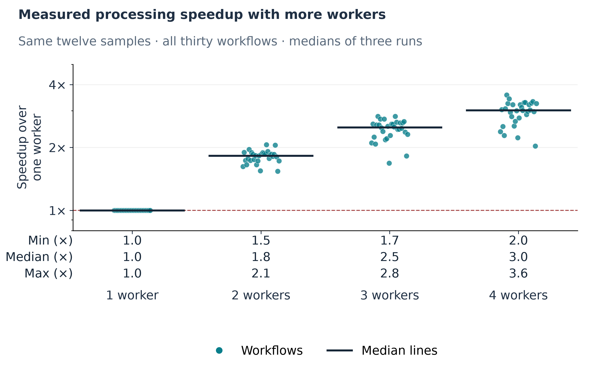
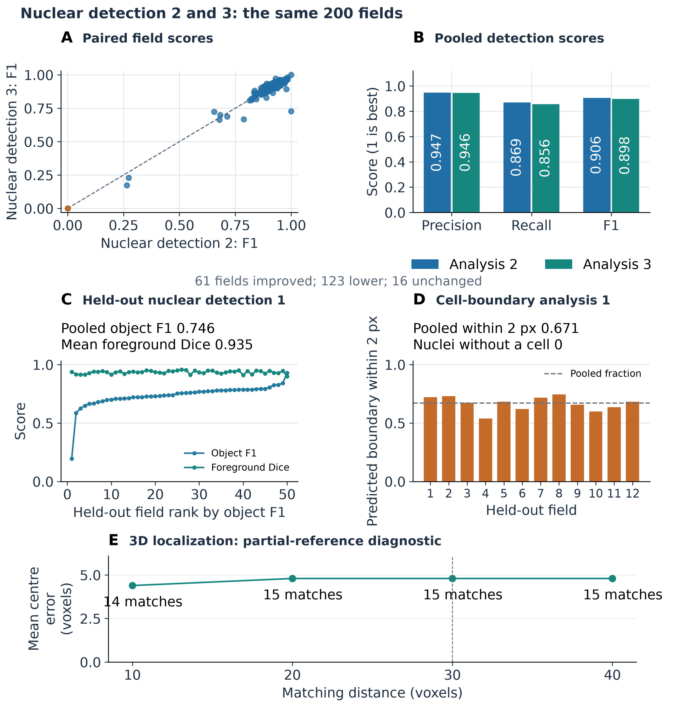
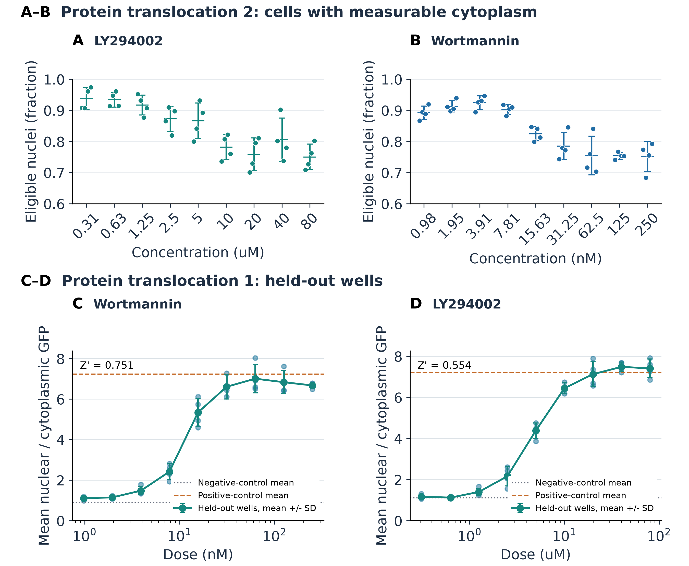
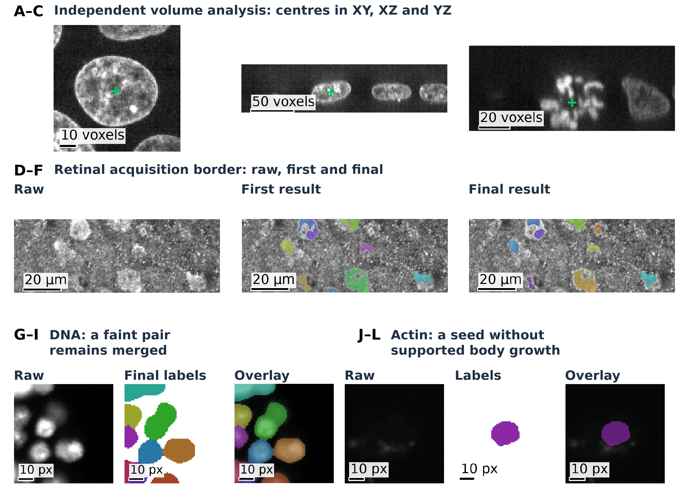

# OpenHCS supplementary material

Additional methods and figures describe pipeline execution, processing times and analysis evaluation. Supp. Data 1–8 retain the measurements, agent instructions, final pipelines and source definitions.

## Supp. Figure 1. Pipeline preparation and execution {#supplementary-figure-1.-pipeline-preparation-and-execution}

{width=6.5in}

::: {custom-style="ImageCaption"}
Pipeline preparation connects image groups and named detections to the functions that use them. **(I, A)** Collecting overlapping sites supplies tiles for a stitching function, which also needs tile positions. Well, channel, Z plane and timepoint are held fixed in this example. Selecting Z planes instead forms a volume. Processing groups remain independent of the stack-axis choice. **(B–D)** Groups can receive different function chains. Named labels connect detections to subsequent measurements. Timepoints are processed sequentially; wells can run in parallel. **(II)** Pipeline compilation prepares the functions and assigns work to processes. Main Figures 1–2 show the editing interface and process connections.
:::

## Supp. Figure 2. Neurite measurements from three blind analyses {#supplementary-figure-2.-neurite-measurements-from-three-blind-analyses}

{width=6.5in}

::: {custom-style="ImageCaption"}
Three frozen blind analyses were re-evaluated with the corrected neurite engine on their original 180 fields in 20 wells. Curves compare each analysis with MetaXpress for fusicoccin-A (FC-A) and Y27632, sharing limits within each endpoint. **(A–B)** Detected cells. **(C–D)** Total outgrowth. **(E–F)** Mean cell process length. **(G–H)** Mean cell median process length. **(I–J)** Total branches. **(K–L)** Total primary processes. **(M–N)** Branches per primary process. Each curve uses its own drug's two zero-dose DMSO wells as baseline. Dots: two technical wells per dose/method; whiskers: sample SD after normalization, excluding control-mean uncertainty. Doses are equally spaced; no concentration–response model was fitted. OpenHCS values average nine fields. MetaXpress branches/process divide exported well totals; per-cell quantities use exported well values. **(O–P)** Pearson r for all nine endpoints, with columns for analyses 1–3. Each coefficient uses ten matched absolute well measurements within one treatment; drugs are not pooled and normalized fold changes are not correlated. Correlation does not establish magnitude agreement or tracing accuracy. Main Figure 6 shows the two primary endpoints; tracing definitions and detailed comparisons remain in Supp. Data 5.
:::

Detailed baseline and effect-size checks and the separate scientist-assisted comparison are retained in [Supp. Data 5](neurite_comparison_details.md). High correlations coexist with smaller absolute branching responses; neither method supplies tracing ground truth.

## Supp. Figure 3. Processing speed with additional workers {#supplementary-figure-3.-processing-speed-with-additional-workers}

{width=6.5in}

::: {custom-style="ImageCaption"}
Execution times for twelve copies of one source sample processed by 1, 2, 3 or 4 OpenHCS workers. Each dot represents one of 30 workflows: its one-worker time divided by its time at the indicated worker count. Timing protocol as in Methods: Performance measurement. Black lines indicate medians; the dashed line indicates equal runtime. Each distribution is labelled with its minimum, median and maximum speedup.
:::

## Supp. Figure 4. Nuclear and cell-boundary measurements {#supplementary-figure-4.-nuclear-detection-and-cell-boundary-measurements}

{width=6.5in}

::: {custom-style="ImageCaption"}
Reference annotations were used to evaluate independently developed nuclear-detection and cell-boundary analyses. **(A–B)** Nuclear detection analyses 3 and 2 on 200 BBBC039 fields, with pooled F1 of 0.898 and 0.906, respectively. Matching required intersection over union ≥ 0.5. **(C–D)** Nuclear detection analysis 1 on 50 fields and cell-boundary analysis 1 on 12 fields. Both evaluation sets were withheld before development; each analysis used four development fields. F1 combines precision and recall; Dice measures area overlap. Boundary support is the fraction of predicted border pixels between touching cells within two pixels of a manual outline and does not measure recovery of every manual border. We provide the per-field scores and counts in Supp. Data 5–6. **(E)** Independent 3D nuclear localization analysis 1 (H002_FRESH15_89): mean centre-to-centre error among matched predictions at each matching radius. Labels give matches among 15 manual centres; the dashed line is the predeclared 30-voxel radius. This fixed-prediction diagnostic is not threshold tuning, and the partial annotations cannot establish a false-detection rate. Main Figure 5D shows its final orthogonal views; [full-resolution views](../figures/slas/supp_nuclear_localisation.png) remain in Supp. Data 5. The body-separation repair in main Figure 4D is a separate analysis.
:::

### Nuclear-detection errors

Across all 200 fields, nuclear detection analyses 2–4 gave pooled F1 of 0.898–0.906. In the retrospective 175-field image-unviewed subset, 117–121 fields per analysis reached F1 of at least 0.90. Missed nuclei accounted for 73–78% of the three agents' errors on the 175 BBBC039 fields not viewed by any of them. For each agent, misses outnumbered false detections in 171–173 fields. All three scored below F1 0.80 on the same six fields; these were mostly less crowded than average, with a median of 59 nuclei against 126 across all 175 fields. On the hardest field, F1 was 0.23–0.27 and 57–59 of 69 nuclei were missed. Between analyses 2 and 3 on all 200 fields, per-field F1 mostly differed by less than 0.03. A correction in analysis 2 on three inspected fields recovered 14 missed nuclei and raised F1 from 0.908 to 0.934, while increasing split reference nuclei from 28 to 43. That correction was not evaluated separately across all fields. The [error summary](task_only_analysis/nuclear_error_summary.csv) and [per-field measurements](task_only_analysis/bbbc039-uninspected-fields.csv) identify the affected images.

## Supp. Figure 5. Protein-translocation measurements and cytoplasmic segmentation {#supplementary-figure-5.-protein-translocation-measurements-and-cytoplasmic-segmentation}

{width=6.5in}

::: {custom-style="ImageCaption"}
In analysis 2, only nuclei with measurable cytoplasm contributed a green fluorescent protein (GFP) ratio; we therefore checked eligibility alongside control separation. **(A–B)** Fraction of nuclei with measurable cytoplasm in protein translocation analysis 2, across 96 BBBC013 wells including four development wells. Dots represent four wells per dose; horizontal marks and whiskers indicate the mean and sample standard deviation (SD). Main Figure 5C shows the corresponding GFP responses. **(C–D)** Nuclear-to-cytoplasmic GFP ratios from the independent analysis 1 on wells withheld before development, with four wells per control condition. Analysis 1 used mean cell-level GFP ratios; analysis 2 used median log2 ratios. The measurements and pipelines are available in Supp. Data 5–6.
:::

## Supp. Figure 6. Segmentation errors in matched image regions {#supplementary-figure-6.-segmentation-errors-in-matched-image-regions}

{width=6.5in}

::: {custom-style="ImageCaption"}
Image review checks whether detections follow visible structures across image planes and channels. **(A–C)** Nuclear centres from an independent volume analysis (H002_FRESH10_89), shown in the XY, XZ and YZ planes. **(D–F)** Retinal repair: raw image and first and final outlines from a run continued after an interruption (R0010_FRESH16_88); a possible split remains. **(G–I)** Nuclear-separation repair in BBBC007 DNA/actin fields (H003_POSTPAUSE_88): raw DNA, final labels and their overlay show a faint pair that remains merged. **(J–L)** Paired DNA/actin inspection (H003_FRESH19_96): a nuclear seed lacks actin-supported cell-body growth. This run is separate from the paired-channel analysis in Supp. Table 5 (Fresh26). Display windows are 0–42 for D–F, 0–151 for G–I and 0–104 for J–L; gamma is 1. Scale bars in A–C are marked in voxel-index units; physical spacing is unverified. Bars are 20 µm in D–F and 10 pixels in G–L. These are separate analyses. Colours identify objects within each view. The source images and reports are available in Supp. Data 5.
:::

## Supp. methods: analysis scoring {#supplementary-methods-analysis-scoring}

Precision was the fraction of detections matched to reference nuclei; recall was the fraction of reference nuclei detected. F1 was their harmonic mean, ranging from 0 to 1. One-to-one BBBC039 nuclear matches required intersection over union (IoU) ≥ 0.5: overlapping area had to cover at least half the combined area of the two outlines. Pooled F1 combined object counts across fields before scoring; mean per-image F1 gave each field equal weight. Dice measured overlap of detected and reference areas, from 0 to 1; splitting and merging were evaluated separately. Signed count error was the detected count minus the reference count. Split and merge checks identified reference nuclei detected as several objects, or several nuclei detected as one.

For comparison with Caicedo et al. [@Caicedo2019], we applied their released `compute_af1_results` evaluator (revision `b33debf5503cdf0926072c740eec4d4fc626c156`) to the same frozen predictions on the official 50-image test partition. It uses strict IoU > threshold at nine thresholds generated by `np.arange(0.5, 0.95, 0.05)`, averages F1 across images and then thresholds, and retains the original `1e-9` denominator offset. The released-evaluator scores were 0.804, 0.792 and 0.823 for nuclear detection analyses 2, 3 and 4, respectively. Their original single-threshold IoU ≥ 0.5 scores remain separate. [Per-image and per-threshold results](task_only_analysis/bbbc039-caicedo-retained-results.json) identify the unchanged predictions and references; no segmentation or pipeline was rerun. Figure 5A pairs these retained scores with the [published comparator values](task_only_analysis/bbbc039-caicedo-published-test50.csv): CellProfiler basic 0.790, CellProfiler advanced 0.811, Random Forest 0.840, DeepCell 0.858 and U-Net 0.898 [@Caicedo2019]. All use the official test split and nine-threshold metric; the published methods used training images for configuration or supervised learning, unlike the agents' label-blind development.

The [viewing chronology](task_only_analysis/bbbc039-official-test-view-chronology.json) records when each agent first viewed an official test image relative to when its method was fixed. Analysis 2 viewed one official test field (`20585_F14_7`) before fixing its method; analyses 3 and 4 viewed none. On six other occasions, an agent first viewed a test image after fixing its method, during result review. As a supplementary robustness check, removing all six distinct test fields viewed by any of the three agents during development or later review left 44 fields and 5,109 reference nuclei. Original per-image mean F1 at IoU ≥ 0.5 was 0.898, 0.892 and 0.895 for analyses 2–4, respectively. This 44-field subset was identified retrospectively; it does not replace the full-50 comparison. The [subset calculation](task_only_analysis/bbbc039-official50-secondary44.json) retains its exact IDs and scores.

Excluding the one official-test field viewed by nuclear detection analysis 2 before its method was frozen left 49 fields containing 5,602 reference nuclei. Mean per-image F1 was 0.9023 at IoU ≥ 0.5 and 0.8037 with Caicedo et al.'s released nine-threshold evaluator, compared with 0.9026 and 0.8036, respectively, for all 50 fields. These summaries use the same retained predictions; the [49-field record](task_only_analysis/bbbc039-fresh612-test49-summary.json) retains exact image IDs, scores and aggregation.

Protein translocation analysis 2 measured cytoplasm around 14,631 of 17,320 nuclei (84.5%); this fraction varied with treatment. The earlier analysis 1 obtained Z′ of 0.554 for LY294002 and 0.751 for Wortmannin on 92 wells withheld before development (Supp. Data 6). The analyses used different well summaries and evaluation sets.

Protein translocation analysis 2 used each well's median log2 nuclear-to-cytoplasmic GFP ratio across cells with measurable cytoplasm. On this log2 scale, 0 means equal nuclear and cytoplasmic intensity, and 1 means twice the intensity in the nucleus.

Control separation was quantified by Z′ (Z-prime): 1 minus three times the sum of the positive and negative control groups' sample standard deviations, divided by the absolute difference between their means. Each drug had four positive and four negative control wells. Z′ of 1 indicates ideal separation with no within-group variation; values above 0.5 indicate an excellent screening assay. Standard deviation (SD) describes variation among wells.

For drug responses, fold change is the measurement divided by its DMSO control mean: 1 means no change, 2 means double and 0.5 means half. Pearson's correlation coefficient, r, describes whether two methods' measurements rise and fall together across wells. It ranges from −1 to 1; values near 1 indicate a strong positive linear relationship, but do not mean that the methods give identical values or effect sizes.

Bright-object detection analysis 1 matched first and final detections one-to-one to computational reference labels from a notebook-derived image. Three-dimensional nuclear localization analysis 1 matched centres one-to-one to partial manual annotations within a predeclared 30-voxel radius. A voxel is a three-dimensional image pixel; lower centre-to-centre distances indicate more accurate localization.

## Supp. methods: neurite morphometry {#supplementary-methods-neurite-morphometry}

Fusicoccin-A (FC-A) or Y27632 was added when the initial Dulbecco's modified Eagle medium containing fetal bovine serum was replaced with supplemented Neurobasal medium. Images were acquired on an ImageXpress Micro Confocal using a 10× Plan Apo Lambda objective (0.45 NA) and 2 × 2 camera binning, giving a pixel size of 1.3556 µm. The nuclear stain was 4′,6-diamidino-2-phenylindole (DAPI). Each channel was recorded as a 1024-by-1024-pixel image at one Z position and one timepoint; calcein-labelled neurons were recorded in the FITC channel.

For Figure 6 and Supplementary Figure 2, we re-evaluated the three frozen function chains on all original images after the neurite-engine corrections. The recorded engine revision includes crossing/branch ownership and centreline-geometry changes; this is a fixed-code re-evaluation, not an isolated single-function patch or three new blind-development runs. Preprocessing, author-selected parameters and acquisition calibration were retained. Analysis 3's custom-function contract annotations were translated to the current nominal API in separately hashed execution copies; function signatures and numerical-body ASTs were unchanged. [Measured records, source hashes and comparison tables](personal_neurite_reanalysis_20261116/README.md) distinguish these results from the preserved original evaluations and scientist-assisted comparison. The matched microscopy in Figure 6F–H and its full-resolution copy in Supp. Data 5 retain the original frozen image-analysis record.

To compare treatment responses across wells, we calculated each well's measurement as the unweighted mean of its nine fields. For process length, each field first averaged per-cell means or medians, including zero for cells without processes; missing measurements were not replaced with zero. Overlapping fields were not deduplicated. Total outgrowth and cell counts therefore describe mean field totals rather than a unique whole-well census.

OpenHCS process lengths include connected daughter branches assigned to a soma-adjacent root. Branch counts require at least three same-neuron paths with distinct image-supported arms; resolved crossings do not automatically count as branches. The [MetaXpress guide](https://www.moleculardevices.com/sites/default/files/en/assets/training-material/dd/img/metaxpress-6-software-application-modules-neurite-outgrowth.pdf) defines primary processes as outgrowths attached to cell bodies and branches as junctions, without specifying crossing resolution. These differences in segmentation and measurement definitions limit comparisons of absolute values; neither method supplies manual tracing ground truth.

The separate scientist-assisted settings, repair history and comparison are retained with their [source measurements and diagnostics in Supp. Data 5](neurite_comparison_details.md).

## Supp. methods: execution-time estimates {#supplementary-methods-execution-time-estimates}

Figure 3C compares measured OpenHCS times on twelve copies of one source sample with a fixed serial CellProfiler estimate for the same workload. Methods: Performance measurement defines the timing protocol, intervals and exclusions.

For N samples processed serially, CellProfiler time was estimated as:

`Estimated time = T8_first + (N − 8) × median(T8_warm)/8`

`T8_first` is the measured first eight-sample batch; `T8_warm` is a later batch after initialization. Setup-plus-processing adds the measured first-batch pre-pipeline overhead once. Figure 3C uses N = 12 and holds this estimate fixed for all four OpenHCS worker counts.

[Calibration](../../benchmark/results/matched_worker_sweep_20261008_latestproduction/calibration/cold_first/cold-first-model-validation.json) covered three workflows with 8, 12 and 16 samples. Maximum absolute prediction error was 7.06% for the same-session eight-sample model, compared with 5.21% for a two-sample model; an earlier-session eight-sample model underpredicted by up to 14.03%. Twelve samples lie within the examined batch-size range, but validation covered only three workflows, not the full corpus.

## Supp. Table 1. AI assistance and evaluation resources {#supplementary-table-1.-ai-assistance-and-evaluation-resources}

These resources address different parts of AI-assisted analysis. The table distinguishes systems that help develop analyses from a benchmark that evaluates agent-produced outputs.

| Resource | Role | Mechanism or evaluation scope |
|:----------------------|:-----------------------|:----------------------------------------------------|
| BioImage.IO Chatbot [@Lei2024] | Community-linked assistance | Conversational access to community bioimaging information, resources and analysis extensions. |
| Omega [@Royer2024] | Code-driven interactive analysis | Generates and executes Python analysis code and creates napari controls for inspection and adjustment. |
| Agentic-J [@Johanns2026] | Fiji-script development and auditing | Uses bioimage knowledge, plugin instructions and specialized agents; calls external tools through the Model Context Protocol (MCP). The cited version plans repeatability assessment across independent agent sessions. |
| BIABench [@Pan2026BIABench] | Analysis-evaluation benchmark | Evaluates agent-produced analyses against reference answers and expert assessments. Performance was stronger on routine 2D tasks; repeated runs were unreliable on more complex data. |

## Supp. Table 2. Reusable software libraries {#supplementary-table-2.-reusable-software-libraries}

We built these eight libraries to connect analysis editing, processing, storage and inspection. Each performs a shared job so that developers can add compatible components without rebuilding the surrounding analysis tools. Main Figures 1–2 show how these jobs connect within OpenHCS.

ArrayBridge supports NumPy, CuPy, PyTorch, TensorFlow, JAX and pyclesperanto. Processing functions available in OpenHCS include illumination correction through a version of BaSiCPy maintained by OpenHCS and N2V2 denoising in PyTorch with CUDA, NVIDIA's GPU-computing platform.

| Library | Role in the analysis |
|:--------------------------|:------------------------------------------------------------------------|
| [metaclass-registry](https://github.com/OpenHCSDev/metaclass-registry) | Discovers classes implementing a shared interface. |
| [python-introspect](https://github.com/OpenHCSDev/python-introspect) | Reads function parameters, types, defaults and documentation. |
| [ObjectState](https://github.com/OpenHCSDev/objectstate) | Stores editable settings, shared defaults and local overrides. |
| [pyqt-reactive](https://github.com/OpenHCSDev/pyqt-reactive) | Dynamically generates the user interface and updates it when analysis settings change. |
| [pycodify](https://github.com/OpenHCSDev/pycodify) | Writes analysis steps and settings as editable Python and reads edited values back. |
| [ArrayBridge](https://github.com/OpenHCSDev/arraybridge) | Converts image arrays between libraries and manages computing resources. |
| [PolyStore](https://github.com/OpenHCSDev/PolyStore) | Reads and writes local files, memory, Zarr and OMERO. |
| [ZMQRuntime](https://github.com/OpenHCSDev/zmqruntime) | Coordinates process communication, startup, shutdown and progress. |

## Supp. Table 3. Timing boundaries {#supplementary-table-3.-timing-boundaries}

Table: Main Methods: Performance measurement defines repetitions, exclusions and batch sizes.

| Application | Processing | Setup plus processing |
|:--------------|:--------------------------------------------|:---------------------------------------|
| CellProfiler | Immediately before the pipeline first runs → batch completion, including internal initialization, image-group preparation, processing, output steps and measurement-file closure. | Before initial output-directory and measurement setup → the same batch completion. |
| OpenHCS | Server execution-job start → job completion, including saving results and plate-level exports. | Sum of four client intervals: submit compilation, wait for compilation, submit execution and wait for execution. Server time falls within these client intervals and is not added again. |

## Supp. Table 4. User tasks covered by automated software checks {#supplementary-table-4.-user-tasks-covered-by-automated-software-checks}

The complete table, including every row and its source links, is provided as [Supplementary Data 8: downloadable table](software_check_coverage.md).

## Supp. Table 5. Tasks, models and evaluation protocols {#supplementary-table-5.-tasks-models-and-evaluation-protocols}

The complete table, including every row and its source links, is provided as [Supplementary Data 5: downloadable table](analysis_protocols.md).

## Supp. Table 6. Evaluation design {#supplementary-table-6.-evaluation-design}

Table: Supp. Table 6. Evaluation design. Pipelines were finalized before reference comparisons, without reference labels or score feedback during development. The quantitative rows used gpt-6.1-sol; repair-continuation model identities, where recorded, are listed in Supp. Table 5. IoU is intersection over union; F1 combines precision and recall. Caicedo F1 averages per-image F1 over nine thresholds from 0.50 to 0.90, requiring IoU strictly greater than each; pooled F1 combines object counts across fields. Original instructions, freeze records and scores: Supp. Data 5–6.

| Analysis and images | Development access | Comparison population | Reference | Measure and scope |
|:-----------------|:--------------------|:----------------------|:------------------|:------------------|
| Nuclear detection 2–4; BBBC039, 200 fields | Before method freeze: analysis 2 viewed one official-test field; analyses 3–4 viewed none | Official 50-field test split; retrospective 175-field subset excluding 25 fields viewed at any time (44 official-test fields overlap) | Manual instance masks [@Caicedo2019] | Test: per-image F1 at IoU ≥ 0.5 and Caicedo F1. Subset: pooled F1 at IoU ≥ 0.5 |
| Protein translocation 2; BBBC013, 96 wells | Four development wells | All 96 wells, including those four | Positive and negative control treatments | Z′ from well-median log2 nuclear / cytoplasmic GFP; control separation, not segmentation accuracy |
| Neurite drug-response analyses 1–3; 20 wells × nine fields | Six, four and eight fields, respectively. Treatment identities released after finalization | All 180 fields, summarized by well | MetaXpress measurements | Fold change from vehicle; Pearson r. Algorithm comparison, not manual tracing accuracy |
| Cell-boundary analyses 2–3; BBBC007, 16 fields | Analysis 2: 12 development fields, four held out by the agent. Analysis 3: all 16 available | All 16 fields | Manual outlines | Predicted borders between cells within two pixels of reference; not the fraction of reference borders recovered |
| 3D nuclear localization 1; H002 volume | Whole volume | Whole volume after finalization | 15 manual centres in part of the volume | Matches within 30 voxels; matched-centre error. No false-detection rate from this partial reference |
| Repairs: H001, BBBC007 DNA, R0010, H002 | Same development image/volume for each first/final pair | Fixed first/final outputs; no held-out population | Computational labels (H001); image inspection (others) | Local before/after repair, not whole-dataset accuracy. H002 repair and localization are separate |

## Supp. Data {#supplementary-data}

1. **Editable analyses.** [Advanced-segmentation and 3D-monolayer CellProfiler imports](complex_cellprofiler_workflows.md), plus [graphical/Python/agent editing records](analysis_records.md#figure-assembly-and-interface-records).
2. **CellProfiler workflow comparison.** [Protocol and source files](analysis_records.md#supplementary-data-2-cellprofiler-workflow-comparison), including exported-file counts, eight added image exports, comparison rules, software versions and database outputs [@Jones2008].
3. **Module coverage.** [Per-module evidence](../figures/slas/benchmark-publication/reference-layout/reference_module_coverage.csv) for the 85 modules: 54 tested in complete workflows, 29 individually and two through shared code only.
4. **Execution times.** [Measured and estimated values for Figure 3](../figures/slas/submission_benchmark_summary_projection.csv), [all workflow timings and charts](analysis_records.md#supplementary-data-4-timing-methods-and-additional-charts) and [benchmark protocol](../../benchmark/results/matched_worker_sweep_20261008_latestproduction/README.md).
5. **Agent-developed analyses.** The [analysis index](analysis_records.md#analysis-index) connects all 20 task-level result records to original instructions, available pipelines, model/guide provenance and the matching resource records. It distinguishes independent analyses, repairs and grouped cohorts, and defines the earlier withheld evaluation inputs and later retrospective image-unviewed subsets. Retained BBBC039 nuclear predictions were rescored with Caicedo et al.'s released evaluator without rerunning the analyses (Supp. methods: analysis scoring).
6. **Analyses with withheld evaluation images.** [Final pipelines and scores](independent_validation/README.md) for nuclear detection 1, cell-boundary 1 and protein translocation 1. Each analysis used four development inputs; evaluation images were withheld before development and released only after the analysis was fixed.
7. **Public NeuronCyto analysis.** [Input images, analysis outputs and reference definitions](analysis_records.md#supplementary-data-7-public-neuroncyto-demonstration-and-references). The published NeuronCyto II output is an algorithm comparison [@NeuronCytoII]; its manual trace coordinates were unavailable, so absolute tracing accuracy could not be scored.
8. **Software checks.** [Configuration, generated-Python and compiler-validation tests](analysis_records.md#supplementary-data-8-workflow-regression-tests), with source versions and execution records.

The [software-resource inventory](software_resources.md) supplies the extension and training-resource tables, with source links and counting rules. [Detailed analysis records](analysis_records.md) provide additional per-analysis measurements and image sources.
