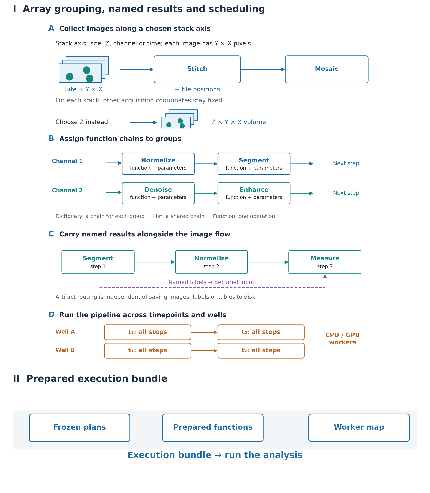
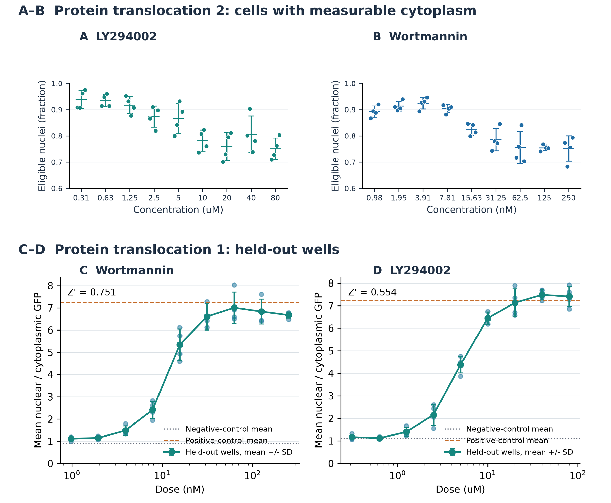
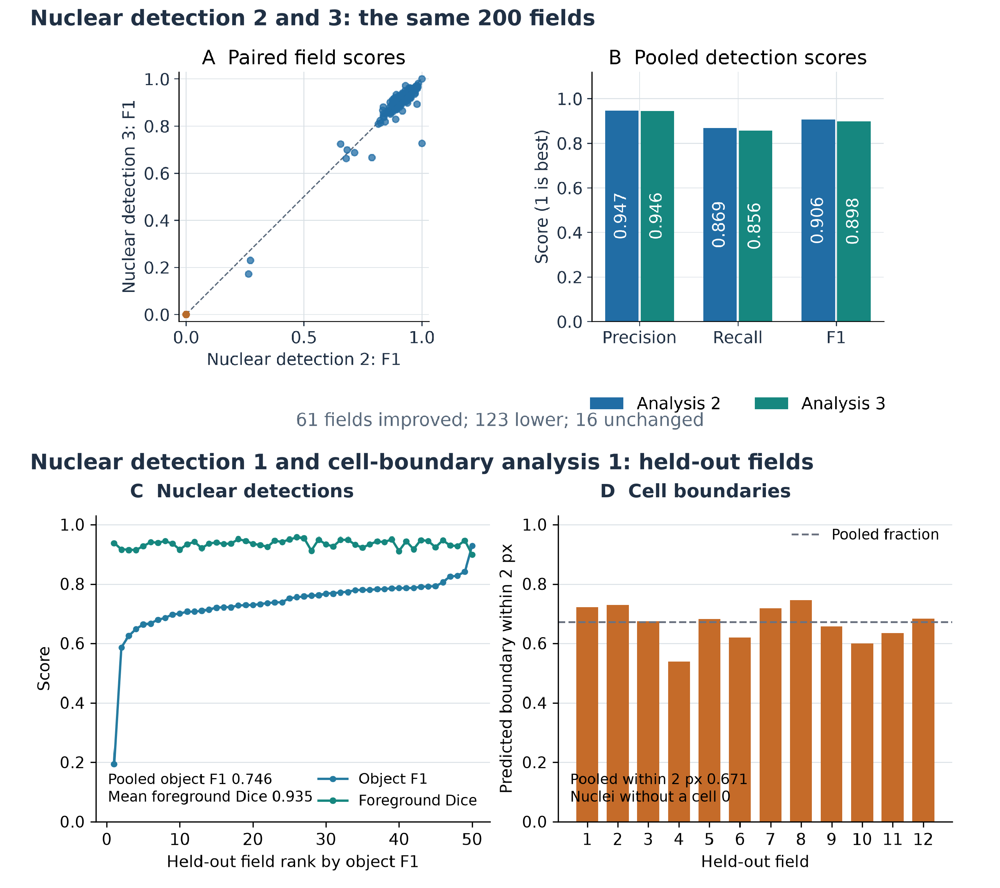
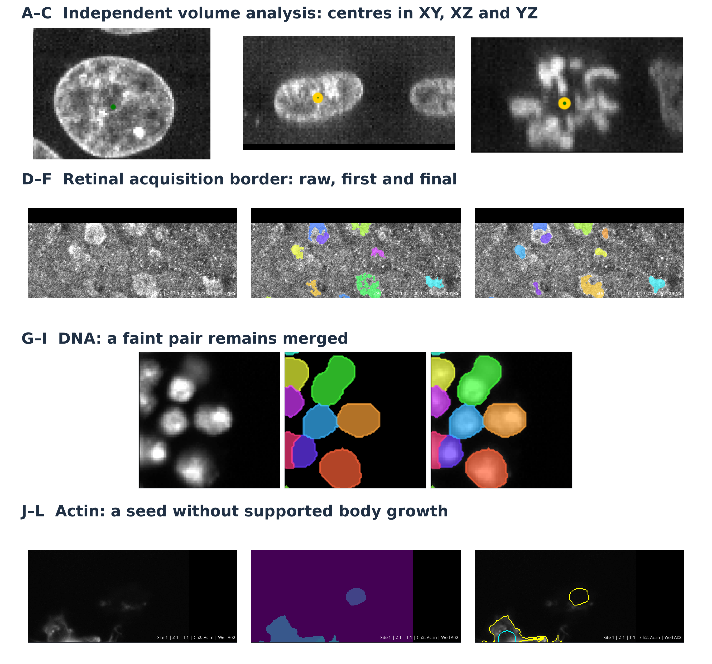
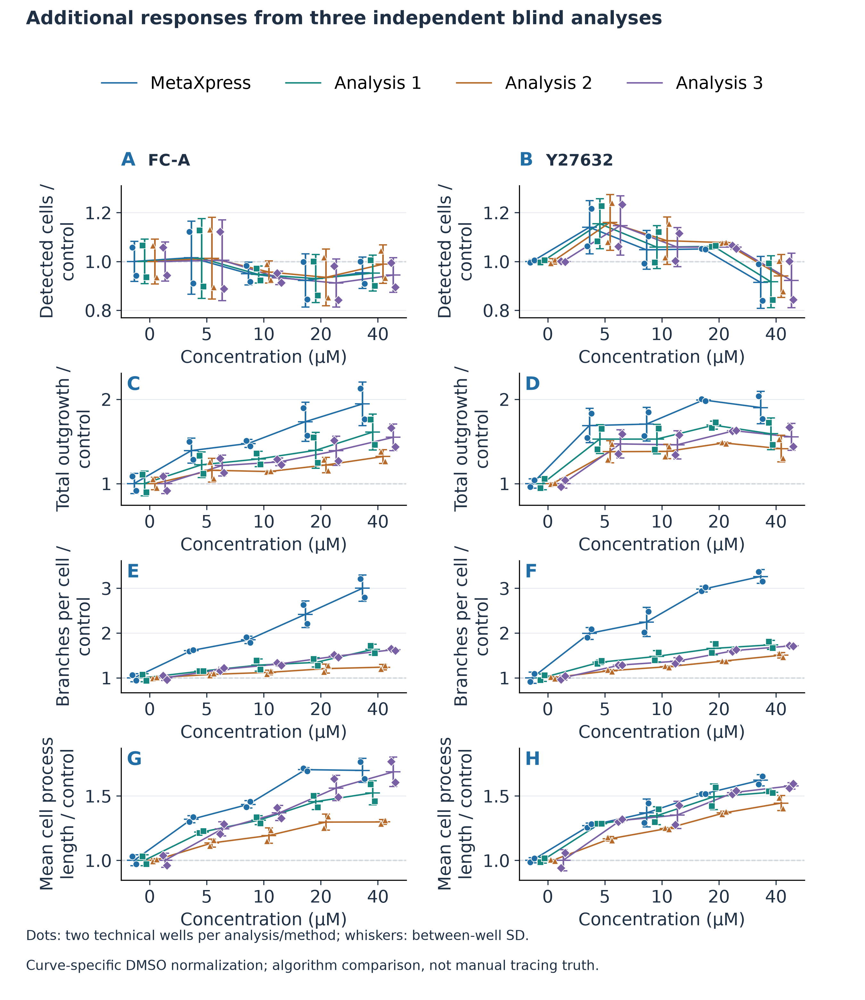
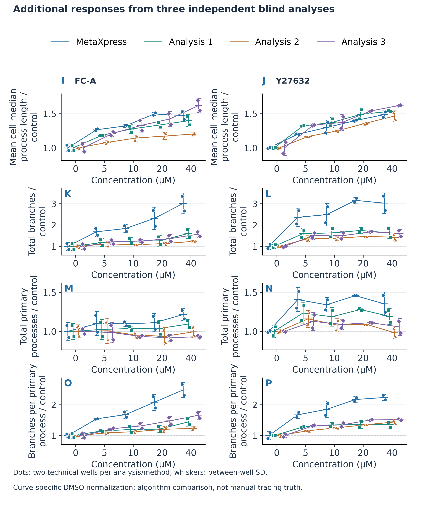
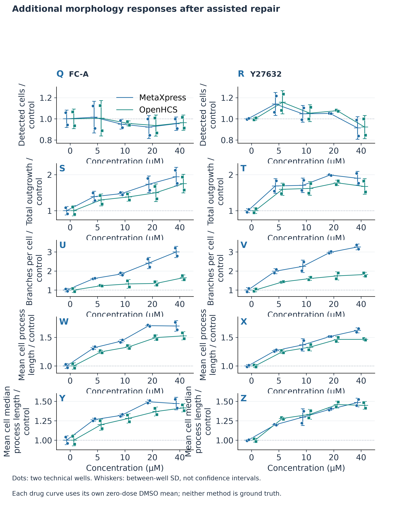
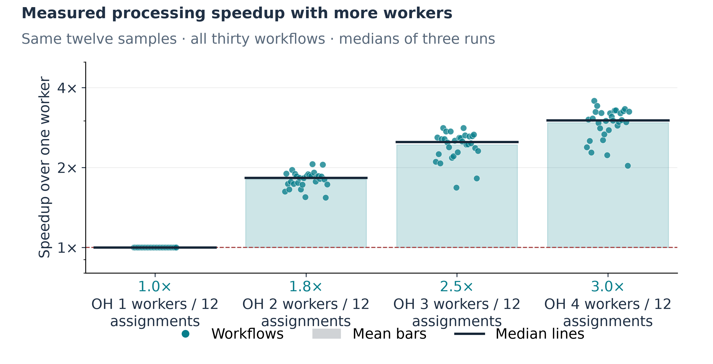

# OpenHCS supplementary material

Additional methods and figures describe assay measurements, segmentation errors and processing times. Supp. Data 1–8 link the underlying measurements, agent instructions and final pipelines. BBBC identifiers refer to the Broad Bioimage Benchmark Collection.

## Supp. Figure 1. Pipeline preparation and execution {#supplementary-figure-1.-pipeline-preparation-and-execution}

{width=6.5in}

::: {custom-style="ImageCaption"}
Pipeline preparation connects image groups and named detections to the functions that use them. **(I, A–D)** Image axes and processing groups determine which planes or volumes each function receives. Named labels connect detections to subsequent measurements. Timepoints are processed sequentially; wells can run in parallel. **(II)** Pipeline compilation prepares the functions and assigns work to processes. Main Figures 1–2 show the editing interface and process connections.
:::

## Supp. Figure 2. Protein-translocation measurements and cytoplasmic segmentation {#supplementary-figure-2.-protein-translocation-measurements-and-cytoplasmic-segmentation}

{width=6.5in}

::: {custom-style="ImageCaption"}
In analysis 2, only nuclei with measurable cytoplasm contributed a green fluorescent protein (GFP) ratio; we therefore checked eligibility alongside control separation. **(A–B)** Fraction of nuclei with measurable cytoplasm in protein translocation analysis 2, across 96 BBBC013 wells including four development wells. Dots represent four wells per dose; horizontal marks and whiskers indicate the mean and sample standard deviation (SD). Main Figure 5E shows the corresponding GFP responses. **(C–D)** Nuclear-to-cytoplasmic GFP ratios from the independent analysis 1 on held-out wells, with four wells per control condition. Z′ describes control separation relative to variation among wells; values above 0.5 indicate an excellent assay. Analysis 1 used mean cell-level GFP ratios; analysis 2 used median log2 ratios. Supp. Data 7–8 contain the measurements and pipelines.
:::

## Supp. Figure 3. Nuclear-detection and cell-boundary measurements {#supplementary-figure-3.-nuclear-detection-and-cell-boundary-measurements}

{width=6.5in}

::: {custom-style="ImageCaption"}
Reference annotations were used to evaluate independently developed nuclear-detection and cell-boundary analyses. **(A–B)** Nuclear detection analyses 3 and 2 on 200 BBBC039 fields, with pooled F1 of 0.898 and 0.906, respectively. Matching required intersection over union ≥ 0.5. **(C–D)** Nuclear detection analysis 1 on 50 held-out fields and cell-boundary analysis 1 on 12 held-out fields; each used four development fields. F1 combines precision and recall; Dice measures area overlap. Boundary support is the fraction of predicted border pixels between touching cells within two pixels of a manual outline and does not measure recovery of every manual border. Supp. Data 7–8 provide per-field scores and counts.
:::

### Nuclear-detection errors

Missed nuclei accounted for 73–78% of the three agents' errors on the 175 uninspected BBBC039 fields. For each agent, misses outnumbered false detections in 171–173 fields. All three scored below F1 0.80 on the same six fields; these were mostly less crowded than average, with a median of 59 nuclei against 126 across all 175 fields. On the hardest field, F1 was 0.23–0.27 and 57–59 of 69 nuclei were missed. Between analyses 2 and 3 on all 200 fields, per-field F1 mostly differed by less than 0.03. A correction in analysis 2 on three inspected fields recovered 14 missed nuclei and raised F1 from 0.908 to 0.934, while increasing split reference nuclei from 28 to 43. That correction was not evaluated separately across all fields. The [error summary](task_only_analysis/nuclear_error_summary.csv) and [per-field measurements](task_only_analysis/bbbc039-uninspected-fields.csv) identify the affected images.

## Supp. Figure 4. Segmentation errors in matched image regions {#supplementary-figure-4.-segmentation-errors-in-matched-image-regions}

{width=6.5in}

::: {custom-style="ImageCaption"}
Image review checks whether detections follow visible structures across image planes and channels. **(A–C)** Nuclear centres from an independent volume analysis in XY, XZ and YZ. **(D–F)** Retinal region before analysis and with the first and final outlines; a possible split remains. **(G–I)** Raw DNA, final labels and their overlay show a faint pair that remains merged. **(J–L)** A nuclear seed lacks actin-supported cell-body growth. Display windows are 0–42 for D–F, 0–151 for G–I and 0–104 for J–L; gamma is 1. Scale bars in A–C are marked in voxel-index units; physical spacing is unverified. Bars are 20 µm in D–F and 10 pixels in G–L. These are separate analyses. Colours identify objects within each view. Supp. Data 8 links the source images and reports.
:::

## Supp. methods: analysis scoring {#supplementary-methods-analysis-scoring}

Precision was the fraction of detections matched to reference nuclei; recall was the fraction of reference nuclei detected. F1 was their harmonic mean, ranging from 0 to 1. Pooled F1 combined object counts across fields before scoring; mean per-image F1 gave each field equal weight. Dice measured overlap of detected and reference areas, from 0 to 1; splitting and merging were evaluated separately. Signed count error was the detected count minus the reference count. Split and merge checks identified reference nuclei detected as several objects, or several nuclei detected as one.

Protein translocation analysis 2 used each well's median log2 nuclear-to-cytoplasmic GFP ratio across cells with measurable cytoplasm. On this log2 scale, 0 means equal nuclear and cytoplasmic intensity, and 1 means twice the intensity in the nucleus.

Control separation was quantified by Z′ (Z-prime): 1 minus three times the sum of the positive and negative control groups' sample standard deviations, divided by the absolute difference between their means. Each drug had four positive and four negative control wells. Z′ of 1 indicates ideal separation with no within-group variation; values above 0.5 indicate an excellent screening assay. Standard deviation (SD) describes variation among wells.

For drug responses, fold change is the measurement divided by its DMSO control mean: 1 means no change, 2 means double and 0.5 means half. Pearson's correlation coefficient, r, describes whether two methods' measurements rise and fall together across wells. It ranges from −1 to 1; values near 1 indicate a strong positive linear relationship, but do not mean that the methods give identical values or effect sizes.

## Supp. methods: neurite morphometry {#supplementary-methods-neurite-morphometry}

We used images from primary cortical-neuron cultures to test whether independent analyses recovered drug-induced changes in neurite growth. The cultures contained neurons from embryonic day 18 (E18) rats, imaged two days after plating. Fusicoccin-A (FC-A) or Y27632 was added when the initial Dulbecco's modified Eagle medium containing fetal bovine serum was replaced with supplemented Neurobasal medium. Each compound was tested at 0, 5, 10, 20 and 40 µM, with two technical wells per dose; zero-dose wells contained dimethyl sulfoxide (DMSO) vehicle. Paired nuclear-stain and neuronal-signal images were acquired at nine fields per well, with a pixel size of 1.3556 µm. The nuclear stain was 4′,6-diamidino-2-phenylindole (DAPI). Each channel was recorded as a 1024-by-1024-pixel image at one Z position and one timepoint; neuronal signal was recorded in the FITC channel.

To compare treatment responses across wells, we calculated each well's measurement as the unweighted mean of its nine fields. For process length, each field first averaged per-cell means or medians, including zero for cells without processes; missing measurements were not replaced with zero. Overlapping fields were not deduplicated. Total outgrowth and cell counts therefore describe mean field totals rather than a unique whole-well census. Three agents independently analysed the same 20 coded wells; their analyses do not add biological replicates.

Each drug curve was normalized to the mean of its two zero-dose DMSO wells. Dots represent two technical wells per dose; whiskers show their sample SD after normalization and do not include uncertainty in the control mean. Doses are equally spaced for display; no concentration–response model was fitted.

OpenHCS process lengths include connected daughter branches assigned to a soma-adjacent root. Branch counts require at least three same-neuron paths with distinct image-supported arms; resolved crossings do not automatically count as branches. The [MetaXpress guide](https://www.moleculardevices.com/sites/default/files/en/assets/training-material/dd/img/metaxpress-6-software-application-modules-neurite-outgrowth.pdf) defines primary processes as outgrowths attached to cell bodies and branches as junctions, without specifying crossing resolution. Its site weighting and analysis settings were unavailable. These differences in segmentation and measurement definitions limit comparisons of absolute values; neither method supplies manual tracing ground truth.

The scientist-assisted analysis used DAPI and calcein images at 1.3556 µm/pixel, with neurite response 30 and candidate threshold 0.03. Image review prompted corrections to soma-edge branches and missing paths; MetaXpress fold changes were not a tuning target. Cell counts were unchanged in all 180 fields. [Settings and source measurements](personal_neurite_repaired_morphometry/source_evidence.json), [matched wells](personal_neurite_repaired_morphometry/joined_wells.csv) and [branch diagnostics](personal_neurite_branch_diagnostics/treatment_effects.csv) document the corrections.

## Supp. Figure 5. Neurite measurements from three blind analyses {#supplementary-figure-5.-neurite-measurements-from-three-blind-analyses}

{width=6.5in}

::: {custom-style="ImageCaption"}
Three agents independently measured responses to fusicoccin-A (FC-A) and Y27632 across 180 fields in 20 wells. **(A–B)** Detected cells. **(C–D)** Total outgrowth. **(E–F)** Branches per cell. **(G–H)** Mean cell process length. Each curve is normalized to the mean of its drug's two zero-dose DMSO vehicle wells. Dots represent two technical wells per dose per analysis; whiskers indicate sample SD. Drug panels share vertical limits. Main Figure 4A–B shows mean outgrowth per cell.
:::

## Supp. Figure 5, continued. Process length and branching {#supplementary-figure-5-continued.-process-length-and-branching}

{width=6.5in}

::: {custom-style="ImageCaption"}
Process-length and branching responses to fusicoccin-A (FC-A) and Y27632 from three independent blind analyses are compared with MetaXpress. **(I–J)** Mean cell median process length. **(K–L)** Total branches. **(M–N)** Total primary processes. **(O–P)** Branches per primary process. Each drug curve is normalized to the mean of its two zero-dose DMSO vehicle wells. Dots represent two technical wells per dose per analysis; whiskers show sample SD. OpenHCS totals are mean field totals. OpenHCS branch/process values average field ratios; MetaXpress values divide exported well totals. The endpoints depend on the tracing and branching definitions of each analysis.
:::

## Supp. Figure 5, continued. Scientist-assisted neurite analysis {#supplementary-figure-5-continued.-scientist-assisted-neurite-analysis}

{width=6.5in}

::: {custom-style="ImageCaption"}
Scientist-assisted neurite measurements were compared with MetaXpress in 20 matched wells. **(Q–R)** Detected cells. **(S–T)** Total outgrowth. **(U–V)** Branches per cell. **(W–X)** Mean cell process length. **(Y–Z)** Mean cell median process length. Curves for fusicoccin-A (FC-A) and Y27632 are normalized to the mean of each drug's two zero-dose DMSO vehicle wells. Dots represent two technical wells per dose; whiskers show sample SD.
:::

The [post-repair measurements](personal_neurite_repaired_morphometry/treatment_effects.csv) and [initial measurements](personal_neurite_baseline_morphometry/treatment_effects.csv) also include mean outgrowth per cell.

At 40 µM, the three blind analyses gave fold changes in branches per cell of 1.24–1.63 for FC-A and 1.50–1.73 for Y27632, against 3.00 and 3.26 for MetaXpress. Their control wells started at 2.1–5.3 branches per cell, against 1.3–1.5 for MetaXpress. For analysis 3, the absolute increases from zero dose to 40 µM were 2.44 and 2.65 branches per cell for FC-A and Y27632, compared with MetaXpress's 2.94 and 2.90. Higher baselines compressed that analysis's fold changes; the cause of the baseline differences was not established.

Smaller branching responses than MetaXpress persisted in total branches and branches per primary process, so cell-count denominators alone do not explain the differences. Spatial ground truth would be needed to separate errors in tracing and path assignment from differences in measurement definitions. The three blind agents' [task](personal_neurite_autonomous/TASK.rst), [acquisition information](personal_neurite_autonomous/ACQUISITION.json), [cohort](personal_neurite_autonomous/cohort.json) and reports for [analysis 1](personal_neurite_autonomous/author114/author-report.txt), [analysis 2](personal_neurite_autonomous/author115/author-report.txt) and [analysis 3](personal_neurite_autonomous/author116/author-report.txt) provide their methods and individual outputs.

## Supp. methods: execution-time estimates {#supplementary-methods-execution-time-estimates}

To compare execution times for additional sample and process counts, we estimated CellProfiler times from measured serial batches and used OpenHCS medians from three repetitions after warmup. Both CellProfiler timing intervals include internal initialization. Setup-plus-processing includes OpenHCS compilation and submission/wait; external application/server startup and OpenHCS library loading are excluded. Repeated samples measure processing speed rather than biological variation.

CellProfiler times for N samples divided across C independent processes were estimated as:

`Estimated time = T8_first + (N/C − 8) × median(T8_warm)/8`

`T8_first` is the measured first eight-sample batch; `T8_warm` is a later batch after initialization. Total time adds pre-pipeline overhead once per process. This assumes evenly divided work and no slowdown from concurrent processes. The measured eight-sample batch used one numerical thread with access to four cores; the estimate assumes that rate on one core per process. Matching multicore CellProfiler runs and combined process memory were not measured.

[Calibration](../../benchmark/results/matched_worker_sweep_20261008_latestproduction/calibration/cold_first/cold-first-model-validation.json) covered three workflows with 8, 12 and 16 samples. Maximum absolute prediction error was 7.06% for the same-session eight-sample model, compared with 5.21% for a two-sample model; an earlier-session eight-sample model underpredicted by up to 14.03%. These calibration errors do not quantify multicore uncertainty. Per-process batches of 3, 4 and 6 samples fall below the validated range.

## Supp. Figure 6. Processing speed with additional workers {#supplementary-figure-6.-processing-speed-with-additional-workers}

{width=6.5in}

::: {custom-style="ImageCaption"}
Execution times for twelve repeated samples processed by 1, 2, 3 or 4 OpenHCS workers. Each dot represents one of 30 workflows: its one-worker time divided by its time at the indicated worker count. Times are medians of three repetitions after warmup. Bars indicate arithmetic means; black lines indicate medians; the dashed line indicates equal runtime. Each distribution is labelled with its minimum, arithmetic mean, median and maximum speedup. All times in this figure were measured.
:::

## Supp. Table 1. Reusable software libraries {#supplementary-table-1.-reusable-software-libraries}

We built these eight libraries to connect analysis editing, processing, storage and inspection. Each performs a shared job so that developers can add compatible components without rebuilding the surrounding analysis tools. Main Figures 1–2 show how these jobs connect within OpenHCS.

ArrayBridge supports NumPy, CuPy, PyTorch, TensorFlow, JAX and pyclesperanto. Processing functions available in OpenHCS include illumination correction through a version of BaSiCPy maintained by OpenHCS and N2V2 denoising in PyTorch with CUDA, NVIDIA's GPU-computing platform.

| Library | Role in the analysis |
| --- | --- |
| [metaclass-registry](https://github.com/OpenHCSDev/metaclass-registry) | Discovers classes implementing a shared interface. |
| [python-introspect](https://github.com/OpenHCSDev/python-introspect) | Reads function parameters, types, defaults and documentation. |
| [ObjectState](https://github.com/OpenHCSDev/objectstate) | Stores editable settings, shared defaults and local overrides. |
| [pyqt-reactive](https://github.com/OpenHCSDev/pyqt-reactive) | Generates parameter controls and updates them when settings change. |
| [pycodify](https://github.com/OpenHCSDev/pycodify) | Writes analysis steps and settings as editable Python and reads edited values back. |
| [ArrayBridge](https://github.com/OpenHCSDev/arraybridge) | Converts image arrays between libraries and manages computing resources. |
| [PolyStore](https://github.com/OpenHCSDev/PolyStore) | Reads and writes local files, memory, Zarr and OMERO. |
| [ZMQRuntime](https://github.com/OpenHCSDev/zmqruntime) | Coordinates process communication, startup, shutdown and progress. |

## Supp. Table 2. User tasks covered by automated software checks {#supplementary-table-2.-user-tasks-covered-by-automated-software-checks}

The automated checks connect software changes to expected user outcomes. The table distinguishes complete analysis or service runs from focused component checks and lists their configured environments. [Supp. Data 1](analysis_records.md#supplementary-data-1-cellprofiler-workflow-comparison) records completed output comparisons; [Data 6](analysis_records.md#supplementary-data-6-workflow-regression-tests) links a passed, revision-pinned component-test run. The [test-workflow definition](https://github.com/OpenHCSDev/openhcs/blob/3fea2bb30142aa76ef25fb60120579b2db58d65e/.github/workflows/integration-tests.yml) specifies the configured coverage below, rather than a result for every environment.

| User task | Expected outcome checked | Check and configured environment |
| --- | --- | --- |
| [Reuse a CellProfiler pipeline](https://github.com/OpenHCSDev/openhcs/blob/0d4954e57268ebbe4c84c028de94b5725fd95990/tests/integration/test_cellprofiler_official30_zmq.py#L525-L535) | Execute 30 imported pipelines and compare their outputs with retained native image and measurement references. | Configured: complete pipeline runs on Linux, Windows and macOS, each with Python 3.12 and 3.14. Recorded output comparisons: [30-workflow results and tested environments](analysis_records.md#supplementary-data-1-cellprofiler-workflow-comparison). |
| [Inspect processing results in Fiji and napari](https://github.com/OpenHCSDev/openhcs/blob/0d4954e57268ebbe4c84c028de94b5725fd95990/tests/integration/test_cellprofiler_official30_zmq.py#L720-L815) | Check that a fresh Fiji process contains images and that napari reports the expected live state after processing. | Real viewer processes: one colocalization workflow with Fiji alone and with Fiji plus napari; Linux, Python 3.12. |
| [Process images from files or Zarr](https://github.com/OpenHCSDev/openhcs/blob/0d4954e57268ebbe4c84c028de94b5725fd95990/tests/integration/test_main.py#L822-L901) | Read generated microscope inputs, execute processing and check output directories and structured metadata. | Synthetic-image integration: disk and Zarr with ImageXpress and Opera Phenix layouts; Linux, Windows and macOS, Python 3.12. |
| [Process images held in OMERO](https://github.com/OpenHCSDev/openhcs/blob/0d4954e57268ebbe4c84c028de94b5725fd95990/tests/integration/helpers/fixture_utils.py#L363-L431) | Upload generated images to an OMERO service and execute the analysis on its plate. | Real service integration: Linux, Python 3.11 and 3.12. This checks server-backed execution, not filesystem-export equivalence. |
| [Save and reload analysis settings as Python](https://github.com/OpenHCSDev/openhcs/blob/0d4954e57268ebbe4c84c028de94b5725fd95990/tests/unit/test_pycodify_formatters.py) | Reconstruct selected settings from generated Python and compare their values, including defaults and local changes. | Configured: component round-trip checks with substituted definition metadata; Linux, Python 3.12. Recorded separately: [passed Python-generation tests at revision 7a7d21f](analysis_records.md#supplementary-data-6-workflow-regression-tests). |
| [Connect compatible processing steps](https://github.com/OpenHCSDev/openhcs/blob/0d4954e57268ebbe4c84c028de94b5725fd95990/tests/unit/test_funcstep_contract_validator.py#L432-L472) | Reject incompatible image-stack inputs before execution. | Configured: component validation checks; Linux, Python 3.12. Recorded separately: [passed function-validation tests at revision 7a7d21f](analysis_records.md#supplementary-data-6-workflow-regression-tests). |
| [Select processing functions from current descriptions](https://github.com/OpenHCSDev/openhcs/blob/0d4954e57268ebbe4c84c028de94b5725fd95990/tests/unit/test_function_catalog_zmq.py#L720-L740) | Reject a request based on an outdated function catalogue. | Configured: component request-routing check with a substituted catalogue service; Linux, Python 3.12. Recorded separately: [passed catalogue-revision tests at revision 7a7d21f](analysis_records.md#supplementary-data-6-workflow-regression-tests). |

## Supp. Data {#supplementary-data}

1. **CellProfiler workflow comparison.** [Protocol and source files](analysis_records.md#supplementary-data-1-cellprofiler-workflow-comparison), including exported-file counts, eight added image exports, comparison rules, software versions and database outputs [@Jones2008].
2. **Module coverage.** [Per-module evidence](../figures/slas/benchmark-publication/reference-layout/reference_module_coverage.csv) for the 85 modules: 54 tested in complete workflows, 29 individually and two through shared code only.
3. **Execution times.** [Measured and estimated values for Figure 6](../figures/slas/submission_benchmark_summary_projection.csv), [all workflow timings and charts](analysis_records.md#supplementary-data-3-timing-methods-and-additional-charts) and [benchmark protocol](../../benchmark/results/matched_worker_sweep_20261008_latestproduction/README.md).
4. **Public NeuronCyto analysis.** [Input images, analysis outputs and reference definitions](analysis_records.md#supplementary-data-4-public-neuroncyto-demonstration-and-references). The published NeuronCyto II output is an algorithm comparison [@NeuronCytoII]; its manual trace coordinates were unavailable, so absolute tracing accuracy could not be scored.
5. **Editable analyses.** [Advanced-segmentation and 3D-monolayer CellProfiler imports](complex_cellprofiler_workflows.md), plus [graphical/Python/agent editing records](analysis_records.md#figure-assembly-and-interface-records).
6. **Software checks.** [Configuration, generated-Python and compiler-validation tests](analysis_records.md#supplementary-data-6-workflow-regression-tests), with source versions and execution records.
7. **Held-out analyses.** [Final pipelines and scores](independent_validation/README.md) for nuclear detection 1, cell-boundary 1 and protein translocation 1. Each analysis was fixed after four development inputs and before its held-out images were released.
8. **Agent-developed analyses.** [Twenty task-level results](task_only_analysis/analysis_results.csv), [instructions](task_only_analysis/original_task_briefs.json), [pipelines and supporting functions](analysis_records.md#instructions-and-reproducibility), and [analysis time and computing resources](task_only_analysis/trial_resource_tables.md). Held-out inputs were withheld prospectively; uninspected inputs were identified retrospectively from image-delivery records. Different model and guide versions are identified in the source records.

The [software-resource inventory](software_resources.md) supplies the extension and training-resource tables, with source links and counting rules. [Detailed analysis records](analysis_records.md) provide additional per-analysis measurements and image sources.
