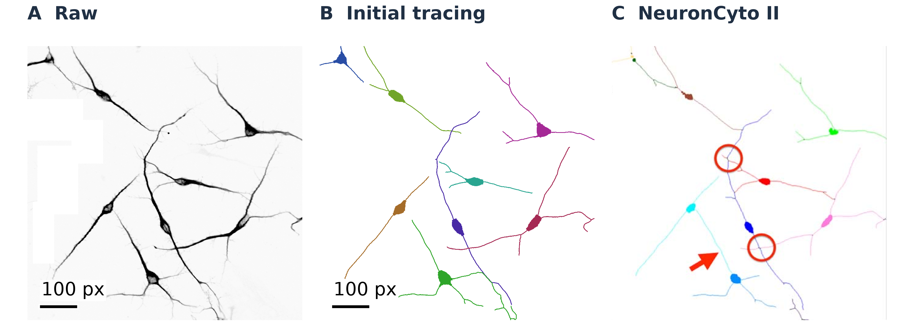

# Analysis protocols and source files

## Supplementary Data 1. CellProfiler workflow comparison

### What was compared

The 30-workflow collection contains 22 official CellProfiler examples, seven tutorials and one workflow from the CellProfiler 4 performance study [@CellProfilerExamples; @CellProfilerTutorials; @Stirling2021]. The [benchmark report](../../benchmark/results/matched_min3_integrated_main_20261007/README.md) identifies pipelines, images and reference outputs.

Every declared image, comma-separated values (CSV) table and database export matched in one warmup and three measured repetitions: 120 OpenHCS observations. This coverage describes exported files, not every internal image or measurement column. The [per-workflow file counts](README_before_readability_20261015.md#declared-exported-file-coverage) retain the complete inventory.

The recorded thirty-workflow benchmark used OpenHCS on Python 3.12.14 with NumPy 2.5.3, SciPy 1.18.1 and scikit-image 0.26.0. Its [per-workflow environment records](../../benchmark/results/matched_min3_integrated_main_20261007/data/singlewell/summary_custody.json) identify these versions for all 30 workflows and native CellProfiler on Python 3.9.25 with NumPy 1.24.4 and SciPy 1.9.0. These are the October benchmark's recorded environments, not inferred versions for the September runs.

Five workflows had no file exports. We appended terminal image or label exports without changing their processing settings, producing eight additional native CellProfiler references listed in the [export manifest](../../benchmark/manifests/official30_value_completion_20260914.json). All five label images matched exactly after removing singleton dimensions. All three numerical images matched within absolute and relative tolerances of `1e-6`; maximum absolute difference was `2.9802322387695312e-8`. The [comparison table](../../benchmark/results/official30_value_completion_20260914/label_aware_exact_commit_run/artifact_comparisons.csv) lists each output.

The separate [five-workflow export-audit environment](../../benchmark/results/official30_value_completion_20260914/label_aware_exact_commit_run/run_environment.json) was OpenHCS on Python 3.12.3, NumPy 2.1.3 and SciPy 1.18.0, against CellProfiler 4.2.8.1 on Python 3.9.25, NumPy 1.24.4 and SciPy 1.9.0. A subsequent [unified run](../../benchmark/results/official30_unified_value_comparison_20260916/README.md) re-executed all 30 workflows and reported zero selected-reference differences. Its [inventory](../../benchmark/results/official30_unified_value_comparison_20260916/reference_inventory.csv) contains 21 CSV, three SQLite and six image/array-only profiles. That run's environment was not recorded; the earlier audit's versions cannot establish it.

### Database exports and automated checks

Imported `ExportToDatabase` steps run once per plate and produce a SQLite database plus CellProfiler Analyst properties files [@Jones2008]. Non-SQLite databases, custom filters, workspace generation and some historical aggregation options remain unsupported.

The [integration workflow](../../.github/workflows/integration-tests.yml) defines Linux, Windows and macOS checks across Python versions, storage types, microscope inputs and installed desktop paths. The [30-workflow comparison](../../tests/integration/test_cellprofiler_official30_zmq.py) executes through ZeroMQ against retained native values. These automated checks are separate from timed benchmarks. The earlier [OpenHCS 0.8.5 release record](ci_official30_085/README.md) retains its own test results.

## Supplementary Data 2. Module coverage

Main Figure 3A assigns each of 85 modules its strongest available test: 54 in complete workflows, 29 in individual tests and two tested only through shared code. For these two modules, test coverage is limited to shared supporting code. The [module table](../figures/slas/benchmark-publication/reference-layout/reference_module_coverage.csv) identifies the evidence for every module.

Older [module](../../benchmark/results/labmeeting_20260513/official30_well_throughput/figures/module_coverage_cppipe_modules.csv), [setting](../../benchmark/results/labmeeting_20260513/official30_well_throughput/figures/module_coverage_cppipe_settings.csv) and [registration](../../benchmark/results/labmeeting_20260513/official30_well_throughput/figures/module_coverage_absorbed_modules.csv) inventories are historical, not a current compatibility matrix. Registration and supported-setting categories are not output-equivalence tests, and their overlapping counts must not be added.

## Supplementary Data 3. Timing methods and additional charts

### Measured times

Main Figure 3B shows the one-sample, one-worker speedups for all 30 workflows, both for processing alone and with pipeline setup included. The [publication values](../figures/slas/benchmark-publication/benchmark_claims.json) give medians and minima; the individual workflow times are linked below.

Main Table 1 defines the timing intervals; Methods: Performance measurement gives the repetitions, exclusions, CPU allocation and batching protocol.

A separate measured eight-sample comparison also favoured OpenHCS for every workflow, both for processing alone and with pipeline setup included, using two workers against one serial CellProfiler process. The variable-batch records below retain this comparison separately from the fixed twelve-sample worker experiment.

With twelve samples held fixed, every workflow ran faster with two, three and four OpenHCS workers than with one, for processing alone and with setup included. These are measured times throughout (Supplementary Figure 6).

### Estimated CellProfiler times

Main Figure 3C compares one fixed serial CellProfiler twelve-sample estimate with measured OpenHCS twelve-sample times at one, two, three and four workers. The [execution-time methods](README.md#supplementary-methods-execution-time-estimates) give the serial estimation formula, define the measured first and post-initialization batches, and report the three-workflow calibration and prediction errors.

The CellProfiler estimate includes initialization; setup-plus-processing adds the measured first-batch pre-pipeline overhead once. Its value is identical across all OpenHCS worker counts for each workflow and timing interval. The measured CellProfiler batch used one numerical thread with access to CPUs 2–5. OpenHCS batch workers could also use those four CPUs, with one numerical-library thread per worker. This is a serial-reference comparison, not matching CPU allocations. Combined memory use was not measured.

### Data and chart links

- [Benchmark protocol](../../benchmark/results/matched_worker_sweep_20261008_latestproduction/README.md), [measured one- and eight-sample CellProfiler calibration](../figures/slas/benchmark-publication/native_actual1_actual8_calibration/actual_native_batch_calibration.csv), and [Figure 3 measured/estimated values](../figures/slas/submission_benchmark_summary_projection.csv).
- Individual workflow timings and ratios, including the measured eight-sample/two-worker comparison: [processing](../figures/slas/benchmark-publication/may/execution/first_use_workflow_metrics.csv) and [setup plus processing](../figures/slas/benchmark-publication/may/total/first_use_workflow_metrics.csv).
- Fixed serial CellProfiler twelve-sample comparison and measured OpenHCS times: [processing](../figures/slas/benchmark-publication/fixed12/execution/first_use_workflow_metrics.csv) and [setup plus processing](../figures/slas/benchmark-publication/fixed12/total/first_use_workflow_metrics.csv). The Figure 3 CSV contains 240 workflow/scope/worker rows; its columns distinguish estimated serial CellProfiler seconds, measured OpenHCS seconds and their ratio.
- Twelve-sample OpenHCS scaling: [processing](../figures/slas/benchmark-publication/fixed12/execution/scaling/derived_workflow_metrics.csv) and [setup plus processing](../figures/slas/benchmark-publication/fixed12/total/scaling/derived_workflow_metrics.csv).
- Additional serial CellProfiler comparisons: [all retained batch configurations](../figures/slas/supp_benchmark_assignments.png). These varying workloads are separate from the fixed twelve-sample worker comparison in main Figure 3C.
- One-worker charts: [processing speedup](../figures/slas/benchmark-publication/serial_batch/execution/serial_cp_relative_speedup_log.png), [seconds per sample](../figures/slas/benchmark-publication/serial_batch/execution/serial_seconds_per_sample_log.png) and [reduction from batching](../figures/slas/benchmark-publication/serial_batch/execution/serial_amortization_factor.png). Corresponding [setup-plus-processing charts](README_before_readability_20261015.md#supplementary-figure-6-continued-one-worker-batch-comparisons) are retained separately.

In the one-worker twelve-sample charts, CellProfiler times are estimated from measured eight-sample batches; OpenHCS times are measured. The single-sample and batch runs allowed different processor cores, so these comparisons do not isolate initialization alone.

## Figure assembly and interface records

Figure source files specify the images, measurements and display settings. The [figure generator](../figures/build_slas_supplement.py) and accompanying source records identify crops, display choices and original files. Lucide icons retain their [licence](../figures/assets/lucide/LICENSE).

Main Figure 1 uses the [two-plate capture](../figures/slas/figure1_two_plate_native_20261007/capture_evidence.json) and [custom-function form/code recording](../figures/slas/custom_extension_live_evidence.json). Gain 1.2 and offset 0.0 identify the same function in the form and [Python readback](../figures/slas/custom_extension_live_code_document.json). This demonstration evaluates function registration and editing; assay execution was outside its scope. A separate [interaction record](../figures/slas/authoring_verified_roundtrip_provenance.json) documents parameter changes propagating between Python and graphical controls.

## Supplementary Data 4. Public NeuronCyto demonstration and references

The [original gpt-5.6-sol demonstration](../../website/assets/agent/cold-start-workflow-record.json) used a method-directed brief specifying normalization, segmentation and neurite assignment. It produced nine neurons, ten nuclei, eight branches, 25 graph paths and 1,982 pixels of outgrowth. It demonstrates authoring and inspection, not unassisted method selection or manual-reference accuracy. A [later OpenHCS 0.8.5 replay](current_neurite_replay_summary.md) is recorded separately.

The NeuronCyto II publication [@NeuronCytoII] provides eight manually traced cell entries for image 1, aggregate length 3,832.601 in unspecified units, and three crossovers, of which its algorithm resolved two. Our two input TIFFs match the public image files byte-for-byte. Manual trace coordinates were not located; cell correspondence, length definitions and units remain unaligned.

A separate [image-1 comparison](neuroncyto_length_evaluation/conclusion.rst) found 4,085.1925 pixels of rooted outgrowth in the first H004 prediction. This is not an accuracy ratio against the published total. The [reference audit](neuroncyto_reference_audit.md) and [unit checks](neuroncyto_length_evaluation/unit_followthrough.rst) retain the evidence. The final attempted repair extended beyond the intended main-shaft target, which was clarified only after that run. The comparison below shows the initial result, not the later revision.

The public comparison below and laboratory tracing in main Figure 5C–E use full-resolution raw arrays and saved paths identified by the [source manifest](../figures/slas/frozen_neurite_views.json). The published algorithm reference is an unmodified embedded JPEG from the article, cropped to 450 pixels and attributed in the [source record](../figures/slas/neuroncyto_published_reference/source.json).

{width=6.5in}

::: {custom-style="ImageCaption"}
**(A–C)** Public NeuronCyto II field: raw image, initial OpenHCS analysis and published NeuronCyto II algorithm output [@NeuronCytoII] (CC BY-NC 4.0), shown at the same field scale. The published output, including its red circles and arrow, is an algorithm comparison, not manual ground truth. Scale bars in A–B are in image pixels. The final attempted repair extended beyond principal shafts; the shaft-only target was clarified after that run. These images retain the original initial-result comparison and do not represent a new trial.
:::

## Supplementary Data 5. Complex workflow imports

The [workflow report](complex_cellprofiler_workflows.md) lists imported steps and editable Python for the advanced-segmentation and 3D-monolayer tutorials. It checks that function identities and settings survive Python export and reload. These are import/editing checks; Supplementary Data 1 separately reports execution and output agreement.

## Supplementary Data 6. Workflow regression tests

The [Python-generation](https://github.com/OpenHCSDev/openhcs/blob/7a7d21fee726905b87b9020cebf0bdfc350631f4/tests/unit/test_pycodify_formatters.py), [function-validation](https://github.com/OpenHCSDev/openhcs/blob/7a7d21fee726905b87b9020cebf0bdfc350631f4/tests/unit/test_funcstep_contract_validator.py) and [catalogue-revision](https://github.com/OpenHCSDev/openhcs/blob/7a7d21fee726905b87b9020cebf0bdfc350631f4/tests/unit/test_function_catalog_zmq.py) tests cover inherited settings, reconstruction, invalid image dimensions/memory types and stale catalogue requests. These files are pinned to a revision unchanged from OpenHCS 0.8.5. The [test job](https://github.com/OpenHCSDev/openhcs/actions/runs/34870874969/job/104066142788) passed. Focused checks complement the complete-workflow comparisons in Data 1.

## Supplementary Data 7. Earlier held-out analyses

Each fresh gpt-5.6-sol agent used four development fields or wells, then fixed its method before receiving the held-out inputs. [Final pipelines and scores](independent_validation/README.md) and the [validation report](independent_agent_validation.md) preserve that prospective design.

| Analysis | Held-out data | Result |
| --- | --- | --- |
| Nuclear detection 1 | 50 BBBC039 fields | 4,733 of 5,720 reference nuclei matched; precision 0.680, recall 0.827, F1 0.746; mean field Dice 0.935. |
| Cell-boundary analysis 1 | 12 BBBC007 fields | 29,450 of 43,875 predicted border pixels within two pixels of a manual outline: 0.671. |
| Protein translocation 1 | 92 BBBC013 wells | 14,262 cells measured; Z′ 0.751 for Wortmannin and 0.554 for LY294002. |

Precision is the fraction of detections matched to references; recall is the fraction of references found. F1 balances both, and Dice measures area overlap; 1 is best for each. Nuclear matching required intersection over union ≥ 0.5. The nuclear analysis predicted 6,964 objects and often split reference nuclei, despite high area overlap.

Boundary agreement checks only predicted borders between touching cells; it does not show that every manual border was recovered or that cells match one-to-one. The cell-boundary analysis predicted 1,274 nuclei and 1,273 cells; every nucleus overlapped a cell. Manual outlines enclosed 1,082 closed nuclear interiors, excluding 12 open/frame-connected regions.

Protein translocation analysis 1 used each well's mean cell-level nuclear/cytoplasmic GFP ratio. Positive/negative control means were 7.235/0.915 for Wortmannin and 7.219/1.127 for LY294002. Z′ measures their separation relative to well variation; both exceeded 0.5. BBBC013 has no manual masks for segmentation scoring. Analysis 2 used median log2 ratios on 96 wells including development. The analyses used different well summaries and evaluation sets.

## Supplementary Data 8. Agent-developed analyses

### Analysis index

Use the following linked records to match each named analysis to its result, instructions, selected pipeline and available resources. The 20 task-level result rows include a repair and a grouped three-agent cohort; they are not 20 independent trials. H001 and H002 retain their original task aliases, and repairs remain part of the same analysis rather than receiving a new quality rank.

- [Results](task_only_analysis/analysis_results.csv): analysis name/dataset, model, evaluation inputs, endpoint and result. Main Table 2 maps tasks, models and protocols; Table 3 selects the principal assay results. The CSV also retains earlier held-out analyses and image-review demonstrations.
- [Instructions and available pipeline sources](#instructions-and-reproducibility): original briefs, guide/software provenance, selected source files and supporting functions, including the [original brief archive](task_only_analysis/original_task_briefs.json).
- [Trial resources](task_only_analysis/trial_resources.csv) and their [timing/usage definitions](task_only_analysis/trial_resource_tables.md): recorded task durations and computational use, distinct from final-pipeline runtime. These records do not supply missing values for unrelated analyses.
- [Principal neurite cohort](personal_neurite_autonomous/cohort.json): the three blind drug-response analyses, distinct from the separate nine-field laboratory tracing and scientist-assisted continuation.

### Results and reference types

**Held-out** inputs were withheld before development and released only after the method was fixed. The **retrospective image-unviewed subset** comprises BBBC039 fields for which none of the three agents was shown a field image or crop during development or result review after their methods were fixed. The shared 175-field subset and supplementary 44-field official-test robustness check use this definition. Before their methods were finalized, two analyses viewed no official test field and the third viewed one. **Development** results may include images used to choose the method.

Object scores use computational labels for bright-object detection analysis 1 and independent nuclear annotations for BBBC039. BBBC007 uses manual outlines; nuclear localisation analysis 1 has partial manual centre annotations. Retinal and neurite demonstrations without spatial ground truth are evaluated by paired raw/result review, not an accuracy percentage.

### Reference coverage and detection errors

Eleven predictions in 3D nuclear localisation analysis 1 had no matching annotation. Because the annotations cover only some centres, these cannot be classified as false detections from this reference alone. The 3D split-cell repair in main Figure 6H is a separate analysis (H002_FRESH22_89), not nuclear localisation analysis 1 (H002_FRESH15_89). Retinal examples include uncertain borders, and paired DNA/actin examples include a faint merged pair and a nuclear seed without supported cell-body growth (Supplementary Figure 4).

The [3D repair report](task_only_analysis/h002-fresh22-postfreeze-localisation.rst) binds candidate01 → candidate02_retry. The [retinal repair provenance](../figures/slas/retina_fresh16_repair_provenance.json) binds R0010_FRESH16_88, a retained continuation after an interrupted CLI, not fresh retinal analyses 1–2; its model is not recorded for this continuation. The [nuclear repair source proof](task_only_analysis/h003-native-source-proof.json) binds H003_POSTPAUSE_88, distinct from the Fresh26 paired-channel result below. Supplementary Figure 4 identifies the exact runs behind its additional image checks. The separate scientist-assisted drug-response [comparison record](personal_neurite_repaired_morphometry/source_evidence.json) does not specify an agent model; it does not inherit the blind cohort's model.

The [nuclear-error data table](task_only_analysis/nuclear_error_summary.csv) and [per-field table](task_only_analysis/bbbc039-uninspected-fields.csv) provide the three agents' scores, missed nuclei and false detections on the 175 BBBC039 fields not viewed by any of them. The [nuclear-detection error analysis](README.md#nuclear-detection-errors) describes their shared difficult fields and the three-field repair, including increased splitting and the absence of a separate evaluation across all fields.

A further [paired-channel analysis](task_only_analysis/h003-fresh26-qualified-completion.rst) recovered three crowded nuclear omissions and removed two cells without actin-supported growth, leaving 56 nuclei and 54 cells. [Cell-boundary analysis 3](task_only_analysis/bbbc007-fresh26-final-candidate.rst) produced 1,428 nuclear and cell IDs across sixteen fields, with remaining merge/boundary uncertainty. Retinal source images were user-provided R0010 images stained for RNA-binding protein with multiple splicing (RBPMS), with retinal repair-panel scale bars derived from original CZI metadata; DNA/actin images were BBBC007v1 A02 from the Sabatini laboratory, Whitehead Institute (CC0).

The [assisted nine-field mosaic](../figures/slas/p001_stitched_dev13_native.png) is development work, not another fresh autonomous trial. Its [continuation](task_only_analysis/p001-allchannel25-qualified-completion.rst) reported 1,740 soma candidates and 123,054 µm of computed outgrowth, but overlapping fields, uncertain ownership and absent spatial ground truth prevent interpreting those totals as a unique biological census.

### Instructions and reproducibility

The [original instruction archive](task_only_analysis/original_task_briefs.json), [trial resource table](task_only_analysis/trial_resources.csv) and [neurite cohort record](personal_neurite_autonomous/cohort.json) identify briefs, model/software versions, timing and retained outputs. Nuclear detection analyses 2–4 received different guide revisions; the three drug-response analyses received the same revision. Guide versions and original instruction files were not retained for the three earlier held-out analyses.

The evaluation used biological briefs supplemented, in some trials, with technical guidance: source bindings and allowed catalogue tracks, nuclear/cytoplasmic GFP measurement, seeded cell segmentation or channel hints. An archived retinal brief mentions inherited conversation, but launch records for retinal analyses 1–2 show fresh sessions with memory disabled; other trials attached to that brief were not checked. The current guide includes later improvements and must not be treated as the exact guide given to earlier agents. The [earlier supplement](README_before_readability_20261015.md#scientific-instructions-supplied-to-authors) summarizes all sixteen briefs.

| Analysis | Final pipeline |
|---|---|
| Bright-object detection 2 | [Source](task_only_analysis/pipelines/h001-fresh25.py) |
| 3D nuclear localisation 2 | [Source](task_only_analysis/pipelines/h002-fresh23.py) |
| Paired nuclear/cell detection | [Source](task_only_analysis/pipelines/h003-fresh26.py) |
| Retinal cell detection 2 | [Source](task_only_analysis/pipelines/retina-fresh26.py) |
| Public-image neurite tracing | [Source](task_only_analysis/pipelines/h004-fresh20.py) |
| Protein translocation 2 | [Source](task_only_analysis/pipelines/bbbc013-fresh23.py) |
| Nuclear detection 2 | [Source](task_only_analysis/pipelines/bbbc039-fresh612.py) |
| Nuclear detection 3 | [Source](task_only_analysis/pipelines/bbbc039-fresh10.py) |
| Cell-boundary analysis 3 | [Source](task_only_analysis/pipelines/bbbc007-fresh26.py) |

The [nine-field neurite pipeline](task_only_analysis/pipelines/p001-fresh13.py) is also supplied. These are the agents' selected sources, unchanged by reference scoring. Reproduction requires the recorded software and inputs; relocate file destinations and viewer endpoints without changing scientific settings.

Additional supplied dependencies are the BBBC039 [image metadata](task_only_analysis/pipelines/bbbc039/source_manifest.csv) and [source binding](task_only_analysis/pipelines/bbbc039/source_bindings.py), BBBC007 [paired-field metadata](task_only_analysis/pipelines/bbbc007/source_sets.csv), 3D [centre-detection function](task_only_analysis/pipelines/h002-fresh23/custom_function.py), and translocation [compartment measurements](task_only_analysis/pipelines/bbbc013-fresh23/bbbc013_compartment_qc_v4.py), [statistics](task_only_analysis/pipelines/bbbc013-fresh23/bbbc013_assay_statistics_v1.py) and [dose summary](task_only_analysis/pipelines/bbbc013-fresh23/bbbc013_dose_response_v2.py). Register custom functions under their recorded names before validation and execution. The original records identify which trial each source supports; the retinal and 3D sources above are not the distinct trials shown in Supplementary Figure 4 and main Figure 6, respectively.

The [detailed trial records](README_before_readability_20261015.md) retain original reports, individual analysis versions and source inventories.
