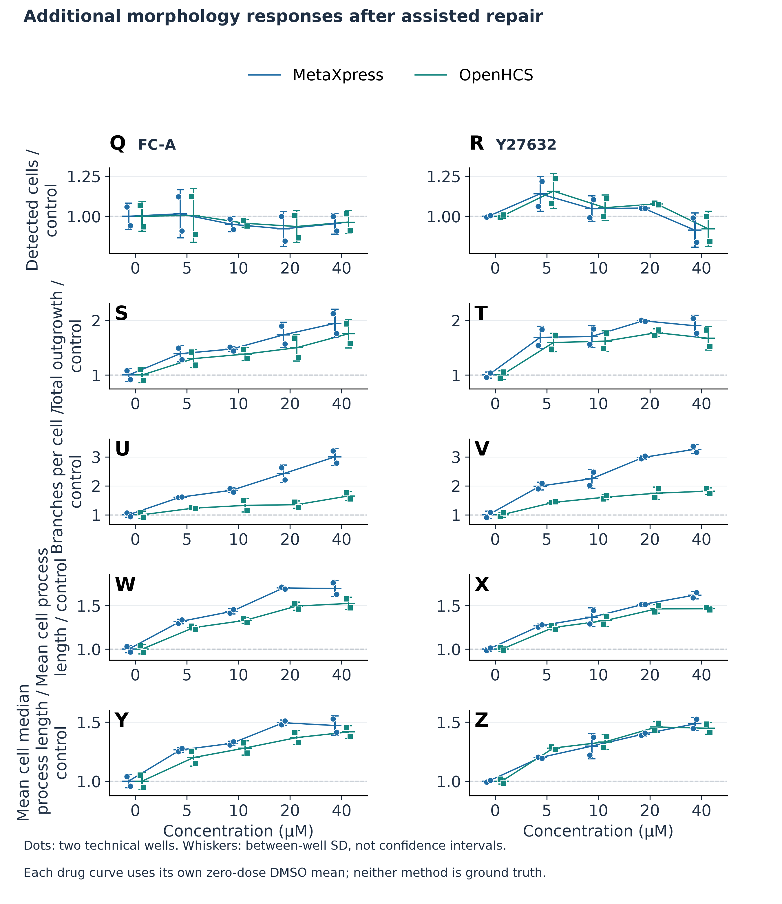

# Detailed neurite comparisons (Supp. Data 5)

These comparisons retain the baseline, aggregation and effect-size checks behind Figure 6. Original blind-development records, corrected-engine evaluations and scientist-assisted measurements remain separate.

## Outgrowth response magnitude

Re-evaluation of the three frozen analyses with the corrected neurite engine found increased mean outgrowth per cell and total outgrowth at every nonzero dose of FC-A and Y27632 (Figure 6A–B). Across the 20 wells, each agent's algorithm-defined mean outgrowth per cell correlated closely with MetaXpress (Pearson r 0.963–0.996), but fold changes were generally smaller, mainly because the analyses measured more outgrowth in vehicle wells (Discussion). At 40 µM, mean outgrowth per cell increased 1.33–1.63-fold for FC-A and 1.49–1.69-fold for Y27632, against 1.98- and 2.05-fold for MetaXpress (Supp. Figure 2). Branches per cell also increased with dose in all three analyses (Figure 6C–D).

## Baselines and aggregation

The neurite analyses estimated smaller fold changes than MetaXpress (Figure 6A–B). OpenHCS averaged nine sites per well; pooling cells instead changed its fold changes by at most 0.053. The agent analyses recovered absolute increases in outgrowth per cell comparable to MetaXpress's (71–95 µm against 75 µm with 40 µM FC-A), but measured 1.5–2.8 times as much outgrowth per cell in vehicle wells. Two analyses had similar cell counts to MetaXpress; analysis 2 detected fewer cells. Their smaller outgrowth fold changes therefore reflect higher vehicle baselines rather than systematically smaller absolute drug responses; branching responses were smaller in absolute terms as well (Figure 6C–D; Supp. Figure 2). Manual tracing and the MetaXpress analysis settings would be needed to explain the baseline differences and compare tracing accuracy. The OpenHCS measurements remain traceable to their detections, settings and source images.

## Supp. Figure 2, continued. Scientist-assisted neurite analysis {#supplementary-figure-2-continued.-scientist-assisted-neurite-analysis}

{width=6.5in}

::: {custom-style="ImageCaption"}
Scientist-assisted neurite measurements were compared with MetaXpress in 20 matched wells. **(Q–R)** Detected cells. **(S–T)** Total outgrowth. **(U–V)** Branches per cell. **(W–X)** Mean cell process length. **(Y–Z)** Mean cell median process length.
:::

For the scientist-assisted neurite analysis, both the [post-repair measurements](personal_neurite_repaired_morphometry/treatment_effects.csv) and [initial measurements](personal_neurite_baseline_morphometry/treatment_effects.csv) include mean outgrowth per cell.

At 40 µM, cell-count fold changes from the three blind analyses were 0.94–0.99 for FC-A and 0.92–0.94 for Y27632, against 0.95 and 0.91 for MetaXpress. The scientist-assisted mean-outgrowth responses were 1.77- and 1.76-fold, respectively; two agents were close to those values and the third estimated smaller effects.

At 40 µM, the re-evaluated analyses gave fold changes in branches per cell of 1.26–1.64 for FC-A and 1.51–1.74 for Y27632, against 3.00 and 3.26 for MetaXpress. Their control wells started at 2.1–5.5 branches per cell, against 1.3–1.5 for MetaXpress. From zero dose to 40 µM, the analyses added 1.41–2.40 branches per cell with FC-A and 1.53–2.60 with Y27632, compared with MetaXpress's 2.94 and 2.90. Analysis 3 came closest, and its higher baseline compressed its fold changes; analyses 1 and 2 also detected smaller absolute increases. The cause of the baseline differences was not established.

Smaller branching responses than MetaXpress persisted in total branches and branches per primary process, so cell-count denominators alone do not explain the differences. Spatial ground truth would be needed to separate errors in tracing and path assignment from differences in measurement definitions. The three blind agents' [task](personal_neurite_autonomous/TASK.rst), [acquisition information](personal_neurite_autonomous/ACQUISITION.json), [cohort](personal_neurite_autonomous/cohort.json) and reports for [analysis 1](personal_neurite_autonomous/author114/author-report.txt), [analysis 2](personal_neurite_autonomous/author115/author-report.txt) and [analysis 3](personal_neurite_autonomous/author116/author-report.txt) provide their methods and individual outputs.

The retained Python pipelines and helper functions reproduce the source bytes captured at each analysis freeze. Their import paths belong to the software revision recorded in the cohort, rather than the current package layout.

## Scientist-assisted settings and repairs

The scientist-assisted analysis used DAPI and calcein images, with neurite response 30 and candidate threshold 0.03. Image review prompted corrections to soma-edge branches and missing paths; MetaXpress fold changes were not a tuning target. Cell counts were unchanged in all 180 fields. [Settings and source measurements](personal_neurite_repaired_morphometry/source_evidence.json), [matched wells](personal_neurite_repaired_morphometry/joined_wells.csv) and [branch diagnostics](personal_neurite_branch_diagnostics/treatment_effects.csv) document the corrections.

